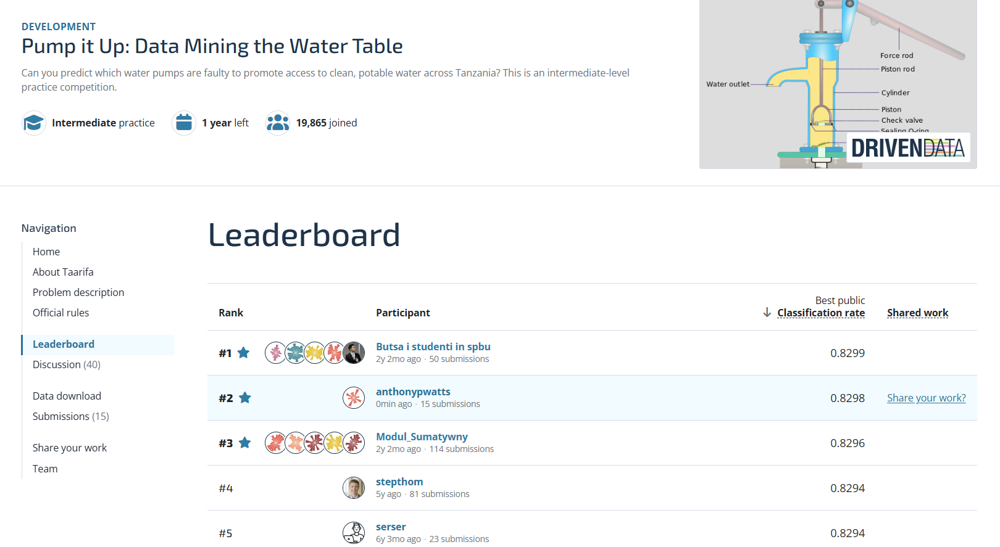

# Imperial ML and AI capstone

Coursework and portfolio work for the Imperial College London Professional
Certificate in Machine Learning and Artificial Intelligence.

## Project status

Stage 1 result snapshot: **5 September 2026**. Stage 2 documentation snapshot: **12 October 2026**.

| Stage | Project | Status | Headline |
| --- | --- | --- | --- |
| 1 | [Pump It Up](stage-1-pump-it-up/) | Model search complete | Fresh CatBoost identity/spatial-grid bag scored **`0.8304`** publicly and was observed at leaderboard position **1** |
| 2 | [Black-box optimisation](stage-2-bbo/) | Week 3 submitted; awaiting results | 191 confirmed observations through round 2; Functions 4, 5 and 7 improved in round 2 |

The leaderboard position is a time-specific observation and may change as
other competitors submit.

## Project structure

| Area | Purpose |
| --- | --- |
| [`index.html`](index.html) | Static Capstone Hub joining the project stages and working tools |
| [`stage-1-pump-it-up/`](stage-1-pump-it-up/) | Multiclass classification using the DrivenData *Pump It Up* competition |
| [`stage-2-bbo/`](stage-2-bbo/) | Assessed black-box optimisation across eight unknown functions |
| [`assets/`](assets/) | Shared site styling, hub styling and status loader |
| [`project-status.json`](project-status.json) | Shared public status snapshot for the hub and both stages |
| [`requirements.txt`](requirements.txt) | Pinned modelling dependencies used by both stages |
| [`setup-venv.ps1`](setup-venv.ps1) | Windows setup for the Capstone-local Python environment |
| [`run-python.ps1`](run-python.ps1) | Runs this checkout's Python without requiring activation |
| [`imperial-capstone.code-workspace`](imperial-capstone.code-workspace) | Standalone VS Code workspace with a local interpreter default |

Stage-specific tools and supporting files live with their stage:

```text
stage-1-pump-it-up/
  assets/       Leaderboard evidence and dashboard image
  dashboard/    Static plan and progress dashboard
  map/          Browser-side training-label map
  ...           Existing data, notebooks, source, reports and submissions
stage-2-bbo/
  notebooks/    Function_N/Week_NN analyses and shared helpers
  index.html    Stage 2 web workspace
  styles.css    Stage 2 workspace styling
  ...           Existing data, notebooks, source, results and submissions
```

Keep shared `.venv/` and `.runtime/` directories at this repository's root; both remain
Git-ignored. Local CatBoost logs live under `stage-1-pump-it-up/catboost_info/`
and are also ignored.

Stage 1 is a self-contained machine-learning project used to practise the
course workflow on a real operational problem. Stage 2 follows the course's
fixed BBO brief and will be developed as each set of observations is released.

## Stage 1: Pump It Up

The Stage 1 goal is to classify Tanzanian waterpoints as `functional`,
`functional needs repair` or `non functional` for the
[DrivenData *Pump It Up* competition](https://www.drivendata.org/competitions/7/pump-it-up-data-mining-the-water-table/).
Competition submissions are scored by multiclass accuracy.

### Current result

| Measure | Result |
| --- | --- |
| Data | 59,400 labelled rows and 14,850 competition rows |
| Predictors | 39 audited; 3 structural removals; 36 candidates retained for modelling |
| Public-leading model | Fresh CatBoost identity/spatial-grid 50:50 bag within the fixed CatBoost slot |
| Fresh five-fold OOF accuracy | **82.0522%** |
| Public leaderboard score | **`0.8304`** |
| Project target | `0.8260` |
| Observed public rank | **1** on 5 September 2026 |

[](https://www.drivendata.org/competitions/7/pump-it-up-data-mining-the-water-table/leaderboard/)

*Historical leaderboard evidence from 23 August 2026. The later rank-1 result
was observed live on 5 September 2026; rankings may change.*

Twenty-one submissions tested the end-to-end workflow. The current best score
exceeds the project target by `0.0044`.

### Model selection

The evaluation design used a fixed stratified 20% local test and five fixed
stratified development folds, with preprocessing fitted inside each training
fold. Candidate changes were assessed through bounded promotion gates rather
than open-ended leaderboard tuning.

The initial broad comparison found Random Forest to be the strongest single
model at 80.59% mean development accuracy. A later 55% XGBoost and 45% Random
Forest vote reached 81.6246% and became the reference for subsequent screens.
Those screens examined feature hierarchies, high-cardinality identities,
geographic robustness, imputation, class imbalance, regional specialists,
alternative target structures and additional ensemble members.

The changes that survived the evidence gates came from genuinely different
representations rather than small local adjustments. Ordered categorical
identity learning produced the first new promotion, followed by complementary
archive-derived categorical-frequency and spatial-height representations. The
fixed deep-XGBoost substitution improved the development, local-test and public
results in the same direction and established the previous `0.8298` best.

After three row-targeted repair submissions regressed publicly on 4 September,
a fresh all-label validation partition was used to distinguish a wrong model
path from adaptive overfit. Formal base-candidate ordering remained aligned
with public ordering, train-versus-competition shift was negligible, and the
historical local subset appeared only moderately harder. The evidence therefore
rejects further row-level postprocessing, not the base architecture. A locked,
non-adaptive three-file model-level slate then scored `0.8302`, `0.8304` and
`0.8303`; the identity/spatial-grid CatBoost bag became the new public leader.

### Main conclusions

| Question | Evidence-led conclusion |
| --- | --- |
| What did the categorical hierarchy screens retain? | Granular extraction, source, quality and waterpoint features survived the bounded comparisons. |
| Did minority oversampling improve the competition objective? | It raised repair recall but reduced overall accuracy. The frozen 2.5× bag scored `0.8174` publicly, so it remained an interpretation of the trade-off rather than the selected model. |
| Is geographic transfer a risk? | Yes. LGA-disjoint validation exposed a substantial accuracy and repair-recall drop even when centroid imputation helped four of five folds. |
| Where did the later gains come from? | Complete identities, categorical occurrence support, spatial-height reconstruction and the deeper XGBoost representation added complementary signal. |
| Were the late test-set regressions a broken test set or a wrong base path? | Neither is supported. Fresh validation and shift checks point to adaptive overfit in row-targeted repair rules; bounded architecture-level changes transferred positively. |
| Why stop? | The new public leader is supported by only a 13-row fresh-OOF gain and did not pass the formal promotion gate; further adaptive tuning would add more overfitting risk than useful evidence. |

### Evidence and reproducibility

- [Publication report](stage-1-pump-it-up/reports/publication/pump-it-up-model-development-report.docx)
  — historical research article revised on 28 August, covering the `0.8298`
  result observed on 23 August; it predates the September follow-ups.
- [Model-search conclusion](stage-1-pump-it-up/reports/model-search-conclusion.md)
  — 23 August decision, lifecycle summary, result comparison and stop rationale,
  with links to the subsequent September work.
- [Deep follow-up report](stage-1-pump-it-up/reports/deep-follow-up-search.md)
  — the previous deep-model seed comparison and `0.8298` submission.
- [Generalisation diagnosis](stage-1-pump-it-up/reports/generalisation-diagnosis.md)
  — fresh evidence separating model-path risk from adaptive overfit.
- [Fresh reconstruction and submission slate](stage-1-pump-it-up/reports/fresh-ensemble-reconstruction-and-submission-slate.md)
  — locked gates, reproducible portfolio, immutable hashes and public results.
- [Report index](stage-1-pump-it-up/reports/README.md) — all feature, model,
  robustness and interpretation experiments.
- [Submission log](stage-1-pump-it-up/submissions/README.md) — exact recipes,
  validation results, hashes and public scores.
- [Data-audit report](stage-1-pump-it-up/notebooks/data-audit/00-overall/00-overall-data-audit.md)
  — predictor-level findings and preparation decisions.

The [Stage 1 README](stage-1-pump-it-up/README.md) contains the detailed
working narrative and links to notebooks, source code and generated evidence.

## Stage 2: black-box optimisation

Stage 2 maximises eight unknown functions from sequential observations. Its
workspace records the Gaussian-process workflow, data constraints, proposed
points and returned values. Both confirmed returns match their saved inputs;
the latest results record covers 191 observations through round 2, up from
183 after round 1. Weekly data files are local and Git-ignored; see the
[data recovery notes](stage-2-bbo/data/README.md#recovering-earlier-snapshots)
when setting up a fresh checkout. The
[Function 1 follow-up](stage-2-bbo/results/function-1-round-01-analysis.md)
reviews its new negative result, unchanged incumbent and improved coverage.
The [Function 2 follow-up](stage-2-bbo/results/function-2-round-01-analysis.md)
reviews its lower response near the incumbent and compares updated noisy-response
models and conditional next-query choices. Round 1 improved the best observed
outputs for Functions 4–7. Week 2 exploration notebooks now cover all eight
functions, with regression comparisons and Gaussian-process UCB recommendations
for Functions 4–8. Round 2 improved Functions 4, 5 and 7. The eight Week 3
inputs have been submitted; confirmation was recorded on 12 October 2026.
Week 3 results have not yet been recorded. The observation count and best
observed outputs therefore remain those confirmed through round 2.

See the [Stage 2 README](stage-2-bbo/README.md) for the current approach and
repository structure.

## Live project tools

- [Capstone Hub](https://anthonypwatts.github.io/imperial-capstone/)
- [Stage 1 dashboard](https://anthonypwatts.github.io/imperial-capstone/stage-1-pump-it-up/dashboard/)
- [Stage 1 training-label map](https://anthonypwatts.github.io/imperial-capstone/stage-1-pump-it-up/map/)
- [Stage 2 workspace](https://anthonypwatts.github.io/imperial-capstone/stage-2-bbo/)

The public pages load the non-sensitive status snapshot in
[`project-status.json`](project-status.json). Competition datasets remain
excluded from Git; visitors provide local copies through the map's file
pickers.

## Local setup

### Modelling environment

This repository is standalone. Clone `imperial-capstone` into any directory;
no surrounding course repository is needed. Both stages use **one environment
at `imperial-capstone/.venv`**. If the checkout is nested inside another project,
that project's environment remains separate.

The supported Windows baseline is **64-bit Python 3.14** (validated with
3.14.5). Install that Python version, then run from the Capstone root in
Windows PowerShell 5.1 or PowerShell 7:

```powershell
.\setup-venv.ps1
```

The [setup helper](setup-venv.ps1) creates `.venv` beside this README, even when
invoked from another directory or with another environment activated. It
reuses a valid local environment, installs `requirements.txt` and runs
`pip check`. For creation it tries `py -3.14`, then a compatible base
`python.exe` on PATH. It rejects other Python versions, 32-bit interpreters
and virtual environments as the base interpreter. An explicit path is also
supported:

```powershell
.\setup-venv.ps1 -Python 'C:\Python314\python.exe'
```

To replace an existing environment, close its notebook kernels, deactivate it
if active, and run:

```powershell
.\setup-venv.ps1 -Recreate
```

`-Recreate` clears the project-local `.venv` and installs the pinned dependencies
again. It does not change the requirements or course data. Add `-WhatIf` to
preview the operation without creating or changing files. A failed installation
leaves the environment in place and reports the failing step; correct the
reported issue before rerunning the command.

Use the [Python launcher](run-python.ps1) for everyday commands. It always
runs this checkout's `.venv\Scripts\python.exe`, preserves the current working
directory and returns Python's exit code. It fails if that interpreter is
missing, so it cannot silently fall back to an active parent environment:

```powershell
.\run-python.ps1 -c "import sys; print(sys.executable)"
.\run-python.ps1 -m pip check
.\run-python.ps1 -m unittest discover -s stage-2-bbo/tests
```

From a stage directory, use `..\run-python.ps1`. From elsewhere, invoke the
script by its path. Calling `.venv\Scripts\python.exe` directly is equivalent.
Avoid bare `python` or `pip` commands when the selected environment is uncertain.

Setup does not switch the current shell's active environment. Activation is
optional; to switch from an already active environment, run `deactivate`
first, then:

```powershell
.\.venv\Scripts\Activate.ps1
```

New environments created by the helper have the prompt `(imperial-capstone)`.
Existing environments keep their previous prompt. Check `sys.executable` when
in doubt; a prompt named `(.venv)` alone cannot identify the project.

### Editor and notebook selection

Open [`imperial-capstone.code-workspace`](imperial-capstone.code-workspace) in
its own VS Code window, even when this checkout is nested inside a course
repository. It recommends the Python and Jupyter extensions and defaults to
the Capstone `.venv`. Existing saved interpreter selections take precedence
over this default; use **Python: Select Interpreter** to choose this checkout's
`.venv\Scripts\python.exe` if necessary. This is a
[VS Code setting limitation](https://code.visualstudio.com/docs/python/settings-reference).

Notebook kernels are selected separately. Use the notebook's **Select Kernel**
menu to choose the same local environment. No global Jupyter kernel registration
is required. Check a notebook's actual runtime with:

```python
import sys
print(sys.executable)  # Must point inside this checkout's .venv.
```

### Dependencies and other platforms

[`requirements.txt`](requirements.txt) pins the direct modelling dependencies
shared by both stages. Transitive dependencies are resolved by pip; it is not
a complete lock file. When adding a dependency, install it using
`.\run-python.ps1 -m pip`, record the intended direct dependency here, and rerun
`pip check` and the relevant stage tests. Do not copy a surrounding repository's
`pip freeze` output into this file. Optional publication tooling has its own
[requirements](stage-1-pump-it-up/reports/publication/requirements-publication.txt).

The PowerShell helpers target Windows. On macOS or Linux, the equivalent
manual setup from the Capstone root is below. These platforms have not been
validated; availability of binary wheels and native libraries may differ.

```bash
python3.14 -m venv --prompt imperial-capstone .venv
.venv/bin/python -m pip install -r requirements.txt
.venv/bin/python -m pip check
```

Use `.venv/bin/python` for commands and notebook selection on those platforms.

The Windows environment-helper regression tests use the standard library and
temporary standalone checkouts, with no package downloads:

```powershell
.\run-python.ps1 -m unittest discover -s tests -v
```

The competition CSV files must already be present under
`stage-1-pump-it-up/data/`; they remain excluded from Git.

### Static project hub

Run the site from the repository root so that the hub, shared status snapshot
and local-data map resolve from the same origin:

```powershell
.\run-python.ps1 -m http.server 8000
```

Then open <http://localhost:8000/>.

## Working conventions

- Keep exploratory work in numbered notebooks.
- Move reusable code into `src/`.
- Record decisions and results rather than relying on notebook output alone.
- Do not commit competition downloads, supplied BBO observations or secrets.
- Prefer a simple, reproducible baseline before tuning more complex models.

Each stage README describes its immediate plan, detailed evidence and remaining
work.
