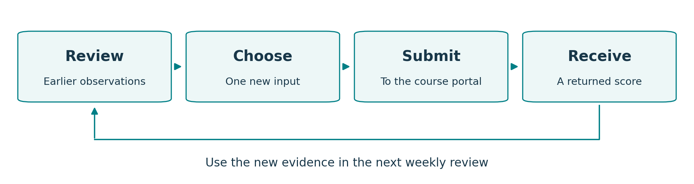
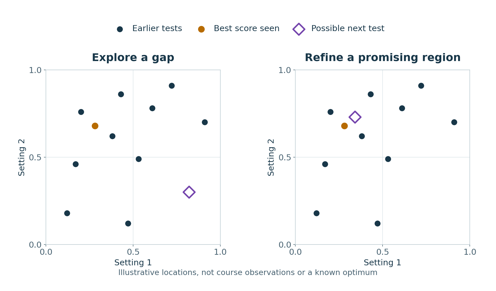

# Stage 2: choosing the next experiment

Imagine trying to improve a recipe when you can try only one new combination
each week. You have a few earlier results, but no recipe book explaining how
the ingredients interact. Should the next attempt be close to something that
worked, or somewhere unfamiliar that might teach you more?

That is the decision at the heart of this black-box optimisation project. The
course gives me **eight unknown functions**: I supply a set of numbers, and each
function returns a score. I cannot inspect the calculation inside. My task is
to find inputs that produce higher scores, with just **one new experiment per
function per week, for 13 rounds**.

As a software developer, I am using this project to develop judgement about
applying machine learning: when a model has earned some trust, when more data
would help, and how to explain a decision that might still turn out badly.

This page tells the story so far. The linked guides contain the calculations,
full results and instructions for running the work. You can also browse the
[Stage 2 web workspace](https://anthonypwatts.github.io/imperial-capstone/stage-2-bbo/)
or return to the [Capstone Hub](https://anthonypwatts.github.io/imperial-capstone/).

## What does one experiment look like?

Think of each input number as a setting on a dial. Function 1 has two dials;
Function 8 has eight. Each dial can be set from zero up to, but not including,
one. Together, their settings describe one point to test.

*Each function has its own history and its own weekly experiment. Choosing an
input does not reveal its score; the course portal supplies that answer later.*

The aim is always to **maximise** the returned score. A negative score can still
be an improvement: moving from `-4` to `-1` is progress. The eight functions use
different scales, so their scores are compared within each function.

The course supplied 175 earlier observations across the eight functions. These
give me a starting point, but leave many combinations untested. Thirteen more
attempts per function is a small budget, especially with eight dials to set.
That makes the choice of the next experiment the main piece of work.

## How do I choose where to try next?

There are two useful reasons to spend an experiment. I might learn about an
area I know little about, or try to improve a result in an area that already
looks promising. These are usually called **exploration** and **exploitation**.
Both can be sensible; the difficulty is deciding which is more useful now.

*This is a sketch of the decision, using invented two-dimensional points.
Neither marker is a known optimum. In the actual project, the next choice also
depends on model evidence, uncertainty and how many experiments remain.*

My working strategy is a **taper**: start by reducing important gaps in my
understanding, then increasingly refine promising regions as evidence builds.
The balance can differ between functions, and a surprising result can send me
back to exploration.

For Weeks 2 and 3, this has led to two practical approaches:

- **Functions 1–3: fill sampling gaps.** I planned small groups of points that
  spread the observations more evenly through the input space. Week 2 tested
  the first point in each group; Week 3 uses the next shortlisted point. These
  choices use the geometry of where I have looked, rather than a prediction
  that the score will be high.
- **Functions 4–8: use a model to guide the choice.** I compared several ways
  of predicting scores, including a simple baseline. A Gaussian process gave
  the lowest prediction error among the models tested for each of these
  functions in Week 2. It supplies both a predicted score and an estimate of
  uncertainty, which I use together to choose a point worth testing.

This is where **Bayesian optimisation** enters the project: a model of the
unknown function, including uncertainty about its predictions, helps choose
the next experiment. The real answer then helps update that model. The model
is a working explanation, and its uncertainty
depends on assumptions that need checking. The coverage choices above are a
separate exploration route.

The [methodology guide](docs/methodology.md) explains those checks, the
exploration batches, the model selection rule and how the approach evolved
from the first round.

## What has happened so far?

**As of 12 October 2026, Week 3 inputs have been submitted and their results
have not yet been recorded.** There are two confirmed rounds of feedback.
“Week” labels the submitted batch; “round” labels its returned evaluation.

| Point in the project | What is recorded |
| --- | --- |
| Starting data | 175 supplied observations across eight functions |
| Week 1 / round 1 | Eight returned scores; new bests for Functions 4, 5, 6 and 7 |
| Week 2 / round 2 | Eight more returned scores; new bests for Functions 4, 5 and 7; 191 observations in total |
| Week 3 | Eight inputs submitted; awaiting recorded results |

Function 5 is the clearest improvement so far: its best observed score rose
from about **1,089** in the starting data to **3,933** after round 1 and
**8,662** after round 2. Function 4 also improved despite its scores remaining
negative. Functions 1, 2, 3 and 8 have yet to beat their starting bests.

An experiment that does not produce a new best can still help me understand a
function. Function 1's first result, for example, improved coverage while
returning its lowest score so far. That distinction matters: learning more and
finding a better score are different outcomes, and I record both. A coverage
improvement alone does not show that I am closer to the maximum.

The [results guide](results/progress.md) shows progress for all eight
functions, the returned scores and the best inputs from returned queries. The
[submission log](submissions/README.md) records the exact submitted strings
and their status.

## What can this work tell us?

It is still early. I do not know the true highest score for any function, so
“best observed” means the best answer seen so far. It does not establish a
global maximum. A good prediction error on this small dataset also does not
guarantee that a model will be reliable in an unexplored area.

The practical lesson I am looking for is how to make a defensible next decision
with limited evidence. The same tension appears when tuning a model, adjusting
a process or planning a product experiment: each test costs something, and
waiting for its answer limits how quickly you can adapt.

## Where to go next

| If you want to… | Read… |
| --- | --- |
| Understand why particular experiments were chosen | [Methodology](docs/methodology.md) — coverage, models, uncertainty and limitations |
| See what improved and what did not | [Results and progress](results/progress.md) — charts, scores and links to the evidence |
| Inspect an individual function's analysis | [Notebook guide](notebooks/README.md) — current work and historical studies |
| Run the notebooks or rebuild a reading copy | [Reproducing the analyses](docs/reproducing-the-analyses.md) — setup, data snapshots and commands |
| Check the official task and submission rules | [Module 12 intake notes](docs/module-12-intake.md) — dated course requirements and sources |

The [documentation index](docs/README.md) also identifies the templates for the
final capstone deliverables. Those remain unfinished while the experiment is
in progress.
