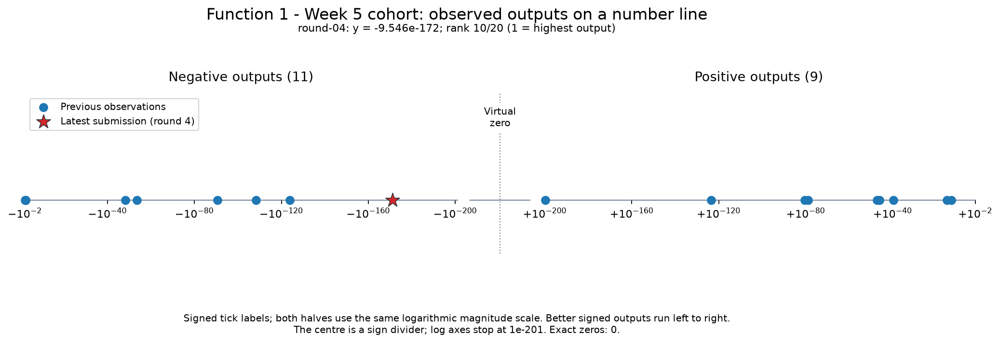
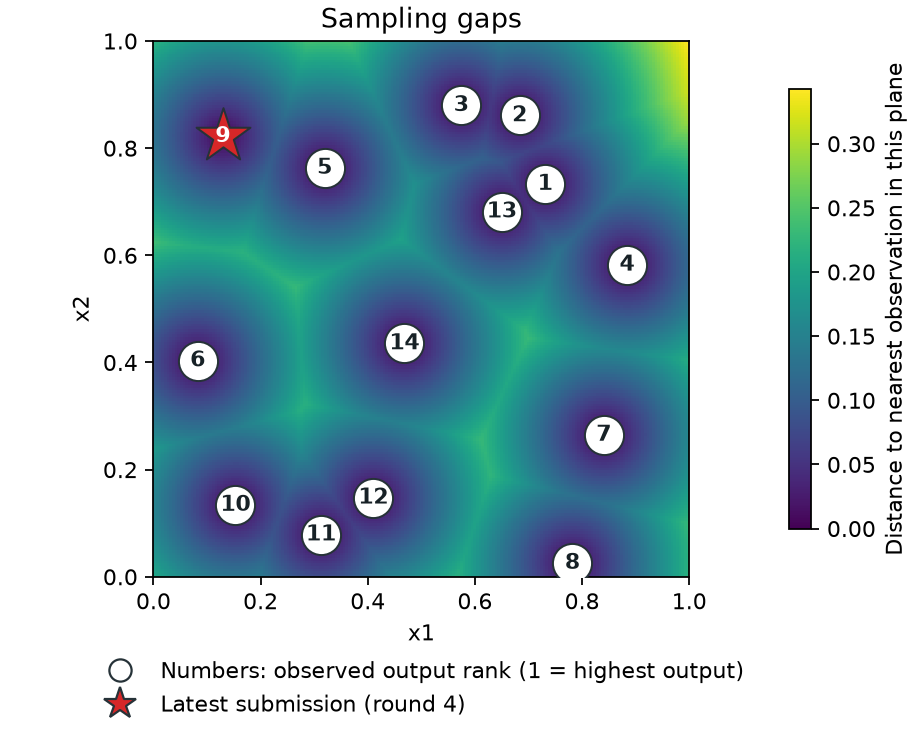
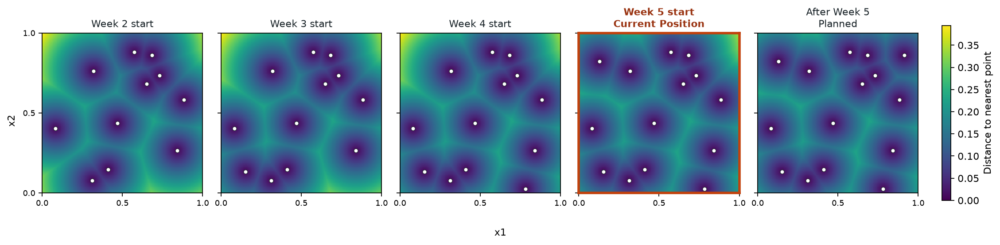
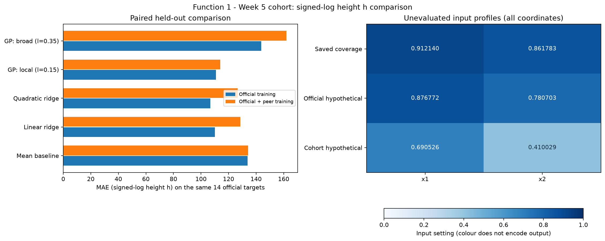
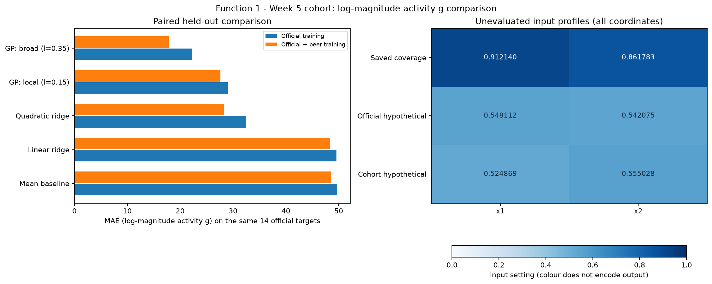
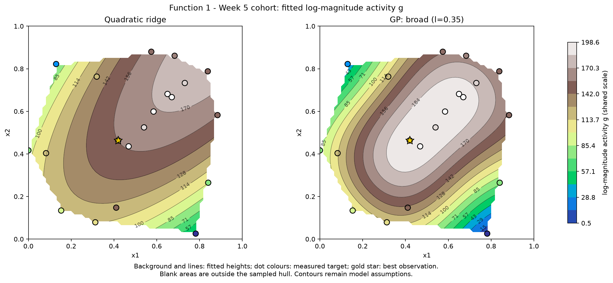

# Function 1 — Week 5 results and cohort comparison

**Submission confirmation, 29 October 2026:** the project owner confirmed
submission of the [eight selected Week 5 inputs](../../../submissions/Week_05/README.md).
Results are pending. Eight future weekly queries remain per function.
The analysis below retains its pre-submission evidence and query budget.

**Analysis snapshot: 24 October 2026.** The official data include the fourth
return, received on 23 October. The cohort comparison adds six accepted peer
returns from the retained 20 October snapshot. No peer repositories have been
refreshed for this analysis.

## What the results show

The saved Week 5 coverage query remains **0.912140-0.861783**. It is the last
point in the predetermined exploration shortlist. The model studies below
provide diagnostics and hypothetical alternatives; they do not replace that
plan or record a portal submission. Nine weekly query opportunities remain,
including Week 5.

The peer data give two different messages. A model of **absolute output
magnitude** becomes more accurate on the same official held-out observations:
the broad Gaussian process's mean absolute error falls by **20.1%**. The
selected model of the **signed score** becomes slightly less accurate on
those targets, with error increasing by **2.8%**. Its preferred hypothetical
query also moves substantially.

The magnitude result helps describe where stronger readings may occur. It
does not establish that those readings will be positive, or that maximising
their magnitude will improve the competition score.

## The problem and the measured evidence

The [Function 1 description in Mini-lesson 12.8](https://classroom.emeritus.org/courses/18642/modules/items/3237303)
uses detecting contamination sources in a two-dimensional area as its analogy.
The competition objective remains to maximise the signed output. Large
negative readings have strong magnitude but are poor competition scores.

The description does not state that Function 1 is noisy, so this review
includes no noise-estimation or noise-sensitivity analysis. The existing GP
diagonal regularisation is retained as a model setting, without treating it
as a measured noise level.

| Measure | Official analysis | With retained cohort data |
| --- | ---: | ---: |
| Supplied initial observations | 10 | 10, included once |
| Official returned queries | 4 | 4 |
| Additional peer returns | 0 | 6 |
| Total observations | **14** | **20** |
| Positive / negative / exactly zero | 8 / 6 / 0 | 9 / 11 / 0 |
| Highest signed output | **+7.710875 × 10⁻¹⁶** | **+1.180859 × 10⁻¹³**, peer-reported |
| Largest absolute output | −0.005509346 | −0.006137883, peer-reported |
| Latest official output | −9.545890 × 10⁻¹⁷² | The same measured return |
| Latest official rank, 1 = highest | 9 of 14 | 10 of 20 |

The latest query was **(0.129549, 0.822189)**. Its very small negative return
does not improve our best signed score, which still comes from the initial
batch. Tiny measurements retain their sign and full floating-point precision;
none has been rounded to zero in the data.

The highest peer-reported score is at **(0.540351, 0.524565)**. The strongest
peer-reported magnitude is a negative result at **(0.419675, 0.463269)**.
These are different observations supporting different statements. Peer
measurements remain self-reported and do not change our confirmed incumbent.

### Reading the output range

*Figure 1. The two sides preserve sign while making the enormous range
visible. Equal spacing represents ratios of magnitude within each side,
rather than equal differences in raw score. The latest return is tiny,
negative and non-zero.*

All 20 observations are non-zero, including positive values near 10⁻²⁰⁰.
An exact zero/non-zero test therefore does not distinguish useful detections
in this snapshot. A practical detection threshold has not been established.
Nor do these sparse measurements identify a physical source map.

The pooled data contain several readings around −0.0036 to −0.0061 in the
central part of the square, while the positive readings remain much smaller.
This motivates retaining the earlier magnitude study, with its different
objective stated explicitly. It does not justify treating a negative reading
as a successful signed-score prediction.

### Coverage and the remaining saved query

*Figure 2. Distance is to the nearest observed input. This is a geometric
coverage view, rather than a predicted response or uncertainty surface.*

*Figure 3. Three of the four saved exploration points have returned results.
The last panel shows the planned position after the Week 5 query, rather
than an observation already collected. The cohort notebook uses this same
official timeline; peer round labels are not added to it.*

The saved point is **(0.9121401448788213, 0.8617829948823881)** before portal
rounding. It lies outside the observed input hull in both snapshots. Its role
in the fixed plan is to extend coverage into that part of the square; no
high output is guaranteed.

Interactive views of the measured signed-log terrain are saved for the
[official data](official/figures/observed-output-terrain.html) and the
[pooled data](cohort/figures/observed-output-terrain.html). Interpolated heights
between samples are aids to reading the observations, not verified values
of the hidden function.

## Two targets, fitted separately

The raw outputs span too many orders of magnitude for the earlier study's
models to describe them usefully on one ordinary linear scale. Both notebooks
retain the same fixed scale, **s = 10⁻²⁰⁰**, and fit two targets:

$$
h(y)=\operatorname{sign}(y)\log_{10}(1+|y|/s)
$$

$$
g(y)=\log_{10}(1+|y|/s)=|h(y)|
$$

The signed target **h** preserves the ordering of the competition score.
The magnitude target **g** instead describes response strength regardless
of sign. Each target gets its own complete model fit and held-out evaluation.
The activity predictions are not absolute values of signed-model predictions.
The scale stays fixed between the official and pooled fits and across folds.

Errors, fitted means, posterior standard deviations and acquisition values
below are in the stated transformed target units. They are not raw output
units. A fitted mean on this nonlinear scale is not a raw expected score;
the notebooks do not claim one by simply reversing the transform. Changing
the target also changes what prediction error means, so errors for h and g
must not be compared as if they measured the same task.

### Methods and validation

Both versions retain the five established model families:

- Mean baseline.
- Linear ridge, with input scaling fitted within each fold.
- Quadratic ridge, with degree-two features and scaling fitted within each fold.
- A local Gaussian process with fixed RBF length scale **0.15**.
- A broad Gaussian process with fixed RBF length scale **0.35**.

Ridge regularisation remains 1.0. Both GPs normalise the training target,
retain the existing 0.10² diagonal setting and perform no kernel optimisation.
The same settings apply to both targets and datasets.

Leave-one-out validation uses **mean absolute error (MAE)** for selection,
as in the previous Function 1 studies. The best GP is selected separately
from the best method overall because the hypothetical query policy requires
GP uncertainty. Root mean squared error (RMSE) is also retained in the
notebook outputs.

| Target and dataset | Best GP by MAE | GP MAE | Mean-baseline MAE | Best method overall |
| --- | --- | ---: | ---: | --- |
| Signed h, official 14 | Local, 0.15 | 110.87 | 133.87 | Quadratic ridge, 106.76 |
| Signed h, pooled 20 | Local, 0.15 | 139.83 | 142.40 | Local GP |
| Magnitude g, official 14 | Broad, 0.35 | 22.29 | 49.70 | Broad GP |
| Magnitude g, pooled 20 | Broad, 0.35 | 15.50 | 50.10 | Broad GP |

The pooled signed GP beats the mean baseline by only **1.8%** on its full
20-target evaluation. That is weak support for relying on its precise
surface or proposed coordinates. The magnitude models are more successful
at predicting their own target, particularly the broad GP.

These full-snapshot rows involve different held-out targets. They describe
each fit's performance, but cannot isolate the effect of adding peer
training observations.

### Compare the same official targets

The paired check holds out each of the same **14 official observations**.
For each target, the official fit trains on the other 13 official rows;
the pooled fit trains on those same rows plus the six retained peer returns.
No official target is left in its own training fold.

| Method | Signed h MAE: official → pooled training | Magnitude g MAE: official → pooled training |
| --- | ---: | ---: |
| Mean baseline | 133.87 → 134.20 | 49.70 → 48.58 |
| Linear ridge | 110.08 → 128.61 | 49.56 → 48.33 |
| Quadratic ridge | 106.76 → 126.61 | 32.43 → 28.28 |
| Local GP, 0.15 | **110.87 → 113.98** | 29.12 → 27.63 |
| Broad GP, 0.35 | 143.76 → 162.07 | **22.29 → 17.80** |

For the selected signed GP, MAE rises by **2.8%**, although RMSE falls slightly
from **138.52 to 136.94**. The two metrics weight the error distribution
differently; the declared selection rule remains MAE. For the selected
magnitude GP, MAE falls by **20.1%**, and RMSE also falls, from **30.61 to 25.88**.
The peer rows help the magnitude fit without providing the same improvement
for the signed target.

*Figure 4. Both training versions are scored against identical signed
official targets. The lower profiles compare hypothetical alternatives,
not two approved submissions.*

*Figure 5. The broad GP benefits from the additional peer training rows on
this target. Its hypothetical input remains near the central readings,
but the target does not predict their sign.*

## What the fitted surfaces suggest

*Figure 6. These are fitted magnitude surfaces in g units. The gold star
marks the largest observed magnitude, a negative peer return. It does not
mark the best signed score. The GP and quadratic views share a colour scale;
neither establishes the physical shape of the hidden function.*

The broad magnitude GP places a strong-response region near the central
observations. Its official and pooled hypothetical queries are close:
**(0.548112, 0.542075)** and **(0.524869, 0.555028)**. Under the pooled fit,
their acquisition values differ by only **0.32 g units**, against a pooled
LOO MAE of **15.50**. This supports discussing a region, rather than treating
the precise coordinate difference as decisive.

The local magnitude GP offers a different extension near
**(0.321717, 0.357282)** at the standard uncertainty weight. Increasing that
weight to 3 sends its choice to the upper-right corner. Kernel range and
the preference for uncertainty therefore still matter.

The signed fit is much less stable. The official-only hypothetical choice,
**(0.876772, 0.780703)**, moves to **(0.690526, 0.410029)** after pooling.
A retained negative peer return at **(0.838384, 0.787879)** lies about
**0.039 input units** from the official hypothetical point. It adds evidence
in a region the official fit favoured, though the entire pooled refit
contributes to the change.

### Score the saved point without changing the plan

The query calculation uses **mean + 1.96 × posterior standard deviation**.
The search contains **4,100** rounded, unobserved candidate inputs from the
fixed Sobol pool and corners. It is a finite search, not a continuous optimum.

| Target | Official hypothetical input | Cohort hypothetical input | Actual saved coverage input |
| --- | --- | --- | --- |
| Signed h | 0.876772-0.780703 | 0.690526-0.410029 | **0.912140-0.861783** |
| Magnitude g | 0.548112-0.542075 | 0.524869-0.555028 | **0.912140-0.861783** |

Both fits are also compared on a symmetric common pool of **4,101** points,
including both original candidate sets, their hypothetical choices and the
saved point. Each retains its own preferred choice for each target. The
disagreement is therefore not explained solely by different search inputs.

At the actual saved coverage point, the signed GP's fitted mean changes
from **+197.99 h units** to **−544.38 h units** after adding peer data.
Its conditional posterior SD falls from **120.65 to 70.20**, despite the
large change in the fitted surface. The point remains outside both observed
hulls. This is a clear example of model uncertainty conditional on its fixed
assumptions failing to describe the full uncertainty about the function.
Neither signed prediction is a reliable raw-score forecast.

For magnitude, the saved point's fitted mean changes from **140.56 to
126.60 g units**, and its SD from **19.13 to 11.08**. Both magnitude fits
prefer the central region over the saved corner. That is useful context
for the later model-led phase, while the current coverage plan remains
explicitly separate.

The saved [official signed query maps](official/figures/signed-model-query-proposal.png)
and [pooled signed query maps](cohort/figures/signed-model-query-proposal.png)
show mean, conditional uncertainty and acquisition. In these query maps,
the gold star is the **saved coverage point** and the magenta cross is the
**hypothetical model choice**. This differs from the observed-best star
used in the fitted-contour figure.

Weight checks at 0, 1, 1.96 and 3 retain both GP families and both targets.
They show material coordinate changes, particularly for the signed target
and the local magnitude model. A single high acquisition value is not
enough to establish a robust replacement query.

## Scope and reproducibility

The peer snapshot contains six accepted returns from four pinned sources.
The four retained source files were checked against their recorded
checksums. The earlier 13 official rows were verified against the current
history before the six peer rows were appended to the current 14-row CSV.
The shared initial batch is included once. Earlier duplicate reports,
invalid inputs and pending results remain excluded.

The official CSV is unchanged. Peer round labels do not enter the official
query timeline. The detailed local audit and raw CSVs remain Git-ignored;
the [data notes](../../../data/README.md#function-1-week-5-cohort-comparison)
describe reconstruction. Peer precision varies, and the observations were
chosen adaptively. These held-out checks are retrospective evidence,
rather than an independent test of future optimisation performance.

The matching calculation notebooks are
[official exploration](official/exploration.ipynb),
[official model predictions](official/model_predictions.ipynb),
[cohort exploration](cohort/exploration.ipynb) and
[cohort model predictions](cohort/model_predictions.ipynb).
Each declares settings at the top and saves figures in its own folder.
The exploration name is retained because one fixed point remains.

### Course lifecycle

| Step | Application to this review |
| --- | --- |
| 1. Define the goal and scope | Review the fourth return, compare retained peer evidence and inform the next decision while retaining the final saved coverage query. |
| 2. Gather the data | Use 14 official observations and six previously accepted peer returns, with pinned provenance. |
| 3. Explore the data | Review signed outputs, magnitudes, input gaps and the official fixed-plan progression. |
| 4. Clean and preprocess the data | Verify IDs, bounds, precision and official history; retain tiny non-zero values; apply the fixed target transforms. |
| 5. Select and engineer features | Keep both ordered inputs; fit quadratic features and scaling within each training fold where applicable. |
| 6. Define the machine-learning task | Regress the signed transformed score and, separately, transformed absolute magnitude; only the signed score is the competition objective. |
| 7. Partition the data | Use leave-one-out validation and paired checks on identical official targets; no independent test set is reserved from this small snapshot. |
| 8. Select and train candidate methods | Compare the five established families for each target; select the best GP by MAE for hypothetical uncertainty-based scoring. |
| 9. Evaluate and interpret the results | Compare baseline errors, paired errors, fitted views, common candidate scores and kernel/weight sensitivity in the declared target units. |
| 10. Deploy and iterate | No deployment or portal submission applies here. Retain the saved coverage query and review the returned evidence before a later model-led decision. |
