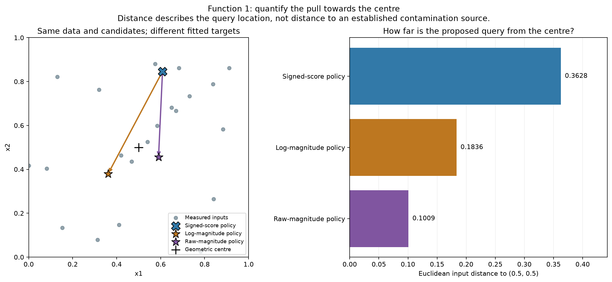
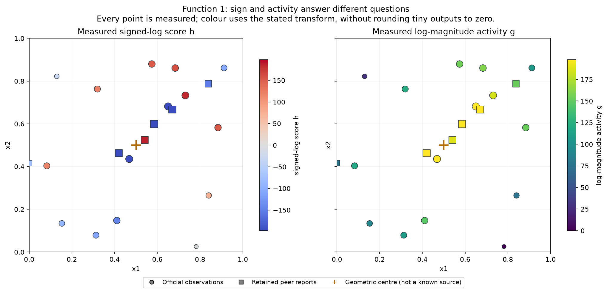
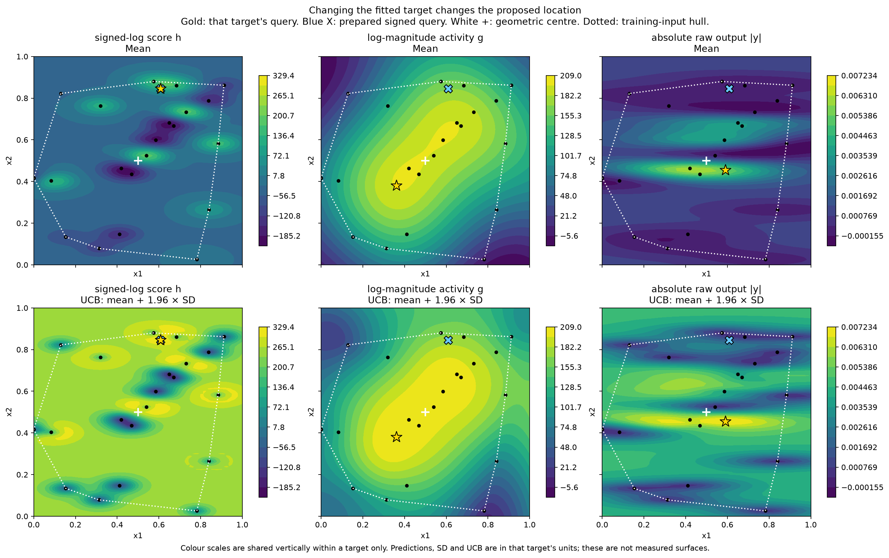

# Function 1 — Week 6 activity hypothesis

**Submission confirmation, 31 October 2026:** the project owner confirmed submission of the [eight Week 6 inputs](../../../submissions/Week_06/README.md). Results are pending; seven future queries remain per function. The analysis below retains its pre-submission evidence and query budget.

**Analysis dated 30 October 2026. Function 1's central query is agreed and the
prepared file is updated; nothing has been submitted.**

[Executed notebook](official/activity_hypothesis.ipynb) ·
[Numerical results](official/activity-hypothesis/results.json) ·
[Earlier magnitude study](../Week_05/report.md)

## Agreed Week 6 query: pursuing a hunch

The agreed input is **`0.537942-0.522217`**, the saved signed-log GP mean
maximum. Its effective uncertainty weight is **zero**. The magnitude comparison
informs the central-region hypothesis; it does not select the final point.
This is explicitly following through on a hunch, not claiming a detected source.

**None of the outputs so far is regarded as clearly non-zero in practical or
source-detection terms.** All stored numerical values remain unchanged. Their
being non-zero in floating-point arithmetic does not establish meaningful
activity, a background level or a detection threshold.

The query is close to a self-reported positive peer input and tests that
neighbourhood with an official query. The peer-assisted GP favours it, but the
official-only neural fit predicts a negative sign. The expected learning is
therefore conditional on a tentative interpretation of sparse evidence.

The study below preserves the **original** `0.608515-0.846200` UCB point as its
comparison reference. Its numerical results and source hashes describe the
comparison run before this decision; the prepared file now follows the agreed
central point. Earlier model notebooks retain their provisional proposals.

## What the comparison establishes

With the existing uncertainty weight **1.96**, both magnitude-only targets
move the proposed query closer to the geometric centre than the existing
signed-score policy. The log-magnitude query is **49.4% closer**;
the literal raw-magnitude query is **72.2% closer**.
This result uses exactly the same candidate locations for all three targets.

| Policy | Proposed input | Distance to (0.5, 0.5) | Closer than prepared signed query |
| --- | --- | ---: | ---: |
| Existing signed-score policy | `0.608515-0.846200` | 0.362808 | 0.0% |
| Log-magnitude policy | `0.361195-0.379880` | 0.183564 | 49.4% |
| Raw-magnitude policy | `0.590368-0.455132` | 0.100894 | 72.2% |

The proposals are different and do not identify one precise source or optimum.
The log-magnitude rule moves into the lower-left part of the central region;
the raw-magnitude rule favours a central horizontal band. The symmetric pool
check, which gives every policy the same extra activity-neighbourhood candidates,
retains a 48.4% central-distance reduction for log magnitude
and 72.2% for raw magnitude.

## The signed model already sees a central high-mean location

The existing signed model's **mean-only** candidate is
**(0.537942, 0.522217)**, just **0.043968**
from the centre. It is closer to the centre than either magnitude rule's mean-only
choice. Adding the UCB uncertainty bonus moves that signed policy to
**(0.608515, 0.846200)**.

That distinction matters. The prepared upper-region point is not evidence that
the signed model believes the largest mean response is there. Its signed-log
mean is **118.111**, with latent SD
**108.324**; the 1.96 × SD bonus is about
**212.315**, producing UCB
**330.425**. That policy deliberately values uncertainty.

The supported claim is therefore conditional: **at the current uncertainty-aware
selection rule, changing the fitted target to activity draws the query towards
the centre**. It does not establish that magnitude is the only route to a central
query. Nor does the central pull hold for every exploration weight; at weight
zero the signed policy is the closest of the three.

## Why negative readings can still be informative

The course's contamination-source analogy motivates separating two ideas:

- **Signed score:** the quantity the challenge asks to maximise.
- **Activity:** response strength that might help locate an interesting region,
  even when its current reading is negative.

A numerically stronger negative reading can motivate investigating nearby
structure, including the hypothesis of a nearby positive lobe. That relative
strength has not been established as a clearly non-zero physical signal.
The description does not provide a sign-change law or
guarantee that the nearby positive maximum exists. A negative response could
also belong to a wholly unhelpful signed-score region.

There are **15 official observations and six unchanged retained peer reports**.
All 21 are non-zero at full float64 precision. A literal zero/non-zero detector
therefore cannot distinguish useful detections in this snapshot; no practical
threshold has been established. Small readings are not rounded away.

The largest observed absolute response is a negative peer report near
**(0.419675, 0.463269)**. A retained **positive** peer report at
**(0.540351, 0.524565)** has output **1.180859165804771e-13**. The latter is
central and exceeds the owner's confirmed best numerically, but remains a
self-reported peer measurement. It does not change the confirmed owner incumbent.
Nearby opposite-sign measurements support studying the region; they do not
identify the hidden function between observations.

## The targets are separately fitted

The fixed scale remains $s=10^{-200}$:

$$
h(y)=\operatorname{sign}(y)\log_{10}(1+|y|/s),\qquad
g(y)=\log_{10}(1+|y|/s)=|h(y)|.
$$

The third target is raw $|y|$. Signed-log preserves signed-output ordering;
the two activity targets preserve absolute-magnitude ordering and discard sign.
Taking the absolute value of a signed fitted mean is not used as a substitute
for fitting activity. Mean, SD, UCB and validation errors always retain the
units of their stated target. A signed-log posterior mean is not a raw expected
score obtained by reversing the transform.

The same four GP families are available for each target: fixed local and broad
kernels, plus optimised shared and separate length scales. Selection retains
the existing official-target MAE criterion. Official-only and peer-assisted fits
are scored on the identical 15 official held-out rows; peer reports enter
training only. No source repositories or course outputs are refreshed.

Each target is compared with its own mean baseline. The selected signed model's
MAE/baseline ratio is **0.904**, versus
**0.348** for log magnitude and
**0.750** for raw magnitude. This supports
discussing a more learnable activity explanation relative to its own benchmark.
Errors across the different target definitions do not measure the same task.
The notebook retains the exact fitted kernels and fitting warnings. Diagonal
regularisation is not treated as a measured noise level or an explanation of
the observed sign changes.

## Controls against a manufactured central answer

The baseline pool contains **20,488** shared,
six-decimal candidate inputs; the symmetric expansion contains
**24,589**. Both exclude known official and peer
coordinates. No candidate pool or model setting is tuned on distance to the
centre. The geometric centre is a measurement reference, not an assumed source.

At weight 1.96, holding GP family and training scope fixed gives a closer-to-centre
query for log magnitude in **8/8 cases** and raw magnitude
in **8/8 cases**. All four GP families and both scopes are
shown, including the weaker fits. These are model-sensitivity controls on the
same data, not independent confirmations of the true source location.

## What remains unresolved

The signed fit's mean at the log-magnitude proposal is
**-34.366 h units**, with latent SD
**139.046**. At the raw-magnitude proposal it is
**-44.233 h units**, with latent SD
**136.022**. The currently fitted signed
means are negative and uncertain there. The activity fits do not establish a
positive return, a better confirmed maximum, or the assignment writers' intent.

The evidence provides a defensible basis for considering an **activity-led
information query** in the central region. Choosing one would be an explicit
decision to investigate the hypothesis, rather than a claim that maximising
magnitude directly maximises the assessed signed score. A measurement near a
sign transition, or a confirmed positive result in that region, would address
the nearby-positive-peak idea more directly.

## Verification and course lifecycle

The notebook reproduces the existing signed GP choice, official-target error
and exact prepared input before showing counterfactuals. It retains source
hashes, complete warnings and independent target fits. The comparison run
preserved the then-prepared eight-line file and earlier Function 1 analyses.
The later agreed change updates only Function 1's prepared line and its
decision records. No course evaluation or portal submission is performed.

1. **Define the goal and scope** — test the central pull of an activity-led search rule while submission remains under discussion.
2. **Gather the data** — use official observations through round 5 and the same six audited peer reports.
3. **Explore the data** — compare measured sign, magnitude and opposite-sign proximity.
4. **Clean and preprocess the data** — verify hashes and dimensions; retain tiny non-zero outputs and explicit target transforms.
5. **Select and engineer features** — retain both original coordinates; do not add an assumed source location.
6. **Define the machine-learning task** — distinguish signed-score regression from activity-guided information seeking.
7. **Partition the data** — use identical official held-out targets, with peer rows added only to training; no independent final test is available.
8. **Select and train candidate methods** — fit all four declared GP families separately for each target within the fixed budget.
9. **Evaluate and interpret the results** — compare target-specific baselines, shared-pool queries, centre distances, fixed-family controls and weight sensitivity.
10. **Deploy and iterate** — no deployment or submission applies; retain the study for the continuing Function 1 decision.
