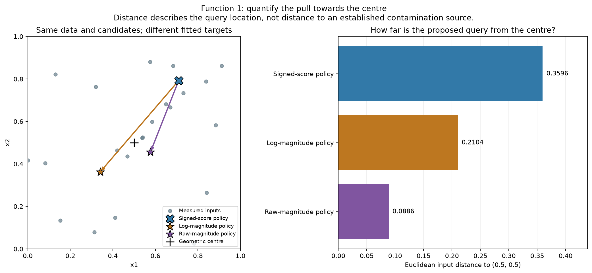
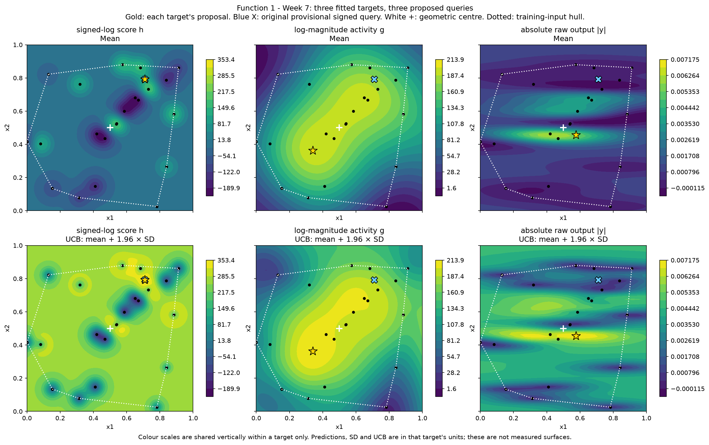

# Function 1 — Week 7 three-target comparison

**Subsequent study:** the [official-only source comparison](source-shape.md)
now recommends testing `0.627916-0.628953`. The three-target study below
preserves its earlier recommendation and numerical evidence.

**Earlier recommendation: `0.340635-0.362578` for one log-magnitude-led exploration query.**
This is recommended for discussion, without final agreement or submission.
Seven queries remain, including Week 7. The study was run on **5 November
2026**, using **16 official observations through round 6** and **six unchanged
retained peer reports**.

[Executed notebook](official/activity_hypothesis.ipynb) ·
[Complete numerical evidence](official/activity-hypothesis/results.json) ·
[Week-level review](report.md) · [Previous study](../Week_06/activity-hypothesis.md)

## Decision and caveat

The latest central test returned `2.1709129251221444e-14`: a numerical best,
while remaining practically zero. It has not established meaningful source
activity. Repeating almost the same point would add little coverage.

The log-magnitude GP improves held-out MAE by **65.0% against its own mean
baseline** and also beats a median benchmark. The proposal is identical in
both shared candidate pools, and weights 0–3 keep it in the same lower-left
neighbourhood. The raw-magnitude GP loses to its median benchmark, and its
location is more sensitive to family and retained peers.

This changes the recommendation from the original signed-GP/UCB proposal.
It is one activity-seeking experiment. The signed model's mean at the new
point is **-19.455 h**, with latent SD **139.400 h**: its sign is unresolved
and a negative return is a material possibility. No positive improvement,
contamination source or practical detection threshold is established.

## Separate targets, common controls

The fixed scale remains $s=10^{-200}$:

$$
h(y)=\operatorname{sign}(y)\log_{10}(1+|y|/s),\qquad
g(y)=\log_{10}(1+|y|/s)=|h(y)|.
$$

Fit signed-log score $h(y)$, log magnitude $g(y)$ and raw magnitude $|y|$
independently. Taking the absolute value of a signed fitted mean is not used
as a substitute. Target units and their meanings remain explicit.

All three use the four established GP families, unchanged settings, LOO MAE
selection, optimiser budget and seeds. Official-only and peer-assisted fits
score the **same 16 held-out official rows**. Peer observations enter training
only. Source data are unchanged; no peer repository is refreshed.

The baseline pool has **20,487** candidates and reproduces the saved Week 7
signed proposal exactly. The symmetric pool has **24,588** candidates, adding
the strongest-response neighbourhood to every policy. All known official and
peer inputs are excluded at six-decimal precision. The geometric centre is a
descriptive reference, not a selection criterion or known source.

## Validation within each target's units

| Target | Selected GP | GP MAE | Mean-baseline MAE | GP / own baseline | Reduction |
| --- | --- | ---: | ---: | ---: | ---: |
| Signed-log score | Shared length scale | 109.584157 | 135.523206 | 0.809 | 19.1% |
| Log magnitude | Shared length scale | 16.952687 | 48.422875 | 0.350 | 65.0% |
| Raw magnitude | Separate length scales | 0.000785537 | 0.001063464 | 0.739 | 26.1% |

All three selected fits use official data plus retained peers. Raw errors
across different target units are not ranked against each other. These ratios
describe improvement over each target's own benchmark; they do not prove
which policy will maximise the real signed function. Selection reuses these
errors, making them optimistic estimates on a small adaptive sample.

As an additional MAE diagnostic, each official held-out row is predicted using
the median of the other official targets. This changes no GP selection rule:

| Target | Median-baseline MAE | Selected GP beats median? |
| --- | ---: | --- |
| Signed-log score | 165.078410 | Yes |
| Log magnitude | 58.002869 | Yes |
| Raw magnitude | 0.000569713 | No |

Most raw magnitudes are tiny, so the median benchmark checks whether the raw
GP's improvement over its mean baseline overstates its predictive usefulness.
The selected log GP also improves on the best official-only log GP's
**21.556723** MAE, with the caveat of additional self-reported training evidence.

## Proposed inputs and cross-predictions

At weight **1.96**, both candidate pools choose exactly these points:

| Policy | Proposed input | Distance to geometric centre | Nearest known input |
| --- | --- | ---: | ---: |
| Signed score | `0.709459-0.792240` | 0.359552 | 0.063043 |
| **Log magnitude** | **`0.340635-0.362578`** | 0.210433 | 0.128008 |
| Raw magnitude | `0.576742-0.455704` | 0.088609 | 0.077003 |

Log and raw magnitude are respectively **41.5%** and **75.4%** closer to the
geometric centre than the signed proposal. The raw point's greater centrality
does not make it preferable. None duplicates a known or previously submitted
input. The recommended point is **0.2538** from the latest official query.



| Candidate | Signed mean h | Signed latent SD h | Log-magnitude mean g | Raw-magnitude mean, approximately |
| --- | ---: | ---: | ---: | ---: |
| Signed-policy point | 112.643497 | 122.527757 | 177.782423 | -0.000002 |
| Recommended log point | -19.455075 | 139.400392 | 198.536814 | 0.000805 |
| Raw-magnitude point | 32.193279 | 134.915576 | 180.050236 | 0.005511 |

The separate fits disagree materially about the activity region. A Gaussian
raw-magnitude surrogate can predict a negative mean despite non-negative
measured targets; this is a model artefact and is not silently clipped. No
transformed posterior mean is inverted and presented as an expected raw score.
UCB is an optimistic ranking score, not a forecast or guarantee.

## Sensitivity and change since Week 6

Weights 0, 1, 1.96 and 3 keep log-magnitude proposals around
`x1=0.33–0.37`, `x2=0.35–0.40`. Raw-magnitude proposals move from about
`(0.443, 0.455)` to `(0.633, 0.456)`. Its fitted length scales, approximately
**0.258 and 0.0364**, describe a narrow horizontal band inferred from sparse data.

Holding GP family, scope, pool and weight fixed, log magnitude is closer to
the centre than signed output in **6/8** comparisons and raw magnitude in
**5/8**. Last week's **8/8** result for each does not persist universally.
This is model sensitivity, not an independent source-location test.

Official-only optimised log-GP proposals are near `(0.342, 0.393)` and
`(0.338, 0.419)`, while the selected peer-assisted point is `(0.341, 0.363)`.
The fixed broad official-only model instead favours `(0.585, 0.590)`.
The evidence supports a recurring region, without unanimity across families.

| Target | Saved Week 6 comparison | New Week 7 comparison | Input movement |
| --- | --- | --- | ---: |
| Signed | `0.608515-0.846200` | `0.709459-0.792240` | 0.114461 |
| Log magnitude | `0.361195-0.379880` | `0.340635-0.362578` | 0.026871 |
| Raw magnitude | `0.590368-0.455132` | `0.576742-0.455704` | 0.013638 |

These are saved comparison proposals: Week 6 actually submitted the separate
central signed-mean point. Week-to-week movement includes the new observation
and an updated incumbent-local pool. Within-week common pools provide the
like-for-like target comparisons.



## Reproduction and verification

From the Capstone root:

```powershell
.\run-python.ps1 stage-2-bbo/scripts/run_week_07_reviews.py --functions 1 --kind activity
```

The executed notebook checks local interpreter, snapshot/audit hashes, exact
round counts, official/peer alignment, reproduction of the original signed
fit, candidate bounds/precision, duplicates and earlier submitted inputs.
The JSON evidence retains all validation tables, held-out predictions,
warnings, pool hashes, cross-predictions, controls and recommendation status.
The relevant activity, Function 1 model, prediction and cohort helper suites
passed **25 tests**. Saved outputs, plots and numerical evidence are inspected
separately. Earlier data, source model summaries and submitted inputs are
preserved. No course evaluation, submission or publication is performed.

Readback verified **nine executed code cells, six embedded charts and six
figure files**. Held-out errors and both baselines were recalculated from
saved predictions; candidate pools were reproduced from their declared
settings and hashes. **251 protected files** retain their original hashes.
The existing model notebook adds a linked recommendation while preserving
every earlier code cell and fitted output. All six figures were visually
inspected. The [verification record](official/activity-hypothesis/verification.json)
retains these checks.

## Course lifecycle

1. **Define the goal and scope** — compare three target policies and recommend one next Function 1 experiment for discussion.
2. **Gather the data** — use 16 official observations through round 6 and six unchanged audited peer reports.
3. **Explore the data** — inspect sign, magnitude, nearby opposite signs and the latest central return.
4. **Clean and preprocess the data** — verify alignment, bounds, counts and hashes; preserve tiny values and declare target transforms.
5. **Select and engineer features** — retain both original coordinates; target changes add no assumed source-location feature.
6. **Define the machine-learning task** — use regression for signed maximisation and compare activity-led learning heuristics.
7. **Partition the data** — use identical official leave-one-out targets; peers enter training only and no independent final test is available.
8. **Select and train candidate methods** — fit four established GP families per target with unchanged settings and search budgets.
9. **Evaluate and interpret the results** — compare target-specific baselines, shared pools, family/scope/weight controls and cross-predictions.
10. **Deploy and iterate** — deployment is not applicable; retain the unsubmitted recommendation and assess its eventual official return before further experiments.
