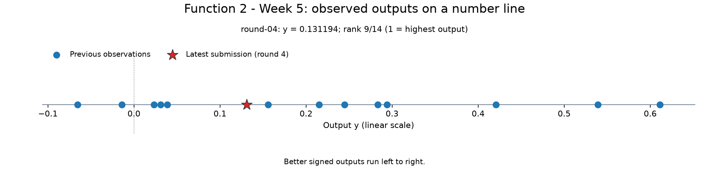
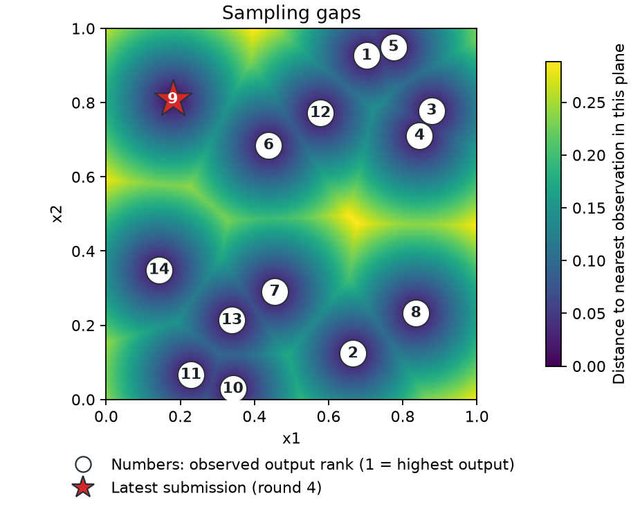
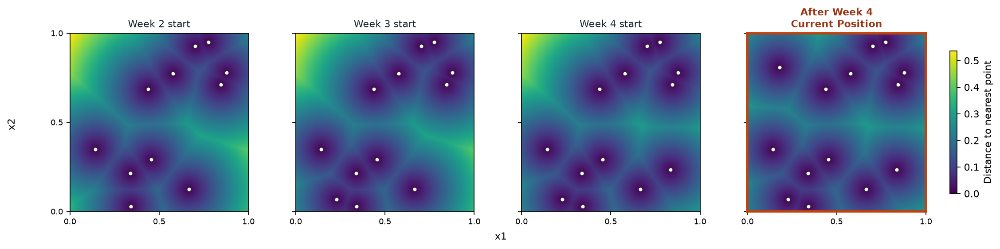
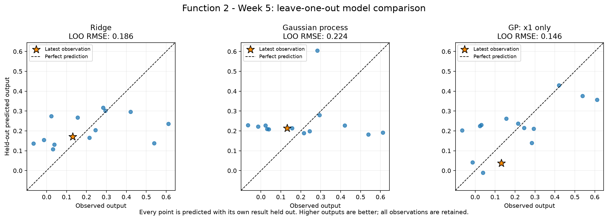
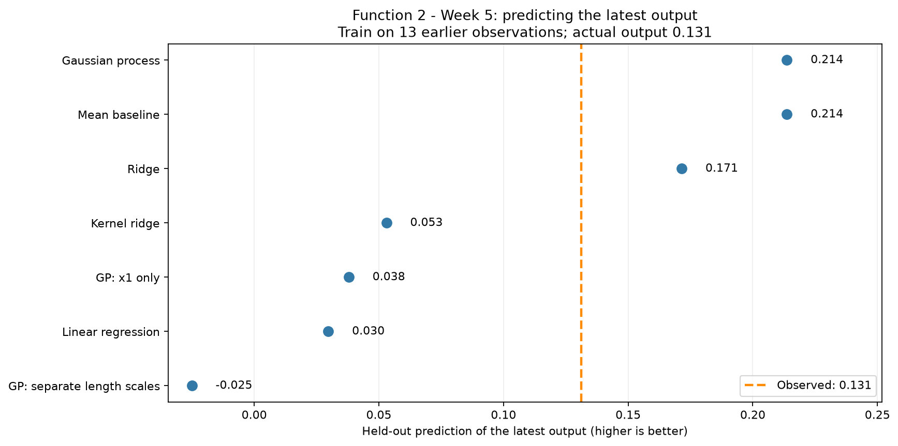
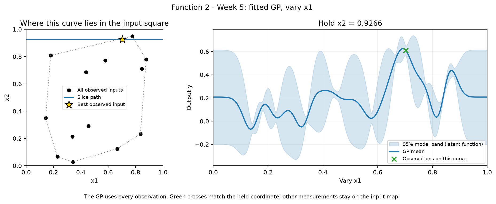
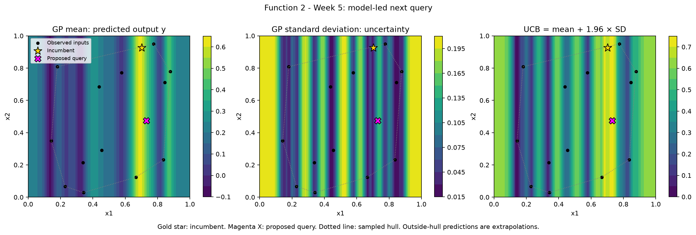
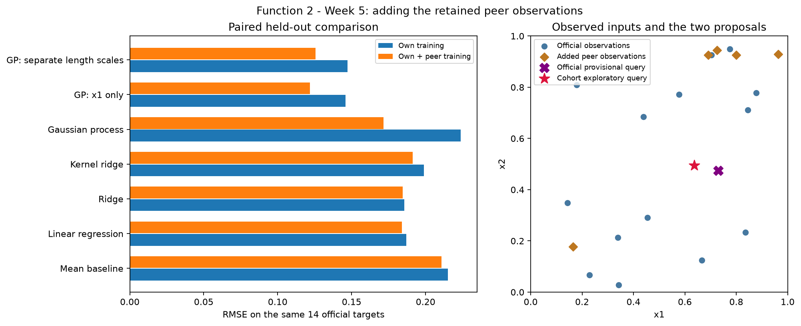
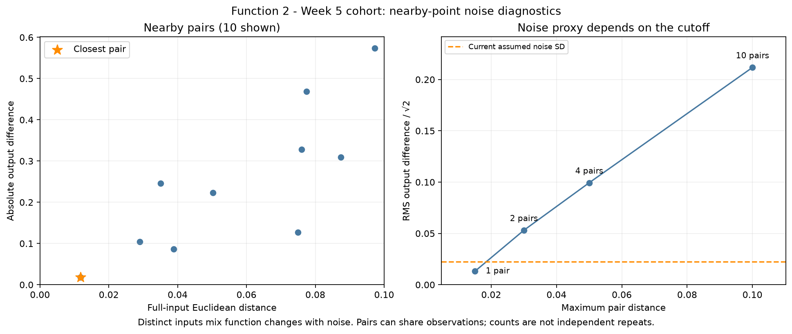

# Function 2 — Week 5 results and cohort comparison

**Submission confirmation, 29 October 2026:** the project owner confirmed
submission of the [eight selected Week 5 inputs](../../../submissions/Week_05/README.md).
Results are pending. Eight future weekly queries remain per function.
The analysis below retains its pre-submission evidence and query budget.

**Selection review, 28 October 2026:** the [prepared Week 5 submission](../../../submissions/Week_05/README.md)
selects the retained cohort candidate **`0.636151-0.495605`**. On the same
14 official targets, the x1-only GP's RMSE falls from 0.145783 to 0.121879
(16.4%), with lower MAE as well. The saved common-pool comparison retains this
choice. The x2 setting is a geometric tie-break; the lower predicted mean and
weight sensitivity make this an exploratory query. The official provisional
proposal and the analysis below are retained as history. Submission confirmation is recorded above.

**Analysis snapshot: 23 October 2026.** Official feedback includes four returned
queries. The cohort comparison adds five peer observations retained on
20 October 2026. This report uses the saved notebook results and exported
figures; it introduces no new observations or query decision.

## What the results show

Function 2 takes two numerical inputs, x1 and x2, and returns a noisy score.
Higher signed scores are better. The best observed score remains **0.611205**,
from the initial data. None of the four subsequent official returns, or the
five additional peer observations, improves it.

The strongest prediction results come from a Gaussian process (GP) using
**x1 alone**, closely followed by a GP that allows the two inputs to behave
differently. This supports x1 as a useful explanation of the observations,
while leaving the independent contribution of x2 unresolved.

Adding the peer observations reduces the x1-only model's prediction error by
**16.4% on the same 14 official results**. At the existing official proposal,
its predicted output changes little, but its estimated uncertainty falls
substantially. That difference explains the change in the saved exploratory
proposal; it does not represent a newly measured improvement.

## The observations available

| Measure | Official analysis | With retained cohort data |
| --- | ---: | ---: |
| Supplied initial observations | 10 | 10, included once |
| Official returned queries | 4 | 4 |
| Additional peer observations | 0 | 5 |
| Total observations | **14** | **19** |
| Best observed output | **0.611205** | **0.611205** |
| Latest official output | 0.131194 | 0.131194 |
| Latest official output rank, 1 = highest | 9 of 14 | 11 of 19 |

The latest official return was received on **23 October 2026** for the input
**x1 = 0.179540, x2 = 0.808737**. Its output lies within the earlier range and
does not change the best observed result. Its lower numerical rank in the
pooled analysis comes from adding more observations to the comparison; the
measured value itself has not changed.

*Figure 1. Measured outputs on their original linear scale. The red star is
the latest official return. Better scores lie further to the right.*

The latest result adds evidence about a relatively low-x1 location. It neither
establishes a new high-performing region nor isolates the effect of either
input. Function 2 is described as noisy, and no identical-input repeats in
these snapshots establish how much of the variation is measurement noise.

### Where the measurements lie

*Figure 2. Numbers identify measured output ranks. The background measures
sampling distance: brighter areas are farther from an observation. It does
not show predicted output or model uncertainty.*

Several of the strongest observations lie near x1 of about 0.7, at different
x2 values. That pattern motivates examining x1 carefully, but the observations
are too sparse to identify a continuous ridge or prove that x2 has no effect.
Large gaps remain between measured locations. Completing the saved exploration
shortlist has therefore completed that particular plan, rather than mapped
the unknown function exhaustively.

### The observed-output terrain

The [interactive observed-output terrain](official/figures/observed-output-terrain.html)
places x1 and x2 on the ground plane and uses the measured output as height.
Black markers are measurements; the gold diamond marks the best observed
output, initial-010, at approximately **x1 = 0.702637, x2 = 0.926564**.

The triangular faces simply join measured heights. They provide a visual
interpolation inside the sampled region, with blank areas outside it. They
are not a fitted regression or the known shape of the hidden function. The
flattened vertical appearance is a viewing choice; heights remain in the
original output units. Drag to rotate, scroll to zoom and use **Reset view**
to restore the initial orientation and zoom.

### Completion of the predetermined shortlist

Week 5 reviews the final return from the predetermined exploration shortlist.
Its three saved inputs were assigned to Weeks 2, 3 and 4, and all three now
have recorded results. No predetermined Week 5 input remains.

*Figure 3. The panels follow the saved plan from its starting observations to
completion, using recorded coordinates for returned queries and one shared
distance colour scale. The outlined final panel is the current position.*

This completes the fixed shortlist, while leaving the broader unknown function
only sparsely sampled. The separate [official model comparison](official/model_predictions.ipynb)
uses the same 14-observation snapshot to evaluate predictions and record a
provisional Week 5 input. That proposal remains unsubmitted. The earlier
[Week 4 model notebook](../Week_04/model_predictions.ipynb) remains a historical
learning study; it did not replace the predetermined final query.

The cohort exploration notebook uses this same official history for its
progression figure. Peer round numbers belong to their own sources, so they
cannot be inserted into the owner's historical stages. Its number line,
sampling-gap map and observed-output terrain use all 19 retained observations.

## How well the models predict existing results

Seven alternatives were compared using **leave-one-out validation**: each
observation was predicted by a model trained on the other 13 observations.
The mean baseline predicts the average of its training outputs and provides
a simple benchmark that uses no input relationship.

### Model settings and the comparison rule

The observations retain their original signs and full stored precision.
Both inputs already occupy the same unit range, and no additional features
or output transformation are introduced. The x1-only explanation deliberately
omits x2 inside the model, while the other models retain both inputs. The
x1-only and separate-length-scale explanations carry forward the
[earlier Function 2 analysis](../../../results/function-2-round-01-analysis.md).

| Setting | Declared value |
| --- | --- |
| Ridge regularisation strength | 1.0 |
| Kernel ridge | RBF kernel; regularisation strength 0.1; kernel coefficient 1.0 |
| GP covariance | Constant amplitude multiplied by a smooth RBF kernel |
| Initial GP amplitude and allowed bounds | 1.0, bounded between 0.01 and 100.0 |
| Initial GP length scale and allowed bounds | 0.3, bounded between 0.03 and 2.0 |
| Assumed noise standard deviation | 10% of the training output standard deviation |
| GP fitting | Three optimiser restarts, with random seed 42 |

Each GP normalises the output and fits its kernel within each training fold.
The shared-length-scale GP uses one responsiveness setting across both inputs;
the separate-length-scale GP fits one per input. These declared alternatives
were compared without expanding the settings until a favourable result appeared.

The saved selection rule chooses the GP with the lowest held-out RMSE among
the three GP explanations because a GP supplies both a mean and uncertainty.
That rule is separate from identifying the best regressor overall. In this
snapshot the x1-only GP wins both comparisons, but GP status alone does not
establish predictive superiority.

### Held-out prediction errors

The two error measures below use the original output units. **MAE** is the
average absolute prediction error. **RMSE** gives larger misses more weight.
Lower values are better for both.

| Model | Held-out RMSE | Held-out MAE |
| --- | ---: | ---: |
| **GP using x1 only** | **0.145783** | **0.119795** |
| GP with separate input length scales | 0.147264 | 0.120021 |
| Ridge regression | 0.185709 | 0.141081 |
| Linear regression | 0.187074 | 0.144931 |
| Kernel ridge | 0.198864 | 0.154196 |
| Mean baseline | 0.215118 | 0.177465 |
| GP with one shared length scale | 0.223697 | 0.185444 |

The x1-only GP has **32.2% lower RMSE than the mean baseline**. The GP with
separate input length scales is close behind, so the evidence does not sharply
separate these two explanations. The shared-length-scale GP performs worse
than the baseline, despite fitting the training observations very closely.
Model flexibility and a close training fit have not, by themselves, produced
better held-out predictions.

*Figure 4. Points closer to the dashed diagonal have smaller prediction
errors. The gold star identifies the latest official observation. The panels
share axes so their errors can be compared directly.*

The x1-only model improves the overall comparison, but still misses some
observations substantially. In particular, its held-out predictions fall below
the two highest measured outputs. A lower average error does not establish
that the model can locate a better maximum.

### The latest return is a useful counterexample

*Figure 5. The orange line is the actual return. Every displayed prediction
excludes that observation from training. These are retrospective checks using
the model settings declared in the Week 5 analysis, rather than forecasts
recorded before the result arrived.*

Ridge regression comes closest on this particular result, predicting about
**0.1714** against the measured **0.1312**. The x1-only GP predicts about
**0.0379**, underestimating it by approximately **0.0933**. The model with the
lowest error across all observations is therefore not the closest on every
individual observation.

The latest result contributes about **2.9%** of the x1-only model's total
held-out squared error. It is a useful local miss, but does not dominate the
overall error. The notebook's supplementary error for the other observations
excludes the latest row from scoring; the training folds for those other
observations still contain it.

These 14 observations are a small, adaptively collected dataset. The same
validation results were used to compare models, so the winning error is an
optimistic estimate of future performance. There is no independent final
test set in this study.

## What the fitted relationship means

A GP supplies an estimated output and an estimate of uncertainty about the
underlying response. The selected x1-only GP allows the response to vary with
x1 while making no distinction between different x2 values at the same x1.

*Figure 6. The right panel varies x1 while holding x2 at the best observed
input's value, about 0.9266. The left panel locates that slice in the input
square. Only measurements matching the held x2 coordinate appear as green
crosses on the curve; other measurements remain on the input map.*

The high fitted region near x1 of 0.7 is consistent with the strongest
observations. However, the narrow rises and falls elsewhere should be read
cautiously. The fitted length scale, which controls how rapidly the response
can change along x1, reaches its permitted lower bound of **0.03**. The saved
execution retains the associated fitting warnings. The detailed shape depends
on that bound and the assumed noise level.

The shaded band is the model mean plus or minus 1.96 estimated standard
deviations for the underlying function. It excludes fresh observation noise
and has not been shown to contain 95% of future returns. The noise standard
deviation is assumed to be 10% of the training output standard deviation;
repeated experiments have not measured that level.

The [saved x2 slice](official/figures/gp-slice-x2.png) is flat because this model omits
x2. Its flatness, and its unchanged uncertainty along x2, are consequences of
the model definition. They are not experimental confirmation that x2 is
irrelevant. The [fitted contour comparison](official/figures/fitted-output-contours.png)
shows how different a competing model's explanation can look on the same
output scale.

In those contours, background colours and lines are predictions, while dot
colours are measured outputs on the same scale. The gold star is the best
observed input. Blank areas fall outside the sampled convex hull, the footprint
spanned by the observations; they remain part of the allowed search domain.

The [interactive fitted GP terrain](official/figures/fitted-gp-terrain.html)
shows the estimated mean as a surface with measured outputs marked separately.
This differs from the earlier observed-output terrain, whose faces simply
join measured heights. Both views need that distinction to avoid presenting
an estimated surface as measured evidence.

## The saved official proposal

The official analysis records the unevaluated input
**x1 = 0.729749, x2 = 0.474365**. Its predicted mean is **0.472454**, below the
best measured score of **0.611205**. Its model standard deviation of **0.135640**
raises its uncertainty-weighted selection score to **0.738309**. This is an
exploratory proposal around a promising x1 region, rather than a predicted
increase in the best score from the mean alone.

*Figure 7. Black dots are measured inputs, the gold star is the best observed
input and the magenta X is the unevaluated proposal. The dotted line marks
the sampled hull. Predictions beyond that boundary are extrapolations. Each
panel has its own units and colour scale.*

The proposal lies inside the sampled hull, which describes its location
relative to existing inputs. It does not guarantee a reliable prediction.
The gold star identifies an evaluated observation, rather than a queued point
from the completed exploration shortlist.

### How the candidate comparison was made

The calculation compares 16,384 seeded broad samples plus the extreme corners,
a local sample of 4,096 seeded points plus corners within 0.15 of the best
observed input in each coordinate, and one separately optimised geometric
coverage point. Inputs are rounded to six decimal places before prediction.
Duplicates and previously measured inputs at that precision are removed,
leaving **20,489 candidate locations**. The selected score is the maximum over
this finite comparison, rather than a known maximum over the continuous domain.

The score adds **1.96 times model standard deviation** to predicted mean.
That weight and the local radius are declared assumptions. The coverage
alternative measures input-space gaps separately from output improvement;
no hidden course function is evaluated during these comparisons.

The x1-only model assigns identical predictions and uncertainties to every x2
at a fixed x1. After selecting x1, the calculation compares **4,097** evenly
spaced x2 settings and chooses the one farthest from its nearest measured
two-input point. This geometric tie-break uses no outputs and supplies no
evidence of an optimal x2. The same rule is used in the sensitivity comparison.

### Sensitivity and proposal status

The noise check refits the selected model under assumed noise fractions of
**3%, 10% and 30%** of training output standard deviation, predicting the
same proposed input each time. The exploration check instead reuses the same
candidate pool with weights **0, 1, 1.96 and 3**. All four weights choose
different locations, so the proposed input is sensitive to the exploration
balance as well as the fitted model and noise assumption.

Nine weekly query opportunities remain, including Week 5. The official
proposal is provisional and no Week 5 submission is recorded here. This
report makes no replacement decision; returned outputs would provide the
new evidence needed to revisit the predictions.

## What changes when cohort observations are included

The comparison adds five accepted peer returns from four repositories in the
retained **20 October 2026** snapshot. Shared initial data are counted once;
duplicate reports, unreturned queries and reported inputs outside the allowed
range were excluded during the earlier audit. The peer sources were not
refreshed for the Week 5 model runs.

These records are public self-reports, with possible rounding or transcription
errors. They expand the available evidence, while leaving its quality and
sampling limitations relevant to the interpretation.

### Compare predictions against the same targets

The fairest comparison available here predicts the **same 14 official
observations** twice. For each held-out observation, one model trains on the
other 13 official rows; the other trains on those same 13 rows plus the five
peer rows. This keeps the scored targets unchanged.

| Model | Official training: RMSE on 14 official targets | Official + peer training: RMSE on the same targets |
| --- | ---: | ---: |
| **GP using x1 only** | **0.145783** | **0.121879** |
| GP with separate input length scales | 0.147264 | 0.125679 |
| GP with one shared length scale | 0.223697 | 0.171605 |
| Linear regression | 0.187074 | 0.183965 |
| Ridge regression | 0.185709 | 0.184449 |
| Kernel ridge | 0.198864 | 0.191284 |
| Mean baseline | 0.215118 | 0.210850 |

*Figure 8. Left: paired errors on identical official targets, where shorter
bars are better. Right: the locations of the observations and saved proposals.
The proposal markers identify unevaluated inputs and have no measured output.*

Every compared model has lower RMSE on the official targets after adding the
peer rows. The x1-only GP remains the strongest on this measure, with a
**16.4% reduction in RMSE** and a reduction in MAE from **0.119795 to 0.092553**.
This is evidence that the retained peer observations help these models explain
the official results under the declared assumptions.

The pooled notebook also reports x1-only GP RMSE of **0.123776** when all
19 observations are scored. That answers a different question because it
changes the target set. The 16.4% comparison above uses the paired 14-target
evaluation throughout. Neither evaluation provides an independent future test.

The best observed output remains **0.611205**. Better prediction checks have
not produced a new returned score, and the additional data have not established
an independent x2 effect. The x1-only fit still reaches the length-scale bound.

### Why the two saved proposals differ

The saved official proposal is **x1 = 0.729749, x2 = 0.474365**. The cohort
analysis records a separate exploratory alternative at
**x1 = 0.636151, x2 = 0.495605**. Both are unevaluated in this snapshot.

The table applies both fitted models to each of those same locations. Here,
SD measures model uncertainty about the underlying function. The selection
score, labelled UCB in the notebooks, adds **1.96 times that SD** to the
predicted mean, rewarding uncertain locations as well as high predictions.

| Location | Model fitted to | Predicted mean | Model SD | Selection score |
| --- | --- | ---: | ---: | ---: |
| Official proposal | 14 official observations | 0.472454 | 0.135640 | 0.738309 |
| Official proposal | 19 pooled observations | 0.484601 | 0.028008 | 0.539496 |
| Cohort alternative | 14 official observations | 0.321767 | 0.154782 | 0.625138 |
| Cohort alternative | 19 pooled observations | 0.366651 | 0.142027 | 0.645024 |

At the official proposal, adding the peer observations slightly raises the
predicted mean while reducing model SD from **0.135640 to 0.028008**. Its lower
selection score therefore comes from a much smaller uncertainty bonus. The
pooled model has not become more pessimistic about its expected output.

The cohort alternative retains more uncertainty and consequently receives
the higher pooled selection score. Its pooled predicted mean of **0.366651**
is below both the prediction at the official proposal and the best measured
score. Its appeal in this calculation is exploratory. The selection score is
neither a returned output nor a probability of improvement.

Both fits also prefer these respective locations when scored on one common
set of **20,491 candidate locations**, so the difference is not solely caused
by searching different points. Because both selected models use x1 alone,
the x2 values are chosen by a geometric sampling criterion among equal model
scores; they are not learned optima for x2.

The outcome is sensitive to the exploration weight: all four tested weights
produce different locations. In the pooled analysis, lower weights favour
x1 around **0.695**, while weight 3 moves it to about **0.074**. The saved
comparison therefore records an assumption-dependent exploratory alternative.
It does not establish that the official proposal should be replaced. The
official proposal remains unchanged and neither proposal is recorded as
submitted in these analyses.

## Can the cohort data tell us how noisy Function 2 is?

The extra observations give us some nearby inputs, but **no independent
same-input repeats**. There are no matching input pairs either at full stored
precision or after rounding both coordinates to the portal's six decimal
places. The earlier audit excluded a rounded report of an existing initial
observation as a copied duplicate; that is not another experimental return.

### What the closest points show

Distance here uses **both input coordinates**, each on its original unit
scale. Two points with similar x1 but different x2 are not treated as repeats,
even though the selected prediction model omits x2.

| Observation pair | Input distance | Absolute output difference |
| --- | ---: | ---: |
| initial-010 / peer-kosina-round-02 | **0.011808** | **0.018473** |
| initial-010 / peer-tomxandrews-round-01 | 0.028983 | 0.104503 |
| round-01 / peer-mkamar17-round-01 | 0.035047 | 0.245563 |
| peer-kosina-round-02 / peer-tomxandrews-round-01 | 0.038827 | 0.086030 |

The closest pair has almost the same x2, approximately **0.926564**, with
x1 changing from **0.702637 to 0.690829**. Its outputs are **0.611205 and
0.592732**. If the underlying response were equal at those locations, their
difference divided by the square root of two would give a noise-SD proxy of
**0.013063**. That is only one pair, and a change of 0.0118 in x1 could itself
change the response near a narrow peak.

For several pairs, the corresponding calculation takes the square root of
the average squared output difference divided by two. For independent repeats
at identical inputs with equal noise variance, this targets the noise SD.
For distinct inputs, it also includes differences in the underlying function.
It is therefore a **local-difference proxy**, not a measured noise level or
a guaranteed upper bound on the realised noise.

| Include pairs no farther apart than | Pairs | Noise-SD proxy |
| --- | ---: | ---: |
| 0.015 | 1 | 0.013063 |
| 0.030 | 2 | 0.053062 |
| 0.050 | 4 | 0.099351 |
| 0.100 | 10 | 0.211709 |

*Figure 9. Left: output differences for the ten pairs within distance 0.1;
the closest pair is starred. Right: sensitivity of the proxy to the distance
cutoff. The dashed line is the current assumed noise SD, **0.022411** for the
full pooled fit. Pairs can share observations, so their count is not a count
of independent experiments.*

The rapid rise with distance makes a single pooled estimate misleading.
These points are consistent with substantial local changes in the function,
as well as observation noise. The closest pair supplies a useful scale to
compare with the model assumption, but cannot establish a noise floor.

### Letting the models fit a noise level

As a separate diagnostic, each of the three GP explanations was fitted with
an additional independent white-noise component. This component estimates
noise **variance** alongside the smooth response; its square root was converted
back from normalised target units into the original output units.
[Scikit-learn's WhiteKernel documentation](https://scikit-learn.org/stable/modules/generated/sklearn.gaussian_process.kernels.WhiteKernel.html)
describes that variance parameter.

These fits retain the declared amplitude and length-scale bounds, initial
length scale, three optimiser restarts and seed 42. Normalised noise variance
starts at 0.01 and is allowed between **0.000001 and 1**; a separate variance
of 0.0000000001 supplies numerical stabilisation. The fits use all 19 rows.

| GP explanation | Fitted noise SD, original units | Fraction of pooled output SD |
| --- | ---: | ---: |
| Both inputs, shared length scale | 0.031471 | 14.0% |
| x1 only | 0.032524 | 14.5% |
| Both inputs, separate length scales | 0.026381 | 11.8% |

None reaches a noise-variance bound. The x1-only fit still reaches the
length-scale lower bound of **0.03**; the separate-length-scale fit uses
approximately **0.033 for x1 and 1.7 for x2**. These are conditional likelihood
fits to the existing sample, without a separate validation comparison for
the noise-augmented models. Smoothness and noise can trade off, and fitted
answers can depend on optimiser initialisation, as illustrated in
[scikit-learn's noisy-GP example](https://scikit-learn.org/stable/auto_examples/gaussian_process/plot_gpr_noisy.html).

**About 0.03 output units is a tentative model-based noise SD to discuss**,
compared with the current assumed **0.0224**. It is not an independently
measured property of the function. Unmodelled input effects, kernel mismatch
and peer-report errors can be absorbed into the fitted noise term. The
nearby-point evidence does not isolate these effects, and the model fits
cannot resolve them by themselves.

The noise fits are retained as diagnostics alongside the existing 3%, 10%
and 30% assumption checks. They do not enter GP selection, UCB scoring or
either saved proposal. Independently returned repeats at exactly the same
input would be needed for a direct empirical noise estimate.

## Evidence and scope

This report draws on the saved executions of the
[official exploration review](official/exploration-review.ipynb),
[official model comparison](official/model_predictions.ipynb),
[cohort exploration review](cohort/exploration-review.ipynb) and
[cohort model comparison](cohort/model_predictions.ipynb). All displayed figures
are exported from those notebook executions. Values are rounded for reading; the
notebooks retain the more precise results.

The official and pooled data snapshots were checked against the checksums in
the retained local cohort audit. Peer source versions are recorded in the
[pinned cohort source manifest](../../../side-quests/cohort-2026-10-20/source-manifest.json);
the [data notes](../../../data/README.md#function-2-week-5-cohort-comparison)
explain the local snapshots and audit. Later peer repository changes are
outside this report's evidence cutoff.

### Course lifecycle coverage

The report presents the existing analysis, chiefly its evaluation and
interpretation. The saved work covers the course lifecycle as follows.

| Step | Treatment in the saved analysis |
| --- | --- |
| 1. Define the goal and scope | Maximise Function 2's signed output and examine the effect of retained peer evidence. |
| 2. Gather the data | Use 14 official observations and a separate pooled snapshot containing five additional peer returns. |
| 3. Explore the data | Inspect measured outputs, ranks, sampling gaps and full-input neighbour differences. |
| 4. Clean and preprocess the data | Preserve signs and precision, check bounds and duplicates, and fit model normalisation within training folds. |
| 5. Select and engineer features | Compare both original inputs with the explicit x1-only explanation; introduce no new features. |
| 6. Define the machine-learning task | Regress the numerical output to support maximisation. |
| 7. Partition the data | Use leave-one-out checks and paired official targets; no independent final test set is available. |
| 8. Select and train candidate methods | Compare seven declared alternatives, including a mean baseline. |
| 9. Evaluate and interpret the results | Compare held-out errors, the latest return, fitted relationships, peer effects and tentative noise diagnostics. |
| 10. Deploy and iterate | Deployment is not applicable to this report. The saved proposals remain unevaluated; this report makes no new submission decision. |
