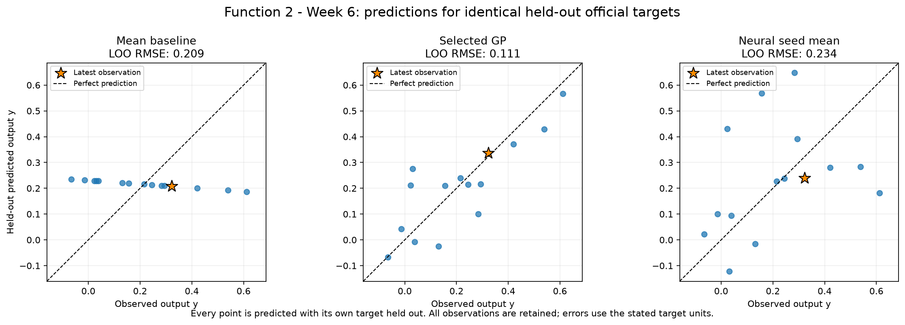
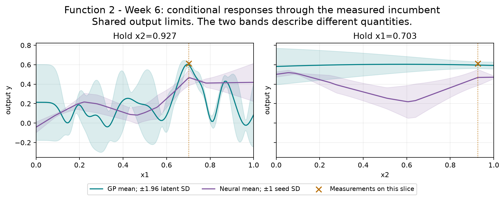
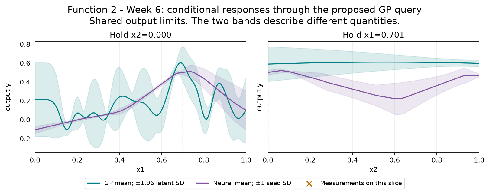
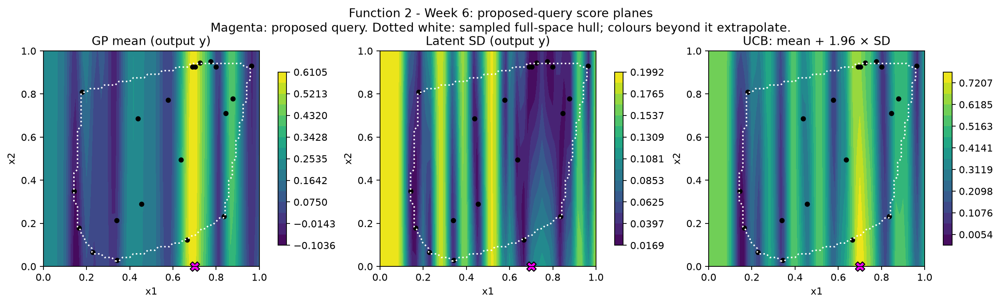

# Function 2 — Week 6 model review

**Submission confirmation, 31 October 2026:** the project owner confirmed submission of the [eight Week 6 inputs](../../../submissions/Week_06/README.md). Results are pending; seven future queries remain per function. The analysis below retains its pre-submission evidence and query budget.

Prepared on **30 October 2026**, using **15 official observations through round 5**.
The provisional query uses **GP: separate length scales**, fitted to **official plus retained peers**.
Its proposal is **`0.700520-0.000114`**. It has not been submitted by this workflow.

**Decision agreed:** keep **`0.700520-0.000114`** with uncertainty weight
**1.96**. The prepared line already matches. The model evidence below retains
its original provisional outputs; no portal submission is authorised or made.

[Executed prediction notebook](official/model_predictions.ipynb) · [Numerical review](official/model-review.json) ·
[Interactive GP/neural input explorer](official/figures/neural-network-explorer.html)

## Evidence and decision

The Week 5 cohort-informed x1-only query returned 0.322508, below the initial incumbent. The x1-only hypothesis remains eligible alongside the shared and separate-length-scale full-input GPs; its omitted x2 would use a geometric tie-break. The Week 6 winner is selected afresh from identical official held-out targets. Its new proposal should be reviewed against those alternatives rather than treated as confirmation of a one-input explanation.

The declared selection criterion is **LOO RMSE**, measured in **output y**. Each row below scores the same official held-out targets.
The selected GP's error is **0.533 times the mean baseline**, a **46.7% reduction**.
The neural ensemble is the mean of all three held-out seed predictions for its validation-selected architecture; no best seed is selected.

| Model | Error |
| --- | --- |
| Mean baseline (official only) | 0.209025 |
| Official-only GP: GP: separate length scales | 0.123352 |
| Selected query GP (official + retained peer training) | 0.111379 |
| Neural seed ensemble (official only): relu-8-8 | 0.234339 |

Official-only GP has the smaller error when both model families train on official observations only. Any selected peer-assisted GP is shown separately because it has additional training evidence. Architecture and GP selection use these validation results, so selected errors are optimistic estimates of future performance. These are predictive checks on adaptively sampled points, not a test of complete optimisation policies or evidence of a global maximum. The GP query policy remains restricted to the declared GPs because neural seed spread is not a posterior uncertainty estimate.

## Provisional query

| Quantity | Value |
| --- | --- |
| Portal input | `0.700520-0.000114` |
| Predicted target mean | 0.588435 |
| Latent posterior SD | 0.0934708 |
| UCB, mean + 1.96 × SD | 0.771638 |
| Mean minus best observed target | -0.02277 |
| Inside this fit's sampled full-input hull | False |
| Distance to nearest known input | 0.12863 |
| Eligible candidates | 20,488 |
| Query opportunities including Week 6 | 8 |

All output quantities in this table use **output y**. Posterior SD is conditional on the GP kernel and regularisation. UCB is a selection score, not a returned value or a guarantee. The finite pool retains seeded full-space and incumbent-local candidates, corners, six-decimal bounds and known-input exclusions. The geometric comparator is a finite-pool farthest-point proxy, not a fresh continuous minimax search. The notebook shows exploration weights 0, 1, 1.96 and 3 on the same pool.

The neural mean-led alternative is **`0.670394-0.122929`**, with predicted target **0.52456** and seed SD **0.0221391**. This is scored on the same eligible candidates. Its seed SD describes fitted-seed variation and must not be used as GP uncertainty.

## Discussion: next-query options and the uncertainty weight

The agreed query is **`0.700520-0.000114`**, with weight **1.96**.
It targets the promising x1 neighbourhood while testing the poorly sampled
low-x2 region. It is an uncertainty-aware query, not the highest predicted
mean. The official-only GP also proposes low x2, at `(0.710232, 0.011611)`.

| Policy on the selected pooled GP | Input | GP mean | Latent SD |
| --- | --- | ---: | ---: |
| Highest mean; weight 0 | `0.693233-0.472984` | 0.617384 | 0.044499 |
| Weight 1 compromise | `0.696437-0.028655` | 0.599146 | 0.085814 |
| Current weight 1.96; also weight 3 | `0.700520-0.000114` | 0.588435 | 0.093471 |

The mean-only forecast exceeds the measured incumbent **0.611205** by only
**0.006179**, far below held-out RMSE **0.111379**. The current query gives up
**0.028949** of predicted mean for greater model uncertainty. Neither figure
establishes the outcome of a noisy future evaluation. The neural alternative
has poorer validation and lies only **0.004711** from an initial observation;
it does not provide a stronger reason to replace the current query.

The GP's fitted input length scales are approximately **0.033 for x1** and
**1.64 for x2**: the current fit varies sharply with x1 and much more gently
with x2. An x1-only GP is a competitive alternative (peer-assisted RMSE
**0.116460**, versus **0.111379**). This is evidence for a weak x2 effect in
the fitted explanation, not proof that x2 is irrelevant. One next query changes
both inputs and cannot isolate x2's causal contribution.

The notebooks score candidates using

$$a(x)=\mu(x)+\kappa\sigma(x),\qquad \kappa=1.96.$$

Here $\mu$ is the fitted mean and $\sigma$ is conditional uncertainty about the
latent function, excluding fresh observation noise. Larger $\kappa$ gives more
weight to uncertainty; zero follows the highest mean. The
[UCB documentation](https://bayesian-optimization.github.io/BayesianOptimization/2.0.3/reference/acquisition/UpperConfidenceBound.html)
describes this trade-off. The number 1.96 is familiar from the central 95% of a
normal distribution ([NIST statistical reference](https://emtoolbox.nist.gov/Publications/NBSSpecialPublication747.pdf)),
but this use does not establish calibrated coverage over
the searched domain, future noisy returns or an optimal exploration policy.

**1.96 is a defensible reference, not a tuned universal default.** For this
function, weights 1, 1.96 and 3 favour the same broad low-x2 region, so the
recommendation does not depend on that exact decimal value. Weight zero
instead chooses an interior x2 location. The policy should be considered per
function; Function 1's agreed hunch explicitly uses zero this week. The saved
3%, 10% and 30% noise-assumption checks score the same original point; they
do not establish that re-optimising under every noise assumption keeps its
location.

## Neural exploration

The bounded comparison retains **tanh-8**, **tanh-16** and **ReLU-8-8**, each with seeds **11, 42 and 73**. Maximum training iterations remain 400, with the existing L-BFGS settings and regularisation. Full input and target scalers are fitted only on each fold's training rows.

The offline explorer includes every architecture and seed. Change inputs or the conditional-curve axis, then compare neural means and seed variation with the selected GP's mean and latent SD. Buttons restore the measured incumbent or the provisional GP query. The validation-selected architecture is labelled separately from whichever architecture is displayed. It performs no training or course evaluations.

2 selected neural seed fit(s) put a ReLU activation near zero at the incumbent. Their anchor gradient checks are flagged; backpropagation is instead verified at a fixed nearby smooth probe. No validated derivative is claimed at the kink.

## Provenance and limits

Official snapshot SHA-256: `e81454caa596dd1ddf7da8ab8658127ece64e6c004c66d6e4c5f319509c0582d`. Earlier weekly notebooks, snapshots and submitted queries remain unchanged. The observation notebook preserves the historical Week 5 forecast comparison; this notebook's held-out review is retrospective.

There are **5 retained peer rows** in the optional training comparison. Their source repositories were not refreshed. The local audit retains the pinned source hashes and verifies that official rows are unchanged. Each official target is held out while peer rows are training evidence only. Peer reports do not establish an official incumbent or increase the owner's query budget. The numerical review records both scopes' candidates on the same pool where peer data are available.

The saved official and peer-fit comparisons record **35 fitting warnings** across all folds and full fits, with their exact messages retained in the numerical JSON. These include declared convergence or kernel-bound limits; the analysis did not extend the tuning budget in response. Neural results deserve the same scrutiny as the GP assumptions.

## Course lifecycle

1. **Define the goal and scope** — support the project owner's next one-query-per-function decision; compare predictive evidence and preserve a reviewable provisional input.
2. **Gather the data** — use the confirmed official Week 6 snapshot through round 5 and, for Functions 1–4, the unchanged audited 20 October peer snapshot.
3. **Explore the data** — carry forward the measured review; inspect fitted conditional responses, candidate scores and the interactive explorer.
4. **Clean and preprocess the data** — validate the fixed schema and round counts, bounds, hashes and complete observations. Neural input and target scaling are fitted inside each fold; Function 1 retains its fixed signed-log transform.
5. **Select and engineer features** — preserve ordered inputs and the declared Function 2 projection and Function 3 quadratic comparator; no information unavailable at query time is introduced.
6. **Define the machine-learning task** — numerical regression supports sequential continuous black-box maximisation.
7. **Partition the data** — use leave-one-out checks on identical official targets. No independent final test set is available; adaptive sampling and model selection limit interpretation.
8. **Select and train candidate methods** — refit the declared baseline, regression, GP and nine neural configurations. Compare retained peer training on the same official targets; neural architecture selection averages all seeds.
9. **Evaluate and interpret the results** — compare held-out errors, neural seed sensitivity, GP regularisation and exploration weights, conditional views, exact candidate inputs and extrapolation. Fitted predictions remain distinct from measured returns.
10. **Deploy and iterate** — not applicable to deployment: prepare a provisional next query for review. No portal submission or new course evaluation is performed; eight query opportunities remain including Week 6.

