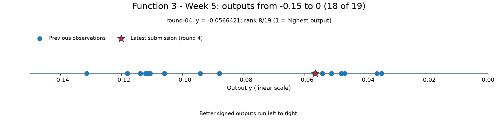
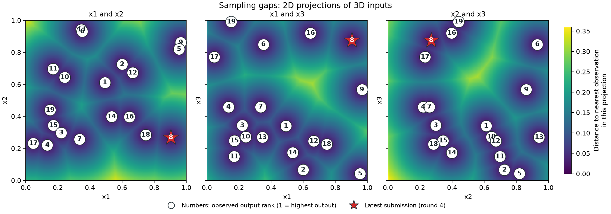
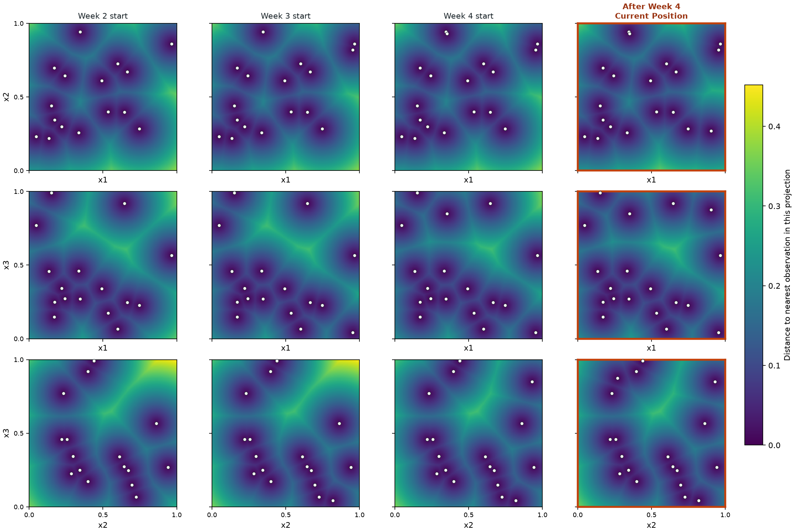
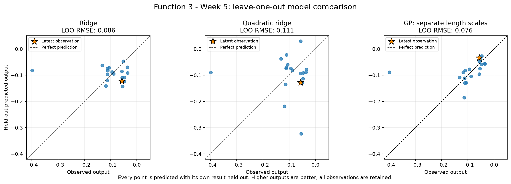
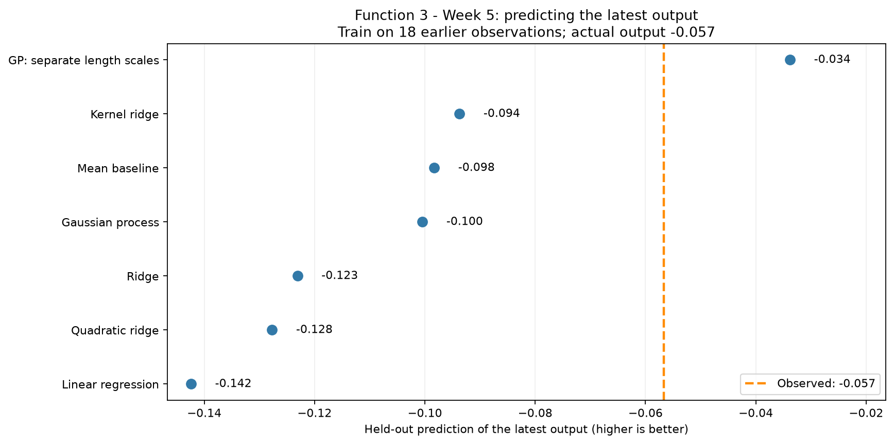
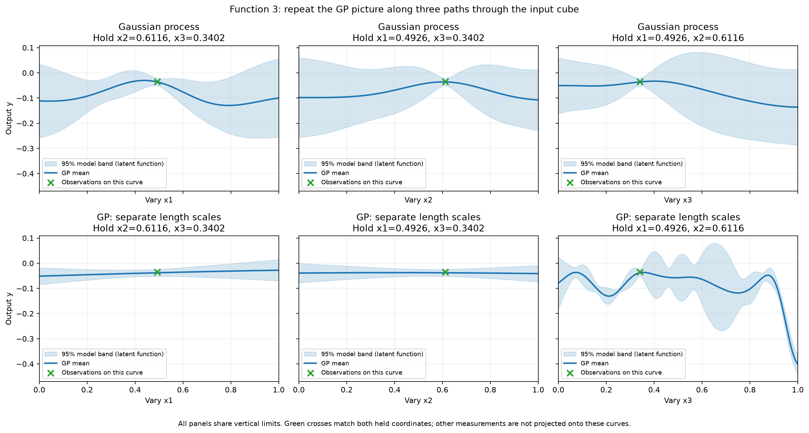
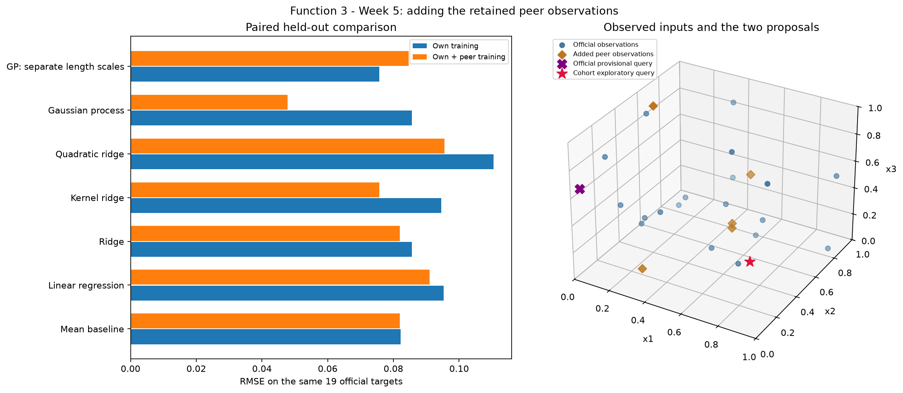

# Function 3 — Week 5 results and cohort comparison

**Analysis snapshot: 23 October 2026.** Official observations include four
returned queries. The cohort comparison adds five accepted peer observations
from the retained 20 October snapshot. This report presents the saved notebook
results and exported figures; both proposed Week 5 inputs remain unevaluated.

## What the results show

The best observed output remains **-0.034835**, from the supplied initial
data. Neither the four official returns nor the five peer additions improves
it. All 24 retained outputs are negative: a less negative score is better.

The official 19-observation comparison favours a Gaussian process (GP) with
separate input length scales, but its RMSE is only **7.9% below the mean
baseline**. Its provisional query is driven by uncertainty rather than a
predicted improvement in the mean.

The cohort evidence changes the preferred explanation. On the **same 19
official held-out targets**, adding the five peer rows reduces the
shared-length-scale GP's RMSE by **44.1%**, while increasing the
separate-length-scale GP's error. The pooled policy consequently favours a
different region, with low x3 and x1 and x2 around 0.6. More observations have
not helped every model equally.

## The problem and the available observations

The [course description in Mini-lesson 12.8](https://classroom.emeritus.org/courses/18642/modules/items/3237303)
uses combinations of three compounds as the application analogy. Side effects
are naturally minimised, but the competition supplies a transformed score to
**maximise**. The precise transformation is not specified, so the negative
scores are not literal counts of adverse reactions and should not be negated
again. Zero has not been established as the function's attainable maximum.

The description, checked on **23 October 2026**, does not state that Function 3
is noisy. No noise-estimation study or noise-sensitivity analysis is included.
The existing GP diagonal regularisation setting is retained as a modelling
assumption, without treating it as a measured property of this function.

| Measure | Official analysis | With retained cohort data |
| --- | ---: | ---: |
| Supplied initial observations | 15 | 15, included once |
| Official returned queries | 4 | 4 |
| Additional peer observations | 0 | 5 |
| Total observations | **19** | **24** |
| Best observed output | **-0.034835** | **-0.034835** |
| Latest official output | -0.056642 | -0.056642 |
| Latest official rank, 1 = highest | 8 of 19 | 10 of 24 |

The latest official input was **(0.903842, 0.268903, 0.875200)**. Its return,
received on **23 October**, is relatively strong within this small sample,
but below the incumbent. Its rank falls in the pooled comparison because
additional observations enter the ranking; its measured value is unchanged.

The two strongest measured combinations are:

| Observation | x1 | x2 | x3 | Measured output |
| --- | ---: | ---: | ---: | ---: |
| initial-004 | 0.492581 | 0.611593 | 0.340176 | **-0.034835** |
| initial-014 | 0.600097 | 0.725136 | 0.066089 | -0.036378 |

Their outputs differ by only **0.001543**, much less than the held-out
prediction errors discussed below. Their fine ranking does not identify a
resolved optimum. The strong latest return at high x3 also cautions against
declaring that low x3 is always preferable: its other two inputs differ.

### Measured outputs and input coverage

*Figure 1. A display-only zoom of the official output number line. Better
signed outputs lie farther right. This window contains 18 of 19 observations;
the lowest observation, approximately -0.398926, remains in every calculation
and in the [full output view](official/figures/output-number-line.png).*

The cohort zoom contains **22 of 24** observations. Both its full and zoomed
views retain the original pooled ranks. Restricting a display does not remove
observations from fitting, validation or candidate selection.

*Figure 2. Each background measures distance within the displayed input pair.
The three panels share a distance colour scale. A small projected gap can
conceal a gap in the omitted third coordinate.*

The [official observed-input cloud](official/figures/observed-input-cloud.html)
and [cohort observed-input cloud](cohort/figures/observed-input-cloud.html)
keep **all three axes as inputs**, using colour for measured output. The gold
diamond identifies the best observed combination. Points are not joined into
an observed surface, since output would require a fourth axis. Drag to rotate,
scroll to zoom and hover for coordinates and outputs.

Plasma colours run from lower outputs in dark purple to higher outputs in
bright yellow. The [official colour-detail view](official/figures/observed-input-cloud-zoom.html)
and [cohort colour-detail view](cohort/figures/observed-input-cloud-zoom.html)
restrict the display to outputs from -0.15 to zero and rescale colours across
the displayed values. Their colours therefore need their own scale when
comparing with the full clouds.

### Completion of the predetermined shortlist

*Figure 3. Rows are input-pair projections; columns follow the saved plan from
the start of Week 2 through the return of the final Week 4 query. All panels
share one projected-distance scale. The outlined final column is the current
position at the start of Week 5.*

All three saved exploration inputs have returned outputs. **No predetermined
Week 5 input remains.** Completing that shortlist does not mean that the
unknown function has been fully explored. The [Week 4 model notebook](../Week_04/model_predictions.ipynb)
remains a historical learning study; the current model comparisons use the
new snapshot through round 4.

Both exploration reviews use only official history in this progression.
Peer round numbers belong to their sources and cannot be inserted into the
owner's earlier information timeline. Their other measured-output and
coverage views use the observations belonging to their respective snapshots.

## How well the models predict existing results

The official comparison predicts each of the **19 observations** using a
model trained on the other 18. This leave-one-out check compares seven
declared alternatives on the original output scale. The mean baseline
predicts the average of its training outputs without using the input location.

### Settings and comparison rule

All three original inputs are retained. They already occupy the same unit
range. Outputs retain their signs and full stored precision, without a log
transform or clipping predictions to zero.

| Setting | Declared value |
| --- | --- |
| Ridge regularisation strength | 1.0 |
| Kernel ridge | RBF kernel; regularisation strength 0.1; kernel coefficient 1.0 |
| Quadratic ridge | Degree 2 polynomial features, feature scaling, ridge strength 1.0 |
| GP covariance | Constant amplitude multiplied by an RBF kernel |
| Initial GP amplitude and bounds | 1.0, between 0.01 and 100.0 |
| Initial GP length scale and bounds | 0.3, between 0.03 and 2.0 |
| GP diagonal variance parameter | 0.01 in normalised target units |
| GP fitting | Three optimiser restarts, seed 42 |

The quadratic model adds three squared inputs and three pairwise interactions
to the original coordinates. Its feature scaling is fitted inside each
training fold. GP target normalisation and kernel fitting also occur inside
each fold. The shared-length-scale GP uses one responsiveness setting for
all inputs; the separate-length-scale GP fits one per coordinate.

The query policy selects the **lowest-RMSE GP** among those two explanations
because it supplies a mean and conditional uncertainty for candidate scoring.
That rule is distinct from choosing the best predictor overall, although the
same model wins both comparisons in this snapshot.

### Official held-out errors

MAE is average absolute prediction error. RMSE places more weight on larger
misses. Both are in original output units, and lower is better.

| Model | Held-out RMSE | Held-out MAE |
| --- | ---: | ---: |
| **GP with separate input length scales** | **0.075703** | **0.037542** |
| Mean baseline | 0.082160 | 0.048173 |
| Ridge | 0.085620 | 0.053200 |
| GP with one shared length scale | 0.085635 | 0.055242 |
| Kernel ridge | 0.094543 | 0.066567 |
| Linear regression | 0.095242 | 0.065211 |
| Quadratic ridge | 0.110504 | 0.079598 |

*Figure 4. Smaller distances from the dashed diagonal indicate smaller
prediction errors. The gold star identifies the latest official return.*

The separate-length-scale GP is the only compared method to beat the mean
baseline on RMSE. Its **7.9% improvement** is modest. The quadratic hypothesis
performs worst on this measure, so fitting a broad curved relationship has
not earned support from these held-out predictions.

### The latest-result check

*Figure 5. The orange line is the measured -0.056642 return. These are
retrospective held-out checks using the current settings, rather than
forecasts recorded before that return arrived.*

The separate-length-scale GP is also closest on this result, predicting
approximately **-0.0338**, an error of about **0.0229**. The latest return
contributes only **0.48%** of its total held-out squared error, so this one
miss does not dominate the overall RMSE. The supplementary error for other
rows omits the latest row from scoring, but their training folds still
contain it.

The dataset is small and adaptively sampled. Model selection reuses these
same folds, making the winning error an optimistic guide to future
performance. There is no independent final test set, and prediction accuracy
does not by itself establish an ability to locate a better maximum.

## What the fitted three-input views mean

*Figure 6. Each column varies one input while holding the other two at the
incumbent's coordinates. The two GP rows share vertical limits. Green crosses
are measurements matching both held coordinates; other observations are not
projected onto the curves.*

The selected model's x1 and x2 length scales both reach their allowed upper
bound of **2.0**, while x3 has a length scale of approximately **0.06085**.
Within this model, the fitted response therefore varies more rapidly along
x3. This does not establish that x1 and x2 are irrelevant. The saved execution
retains the bound warnings; the bounds have not been expanded to obtain a
more favourable comparison.

The shaded bands show the fitted mean plus or minus 1.96 latent-function
standard deviations under the declared assumptions. They describe model
uncertainty and have not been calibrated as 95% coverage of future returns.

The [fitted contour sections](official/figures/fitted-output-contour-slices.png)
compare kernel ridge with the selected GP through the incumbent on shared
output colours. Each panel fixes its stated third coordinate. Blank areas
lie outside the **full three-dimensional sampled hull**, rather than simply
outside a two-input projection.

The [interactive conditional terrains](official/figures/fitted-terrain-slices.html)
repeat those plane sections at seven held-coordinate values from 0.10 to
0.90. Their height and colour represent fitted output. They are model
surfaces, distinct from the measured-input clouds above.

## The saved official proposal

The official policy retains **0.019633-0.050082-0.647040**. Its predicted mean
is **-0.086909**, below the incumbent **-0.034835**. Model SD is **0.085961**,
raising its uncertainty-weighted selection score to **0.081575**. This is
a model-guided exploration proposal, without a predicted mean improvement.

The score adds **1.96 times model SD** to predicted mean, a rule labelled
UCB in the notebooks. A positive selection score is not a prediction of a
positive return or a probability of improvement.

The comparison includes 16,384 seeded broad Sobol samples plus eight corners,
a local sample of 4,096 points plus corners within 0.15 of the incumbent in
each coordinate, and one separately optimised geometric coverage point.
Coordinates are rounded to six decimals before prediction; duplicates and
already observed inputs are removed. This leaves **20,497 candidates**.
All three coordinates remain free throughout the search.

The chosen point maximises the score over that finite pool, rather than over
the entire continuous domain. It lies **outside the sampled 3D hull**. The
[proposal input cloud](official/figures/model-query-input-cloud.html) marks its
location without inventing a measured output. The [conditional acquisition
matrix](official/figures/model-query-proposal-sections.png) passes through the
proposal, with separate mean, SD and UCB columns. Colours are shared down
each column; dotted boundaries identify the hull intersection and coloured
regions beyond them are extrapolations.

Weights **0, 1, 1.96 and 3** select **three distinct inputs**. The two higher
weights agree on the saved proposal, while lower weights favour different
locations. The decision therefore depends on the exploration balance.
Nine weekly query opportunities remain, including Week 5; this allowance
does not increase when peer observations are added.

## What changes with the cohort observations

The pooled snapshot adds **five accepted peer returns from four repositories**,
collected on **20 October 2026**. Shared initial observations are included
once. Copied duplicate reports, unreturned queries and invalid coordinates
remain excluded. Distinct valid inputs with equal reported outputs remain
separate observations. No peer repository was refreshed for this comparison.

These are public self-reports, subject to rounding or transcription errors.
The best observed score remains -0.034835. The additional evidence changes
the fitted explanation and candidate ranking, rather than providing a new
confirmed best result.

### Compare identical official targets

Each official target is predicted twice: first using the other **18 official
rows**, then using those same 18 rows plus **all five peer rows**. The target
values and declared model family are unchanged within each row below.

| Model | Official training: RMSE on 19 official targets | Official + peer training: RMSE on the same targets |
| --- | ---: | ---: |
| Mean baseline | 0.082160 | 0.081956 |
| Linear regression | 0.095242 | 0.091035 |
| Ridge | 0.085620 | 0.081932 |
| Kernel ridge | 0.094543 | 0.075755 |
| Quadratic ridge | 0.110504 | 0.095548 |
| **GP with one shared length scale** | **0.085635** | **0.047850** |
| GP with separate input length scales | 0.075703 | 0.084687 |

*Figure 7. Left: shorter bars are better. Right: all three axes retain
input coordinates, distinguishing official observations, added peer rows
and the two unevaluated queries.*

The shared-length-scale GP's RMSE falls by **44.1%** and its MAE falls from
**0.055242 to 0.038978**. The separate-length-scale GP's RMSE instead rises
by approximately **11.9%**, with MAE rising from **0.037542 to 0.067819**.
The additional evidence supports one explanation while weakening the other.
Small RMSE gains in other models do not always coincide with lower MAE.

When all **24 pooled targets** are scored, the shared-length-scale GP has
RMSE **0.049440**, against its pooled mean baseline of **0.097756**. Those
full-dataset values answer a different question from the official 19-target
comparison. The paired table is the appropriate measure of what changed
when peer data entered training.

The pooled winner does worse on the latest official return: it predicts
about **-0.1094**, against the actual -0.0566. Kernel ridge is closest in the
pooled latest-result check, at about **-0.0841**. An improvement across the
official targets does not imply improvement on every target.

The pooled selected GP uses one fitted length scale of approximately
**0.151**, instead of the official model's separate scales. Both selected
models still retain all three inputs. The [cohort coordinate curves](cohort/figures/gp-coordinate-slices.png),
[contour sections](cohort/figures/fitted-output-contour-slices.png) and
[interactive terrains](cohort/figures/fitted-terrain-slices.html) show this
different explanation of the same domain.

### Compare the two actual proposals

The cohort policy proposes **0.658460-0.558234-0.006012**. Its mean of
**-0.033284** is only **0.001551** above the incumbent, whereas model SD is
**0.065885**. That uncertainty is much larger than the small predicted mean
gain. The UCB score of **0.095850** therefore remains an exploratory selection
score. This point also lies outside the sampled 3D hull.

Applying each selected model to both actual locations gives:

| Location | Model fitted to | Predicted mean | Model SD | Selection score |
| --- | --- | ---: | ---: | ---: |
| Official proposal | 19 official observations | -0.086909 | 0.085961 | 0.081575 |
| Official proposal | 24 pooled observations | -0.099720 | 0.073943 | 0.045208 |
| Cohort alternative | 19 official observations | -0.075118 | 0.044655 | 0.012405 |
| Cohort alternative | 24 pooled observations | -0.033284 | 0.065885 | 0.095850 |

The pooled policy assigns less acquisition value to the original proposal,
and both a higher mean and higher uncertainty to its low-x3 alternative.
Both the training data and the selected GP explanation have changed; the
family-specific paired table above separates their predictive effects more
carefully than a simple comparison of the two winning models.

Both policies retain their respective choices when scored on the **same
20,498 candidates**, including the official coverage alternative and both
proposals. The difference is therefore not solely caused by separately
generated candidate pools.

All four tested weights favour the broad low-x3 region in the pooled fit,
with three distinct locations; weights 1.96 and 3 agree on the displayed
proposal. The [cohort proposal cloud](cohort/figures/model-query-input-cloud.html)
and [conditional score matrix](cohort/figures/model-query-proposal-sections.png)
retain its third coordinate and label the extrapolation.

This evidence supports reviewing the low-x3 alternative, but does not
establish the true optimum or automatically replace the official proposal.
The five peer records remain a frozen, self-reported snapshot, and model
selection reuses the same small adaptive sample. **Neither proposal is
recorded as submitted in these analyses.**

## Evidence and scope

The calculations and exports are retained in the
[official exploration review](official/exploration-review.ipynb),
[official model predictions](official/model_predictions.ipynb),
[cohort exploration review](cohort/exploration-review.ipynb) and
[cohort model predictions](cohort/model_predictions.ipynb). Each folder has
its own local data snapshot, figures and coverage cache. Values here are
rounded for reading; saved calculation outputs retain more precision.

The data and audit files remain local and Git-ignored. Their checksums were
preserved during the folder reorganisation. The [data notes](../../../data/README.md#function-3-week-5-cohort-comparison)
describe reconstruction and exclusions; the [pinned source manifest](../../../side-quests/cohort-2026-10-20/source-manifest.json)
identifies the retained peer repository versions. Later peer changes are
outside this evidence cutoff.

### Course lifecycle coverage

| Step | Treatment in the saved analysis |
| --- | --- |
| 1. Define the goal and scope | Maximise the transformed signed score and compare retained peer evidence with the official snapshot. |
| 2. Gather the data | Use 19 official observations and a separate pooled snapshot with five accepted peer returns. |
| 3. Explore the data | Inspect output ranks, three-input clouds, projected gaps and the completed fixed plan. |
| 4. Clean and preprocess the data | Check bounds, identities and history; preserve signs and precision; fit scaling and normalisation within training folds. |
| 5. Select and engineer features | Retain all three inputs; compare the existing quadratic features and shared or separate GP length scales. |
| 6. Define the machine-learning task | Regress the numerical output to support maximisation. |
| 7. Partition the data | Use leave-one-out checks and identical official targets; no independent final test set is available. |
| 8. Select and train candidate methods | Compare seven declared regressors, including a mean baseline and two GP explanations. |
| 9. Evaluate and interpret the results | Compare errors, latest-return predictions, conditional model views, acquisition scores and the cohort effects. |
| 10. Deploy and iterate | Deployment is not applicable. Both saved proposals remain unevaluated, with no portal action recorded here. |
