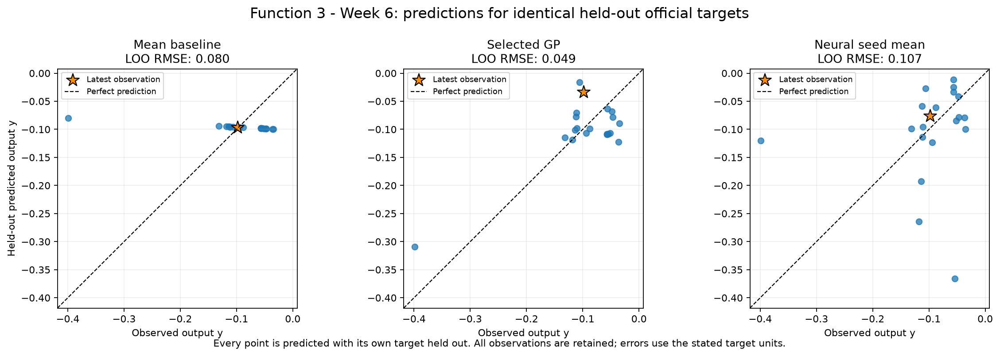
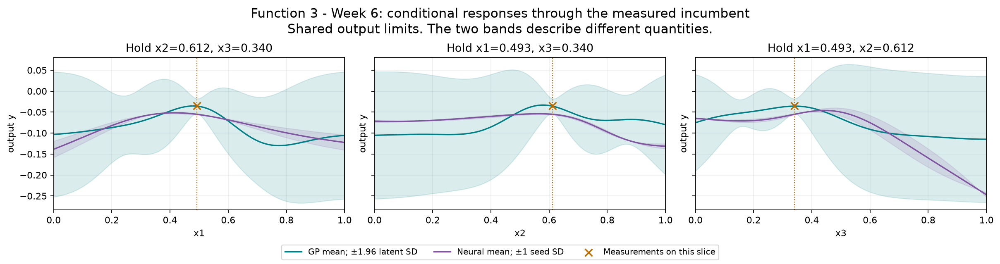
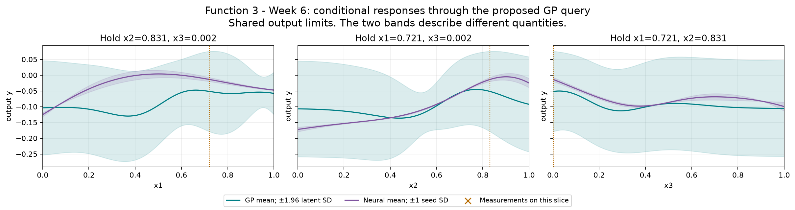
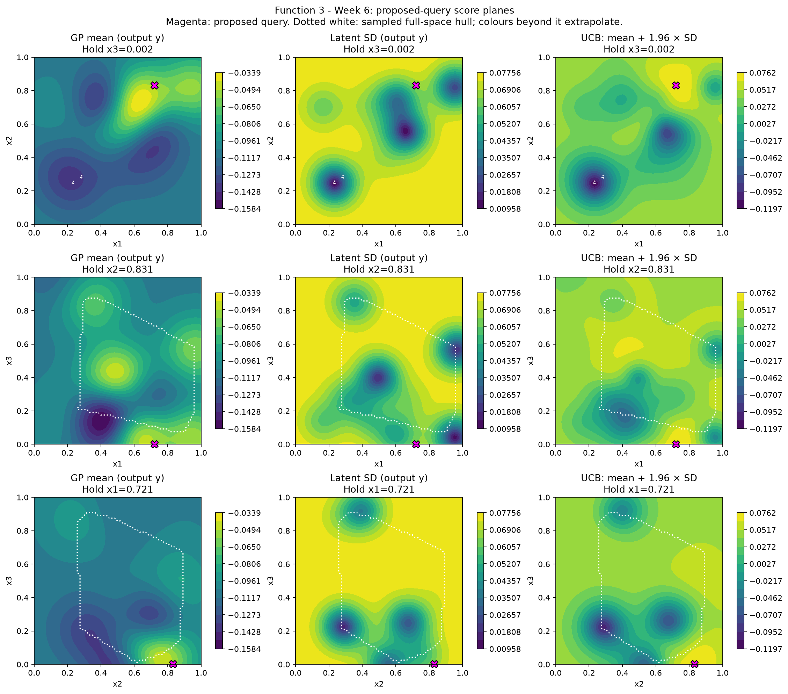

# Function 3 — Week 6 model review

**Submission confirmation, 31 October 2026:** the project owner confirmed submission of the [eight Week 6 inputs](../../../submissions/Week_06/README.md). Results are pending; seven future queries remain per function. The analysis below retains its pre-submission evidence and query budget.

Prepared on **30 October 2026**, using **20 official observations through round 5**.
The provisional query uses **Gaussian process**, fitted to **official plus retained peers**.
Its proposal is **`0.721213-0.830963-0.001845`**. It has not been submitted by this workflow.

**Decision agreed:** keep **`0.721213-0.830963-0.001845`** with uncertainty
weight **1.96**, retaining the caveat that the choice depends on peer training
and that the official-only GP proposes a different region. The prepared third
line already matches. Nothing has been submitted or authorised for submission.

[Executed prediction notebook](official/model_predictions.ipynb) · [Numerical review](official/model-review.json) ·
[Interactive GP/neural input explorer](official/figures/neural-network-explorer.html)

## Evidence and decision

The Week 5 low-x3 query returned -0.0983689, below the previous incumbent and saved model mean. That point remains in every relevant training fold. The quadratic comparator, both GP length-scale explanations and retained peer-training comparison remain available. The new proposal still needs to be assessed as extrapolation if outside the sampled hull. The course description does not specify noisy evaluations for Function 3; GP diagonal regularisation is not presented as measured noise.

The declared selection criterion is **LOO RMSE**, measured in **output y**. Each row below scores the same official held-out targets.
The selected GP's error is **0.610 times the mean baseline**, a **39.0% reduction**.
The neural ensemble is the mean of all three held-out seed predictions for its validation-selected architecture; no best seed is selected.

| Model | Error |
| --- | --- |
| Mean baseline (official only) | 0.07986 |
| Official-only GP: GP: separate length scales | 0.0739004 |
| Selected query GP (official + retained peer training) | 0.0486971 |
| Neural seed ensemble (official only): tanh-16 | 0.106502 |

Official-only GP has the smaller error when both model families train on official observations only. Any selected peer-assisted GP is shown separately because it has additional training evidence. Architecture and GP selection use these validation results, so selected errors are optimistic estimates of future performance. These are predictive checks on adaptively sampled points, not a test of complete optimisation policies or evidence of a global maximum. The GP query policy remains restricted to the declared GPs because neural seed spread is not a posterior uncertainty estimate.

## Provisional query

| Quantity | Value |
| --- | --- |
| Portal input | `0.721213-0.830963-0.001845` |
| Predicted target mean | -0.051737 |
| Latent posterior SD | 0.0649374 |
| UCB, mean + 1.96 × SD | 0.0755404 |
| Mean minus best observed target | -0.0169017 |
| Inside this fit's sampled full-input hull | False |
| Distance to nearest known input | 0.173193 |
| Eligible candidates | 20,495 |
| Query opportunities including Week 6 | 8 |

All output quantities in this table use **output y**. Posterior SD is conditional on the GP kernel and regularisation. UCB is a selection score, not a returned value or a guarantee. The finite pool retains seeded full-space and incumbent-local candidates, corners, six-decimal bounds and known-input exclusions. The geometric comparator is a finite-pool farthest-point proxy, not a fresh continuous minimax search. The notebook shows exploration weights 0, 1, 1.96 and 3 on the same pool.

The neural mean-led alternative is **`0.507760-0.855590-0.009248`**, with predicted target **0.00219223** and seed SD **0.0138581**. This is scored on the same eligible candidates. Its seed SD describes fitted-seed variation and must not be used as GP uncertainty.

## Discussion: Week 6 options and recommendation

The agreed query is **`0.721213-0.830963-0.001845`**, with weight **1.96**.
The caveat about relying on peer data remains part of the decision. The next
input is unsubmitted and no change to the prepared third line is needed.

All official and retained peer outputs are negative. The objective remains to
maximise the given signed score: less negative is better. The transformed
adverse-reaction description does not establish that zero is the attainable
maximum or justify changing to absolute magnitude.

The same selected peer-assisted GP gives these alternatives on the saved
candidate pool. Means and SDs below are fitted outputs, not future returns.

| Policy | Input | GP mean | Conditional latent SD |
| --- | --- | ---: | ---: |
| Highest mean; weight 0 | `0.495233-0.568579-0.295191` | -0.031401 | 0.027406 |
| Weight 1 compromise | `0.706003-0.791240-0.007872` | -0.042846 | 0.056897 |
| Current weight 1.96 | `0.721213-0.830963-0.001845` | -0.051737 | 0.064937 |
| Weight 3 | `0.709584-0.907420-0.029090` | -0.070098 | 0.072106 |

The mean-only point is an interpolation near the incumbent
`(0.492581, 0.611593, 0.340176)`, whose measured score is **-0.034835**.
Its forecasted improvement is only **0.003434**, much smaller than selected
held-out RMSE **0.048697**. It is a defensible local-refinement choice, but
does not offer compelling evidence of a substantial improvement.

The current point accepts a lower fitted mean to explore a different part of
the low-x3 region. It is **0.173193** from its nearest known input and outside
the sampled full-input hull. Its UCB is **0.075540**, a ranking score rather
than a predicted positive return. Weights 1–3 favour a similar broad region;
that agreement is within one fitted explanation and does not validate the
region independently.

Last week's input was `(0.658460, 0.558234, 0.006012)`, returning **-0.098369**.
The current point moves x2 by approximately **+0.273**, x1 by **+0.063** and
x3 by **-0.004**. It is therefore not a near-repeat of that complete input.
Another measured point at `(0.600097, 0.725136, 0.066089)` returned **-0.036378**,
close to the incumbent. These mixed outcomes justify retaining the hypothesis
but do not isolate an x3 effect; all three coordinates matter to the comparison.

The neural proposal is a separate option at
**`0.507760-0.855590-0.009248`**. Its neural mean is **+0.002192**, but two of
the three selected seeds predict negative values and the third predicts
**+0.018194**. The selected GP instead predicts **-0.095846** there. Neural
held-out RMSE **0.106502** is worse than the mean baseline **0.079860** and
both selected GP scopes, so its positive mean does not justify following it.

Discarding peer training and using the selected official-only GP would give
**`0.019633-0.050082-0.647040`** under the same weight. That fit's own predicted
mean is **-0.087157**, with latent SD **0.084393**. This is a distinct global
exploration option, not cross-scope agreement on the low-x3 region. The
peer-assisted shared-length-scale GP has lower declared RMSE (**0.048697**,
versus **0.073900**), but its MAE (**0.039992**) is worse than the official-only
separate-length-scale fit's (**0.035700**). The choice is criterion-dependent;
validation selection and sparse adaptive observations limit confidence.

Retaining the current UCB query is recommended as one measured test of the
low-x3/high-x2 hypothesis, rather than a claim of a positive response or a
known optimum. Its confidence is lower than Function 2's, where both selected
training scopes favour a similar region. No new models or course evaluations
were needed for this comparison.

## Neural exploration

The bounded comparison retains **tanh-8**, **tanh-16** and **ReLU-8-8**, each with seeds **11, 42 and 73**. Maximum training iterations remain 400, with the existing L-BFGS settings and regularisation. Full input and target scalers are fitted only on each fold's training rows.

The offline explorer includes every architecture and seed. Change inputs or the conditional-curve axis, then compare neural means and seed variation with the selected GP's mean and latent SD. Buttons restore the measured incumbent or the provisional GP query. The validation-selected architecture is labelled separately from whichever architecture is displayed. It performs no training or course evaluations.

The selected neural models passed input-gradient checks at the measured incumbent.

## Provenance and limits

Official snapshot SHA-256: `054015a5db41c49533519978a93f4721f5578fedafc1b5661f4621c3eb1e4ff9`. Earlier weekly notebooks, snapshots and submitted queries remain unchanged. The observation notebook preserves the historical Week 5 forecast comparison; this notebook's held-out review is retrospective.

There are **5 retained peer rows** in the optional training comparison. Their source repositories were not refreshed. The local audit retains the pinned source hashes and verifies that official rows are unchanged. Each official target is held out while peer rows are training evidence only. Peer reports do not establish an official incumbent or increase the owner's query budget. The numerical review records both scopes' candidates on the same pool where peer data are available.

The saved official and peer-fit comparisons record **142 fitting warnings** across all folds and full fits, with their exact messages retained in the numerical JSON. These include declared convergence or kernel-bound limits; the analysis did not extend the tuning budget in response. Neural results deserve the same scrutiny as the GP assumptions.

## Course lifecycle

1. **Define the goal and scope** — support the project owner's next one-query-per-function decision; compare predictive evidence and preserve a reviewable provisional input.
2. **Gather the data** — use the confirmed official Week 6 snapshot through round 5 and, for Functions 1–4, the unchanged audited 20 October peer snapshot.
3. **Explore the data** — carry forward the measured review; inspect fitted conditional responses, candidate scores and the interactive explorer.
4. **Clean and preprocess the data** — validate the fixed schema and round counts, bounds, hashes and complete observations. Neural input and target scaling are fitted inside each fold; Function 1 retains its fixed signed-log transform.
5. **Select and engineer features** — preserve ordered inputs and the declared Function 2 projection and Function 3 quadratic comparator; no information unavailable at query time is introduced.
6. **Define the machine-learning task** — numerical regression supports sequential continuous black-box maximisation.
7. **Partition the data** — use leave-one-out checks on identical official targets. No independent final test set is available; adaptive sampling and model selection limit interpretation.
8. **Select and train candidate methods** — refit the declared baseline, regression, GP and nine neural configurations. Compare retained peer training on the same official targets; neural architecture selection averages all seeds.
9. **Evaluate and interpret the results** — compare held-out errors, neural seed sensitivity, GP regularisation and exploration weights, conditional views, exact candidate inputs and extrapolation. Fitted predictions remain distinct from measured returns.
10. **Deploy and iterate** — not applicable to deployment: prepare a provisional next query for review. No portal submission or new course evaluation is performed; eight query opportunities remain including Week 6.

