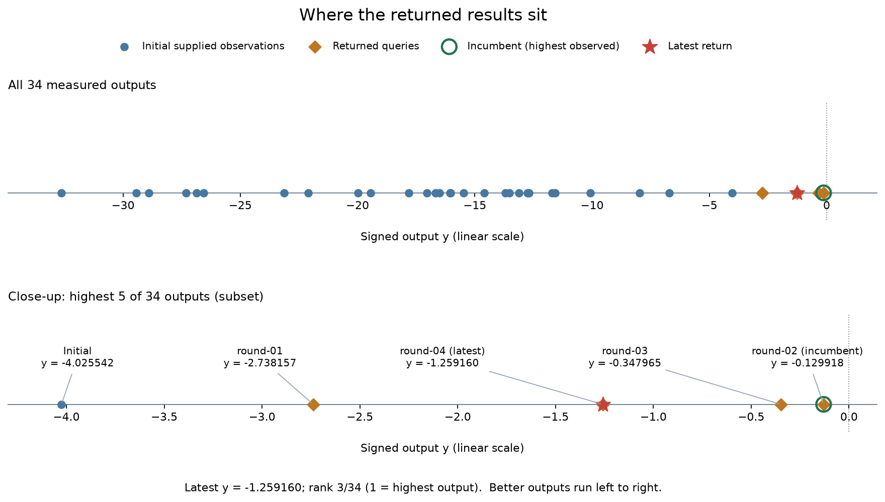
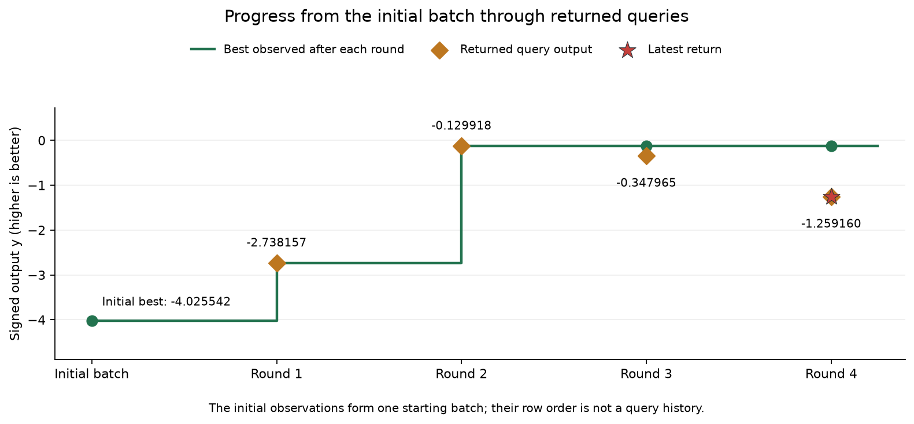
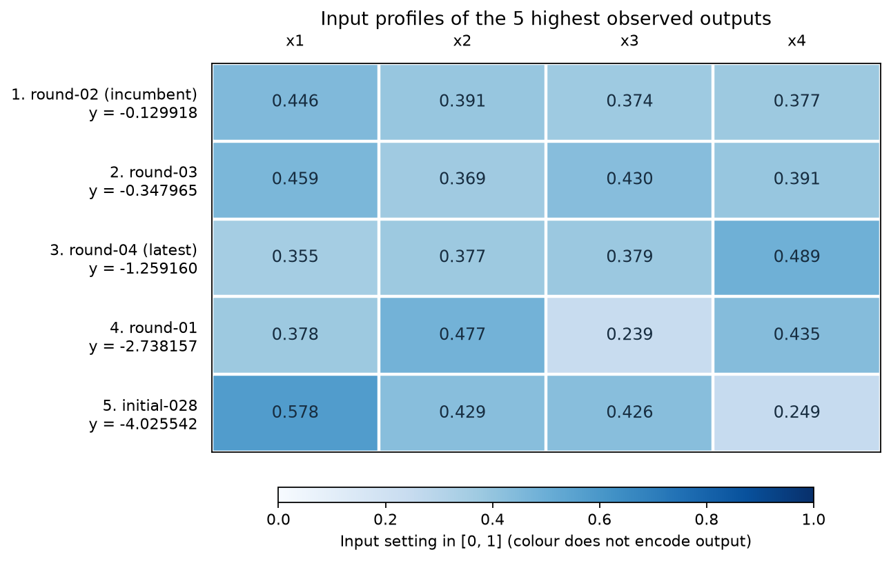
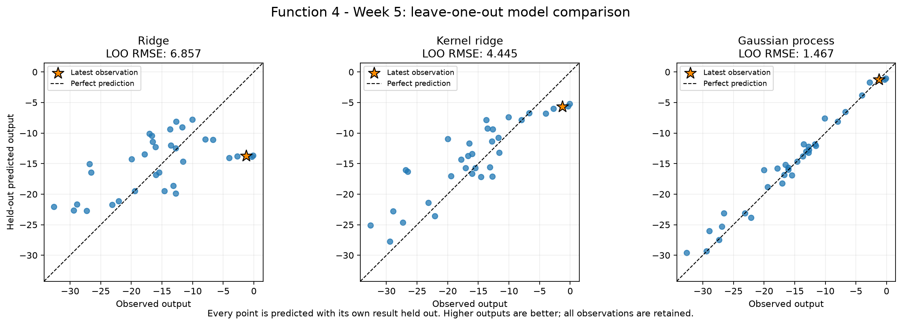
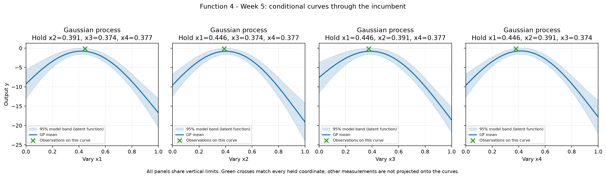
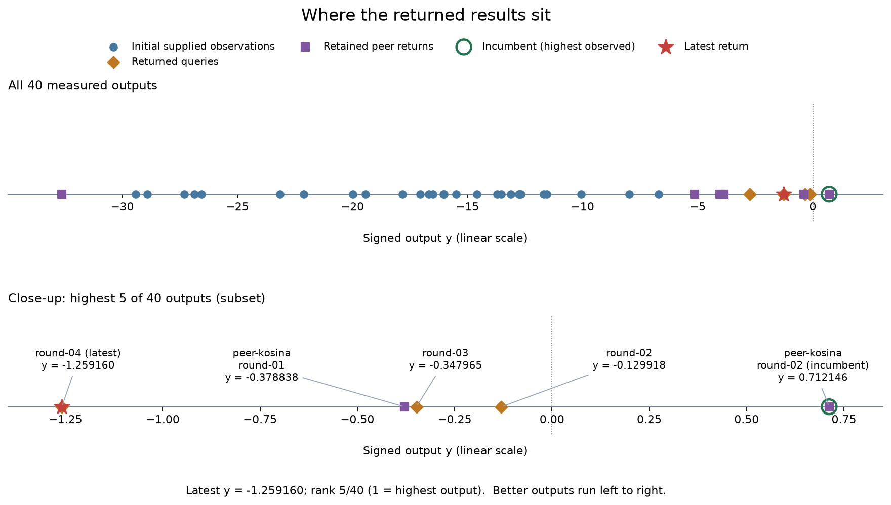
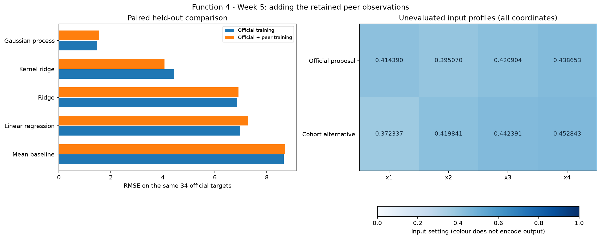

# Function 4 — Week 5 results and cohort comparison

**Submission confirmation, 29 October 2026:** the project owner confirmed
submission of the [eight selected Week 5 inputs](../../../submissions/Week_05/README.md).
Results are pending. Eight future weekly queries remain per function.
The analysis below retains its pre-submission evidence and query budget.

**Selection review, 28 October 2026:** the [prepared Week 5 submission](../../../submissions/Week_05/README.md)
retains the official GP and selects **`0.419096-0.406060-0.408855-0.426466`**,
its already saved winner in the common candidate comparison. That fit has
lower paired RMSE and MAE than the pooled GP; peers raise RMSE from 1.466791
to 1.543057. The selected point's official-model UCB is 0.152263, compared
with 0.139098 at the original official proposal. Its mean remains below the
incumbent. This final review uses the saved comparison without further fitting;
the original proposals and analysis below remain intact. Submission confirmation is recorded above.

**Analysis snapshot: 23 October 2026.** The official data contain 30 initial
observations and four returned queries. A separate cohort snapshot adds six
accepted peer returns collected on 20 October. The Week 5 model studies are
new calculations on these snapshots; their proposed inputs remain unevaluated.

## What the results show

Our best confirmed output remains **-0.129918**, from round 2. Rounds 1 and 2
improved the initial best; rounds 3 and 4 did not. The latest output,
**-1.259160**, is still the third-highest official observation, but is
**1.129242 output units below** our best.

The cohort evidence contains a stronger self-reported result: **0.712146**
at **(0.407459, 0.418058, 0.364200, 0.420348)**. This raises the pooled best
by **0.842064** relative to our official best. It remains a peer report,
rather than an independently confirmed result from our own query history.

The Gaussian process (GP) is the strongest of the five compared prediction
methods. However, adding peer data increases its error on the **same 34
official targets** by **5.2%**. Kernel ridge improves. The new observations
therefore expand the evidence around promising inputs without producing a
uniform improvement in prediction.

## The problem and the available evidence

The [Function 4 description in Mini-lesson 12.8](https://classroom.emeritus.org/courses/18642/modules/items/3237303)
uses four hyperparameters of a warehouse-model approximation as its analogy.
Its score compares with an expensive baseline, and the description highlights
a dynamic system and local optima. The competition objective is to maximise
the signed output. A smaller absolute value is not the objective, and zero
has not been established as an upper bound.

The description does not state that this function is noisy, so no
noise-estimation study or noise-sensitivity analysis is included. The existing
GP diagonal regularisation setting is retained as a modelling assumption.

| Measure | Official analysis | With retained cohort data |
| --- | ---: | ---: |
| Supplied initial observations | 30 | 30, included once |
| Official returned queries | 4 | 4 |
| Additional peer returns | 0 | 6 |
| Total observations | **34** | **40** |
| Best observed output in that snapshot | **-0.129918** | **0.712146**, peer-reported |
| Latest official output | -1.259160 | -1.259160 |
| Latest official rank, 1 = highest | 3 of 34 | 5 of 40 |

The latest official input was **(0.354513, 0.376712, 0.378960, 0.488593)**,
with its return received on **23 October 2026**. Its lower numerical rank in
the pooled view comes from adding stronger peer observations; its measured
value has not changed.

### Where the measured outputs sit

*Figure 1. The top panel retains all 34 observations. The lower panel is an
explicit highest-five subset. The green outline marks the best observation
and the red star marks the latest return. Better outputs lie farther right.*

All four returned official queries exceed the initial best and occupy the
four highest official ranks. This is a useful improvement over the starting
batch. The later points were chosen using previous evidence, however, so
their output distribution does not describe a random sample of the domain.

### Progress through the official rounds

*Figure 2. The initial observations form one starting batch. Their row order
is not a sequence of optimisation decisions. Peer returns are excluded from
this historical timeline in both versions of the observation review.*

| Stage | Returned output | Best after stage | Return minus previous best |
| --- | ---: | ---: | ---: |
| Initial batch | — | -4.025542 | — |
| Round 1 | -2.738157 | -2.738157 | +1.287385 |
| Round 2 | -0.129918 | -0.129918 | +2.608239 |
| Round 3 | -0.347965 | -0.129918 | -0.218047 |
| Round 4 | -1.259160 | -0.129918 | -1.129242 |

The confirmed best has improved by **3.895624 output units** over the initial
batch. The two more recent returns have not improved it. That is a reason
to review the local fit and query selection, without claiming a plateau or
that an optimum has been reached.

### Keep the complete input combinations visible

*Figure 3. Colour represents the input setting on a fixed zero-to-one scale;
it does not encode output quality or an estimated input effect.*

The four official returns have x4 between **0.377372 and 0.488593**, yet all
beat the initial best, whose x4 is approximately **0.249007**. The initial
low-x4 pattern should therefore remain a description of the starting sample,
rather than a restriction on future candidates. Several coordinates changed
together, so these combinations do not isolate any individual effect.

Round 2 is both the best official result before round 4 and its nearest
earlier official input. Their distance using **all four coordinates** is
**0.144479**. The latest input changes x1 from 0.445520 to 0.354513 and x4
from 0.377372 to 0.488593, with smaller changes to the other coordinates.
Geometric closeness alone neither predicts the output difference nor accounts
for different input relevance.

### A forecast recorded before the return

The [saved Week 4 model notebook](../Week_04/model_predictions.ipynb) forecast
**-1.242050** at the actual submitted coordinates. The returned **-1.259160**
is **0.017110 lower**. The observation reviews read that saved forecast and
check that its coordinates match the submitted input; they do not reconstruct
it using later observations.

The current official GP's held-out prediction for this row is also about
-1.2420. It uses the same preceding 33 observations and declared settings,
so these are not two independent confirmations. The historical forecast is
a useful prospective check, while one small error does not establish general
calibration or the location of the maximum.

## How well the models predict

The new official study compares the same **five model families** as Week 4:
mean baseline, ordinary linear regression, ridge, kernel ridge and a GP with
one shared RBF length scale. It predicts each of the 34 observations from
the other 33 using leave-one-out validation.

All four inputs retain their original order and unit range. Outputs retain
their signs and stored precision. GP target normalisation and kernel fitting
take place within each training fold. The five families and settings were
declared before comparing their errors.

| Setting | Declared value |
| --- | --- |
| Ridge regularisation strength | 1.0 |
| Kernel ridge | RBF kernel; regularisation strength 0.1; kernel coefficient 1.0 |
| GP covariance | Constant amplitude multiplied by an RBF kernel |
| Initial GP amplitude and bounds | 1.0, between 0.01 and 100.0 |
| Initial GP length scale and bounds | 0.3, between 0.03 and 2.0 |
| GP diagonal variance parameter | 0.01 in normalised target units |
| GP fitting | Three optimiser restarts, seed 42 |

### Official held-out errors

MAE is average absolute prediction error; RMSE gives more weight to large
misses. Both use original output units, and lower is better.

| Model | Held-out RMSE | Held-out MAE |
| --- | ---: | ---: |
| **Gaussian process** | **1.466791** | **0.988323** |
| Kernel ridge | 4.444830 | 3.532399 |
| Ridge | 6.856622 | 5.641139 |
| Linear regression | 6.979268 | 5.878846 |
| Mean baseline | 8.654269 | 6.737888 |

*Figure 4. Points closer to the dashed diagonal have smaller prediction
errors. The gold star marks the latest official return.*

The GP's RMSE is **83.1% below the mean baseline**, with a GP-to-baseline
error ratio of **0.1695**. That is strong relative predictive support among
these methods. Nevertheless, an error of about 1.47 output units is large
beside the differences between the strongest measured combinations. A good
global comparison does not resolve their fine ranking or guarantee a better
maximum.

The [latest-result comparison](official/figures/latest-output-predictions.png)
shows the GP close to the actual return, while kernel ridge predicts about
**-5.6554** and the other methods are farther away. These current held-out
checks remain retrospective, distinct from the saved forecast discussed above.
Errors for the other rows exclude the latest row from scoring only; their
training folds still include it.

The observations are small in number and adaptively sampled, and the same
folds are reused to compare models. There is no independent final test set.
The query policy uses the GP's mean and conditional uncertainty; here the GP
also has the lowest held-out error across the compared regressors.

### Conditional curves through the incumbent

*Figure 5. All panels share vertical limits. Green crosses are measured
observations matching every held coordinate; measurements elsewhere are not
projected onto the curves. The band is the fitted mean plus or minus 1.96
latent-function standard deviations under the model assumptions.*

The official fitted length scale is approximately **0.7101**, within the
declared bounds. The curves describe a broad promising region near the
strongest measured settings. These are four paths through a four-input
model, rather than four independently fitted input effects. They do not
establish the full interaction structure, and the bands have not been
calibrated as 95% coverage of future returns.

## The new official Week 5 proposal

The official calculation records **0.414390-0.395070-0.420904-0.438653**.
Its predicted mean is **-0.756502**, below the official best **-0.129918**.
Model SD of **0.456939** raises its selection score to **0.139098**. This is
an exploratory proposal; the mean alone does not predict an improvement.

The selection score, labelled UCB in the notebooks, adds **1.96 times model
SD** to predicted mean. It is neither a returned score nor a probability
of improvement. The proposal is inside the sampled four-dimensional hull,
which describes geometric support without guaranteeing an accurate prediction.

The search compares 16,384 seeded broad Sobol samples plus 16 corners,
4,096 local samples plus corners within 0.15 of the measured incumbent in
each coordinate, and one independently optimised geometric coverage point.
All coordinates are rounded to six decimals before prediction. Removing
duplicates and already measured inputs leaves **20,513 candidates** in each
version. All four coordinates remain free.

The official point comes from the local candidate pool. Weights **0, 1,
1.96 and 3** produce **three distinct locations**; weights 1 and 1.96 agree
on the recorded point. This is the best of a finite candidate comparison,
without a claim of a continuous optimum. Nine weekly query opportunities
remain, including Week 5, and no submission is made by these analyses.

## What changes with the cohort observations

The pooled snapshot contains **40 observations**, adding six accepted returns
from four repositories in the retained **20 October** study. The previous
33 official rows were matched exactly to the current official history through
round 3 before adding the new round 4 return. The six retained peer rows were
preserved, and the four pinned source-file checksums were verified locally.
No peer repository was refreshed.

Shared initial observations are included once. Copied duplicate reports,
pending outputs and invalid coordinates remain excluded. Equal reported
outputs at distinct valid inputs remain separate observations. Source-file
verification establishes which published reports were used; it does not
independently verify the function evaluations themselves.

### A stronger reported observation

*Figure 6. Purple squares are retained peer returns. The highest reported
output is 0.712146 from peer-kosina-round-02. The red star remains our latest
official return, now ranked fifth. Peer round numbers are source labels.*

The peer-reported best uses **(0.407459, 0.418058, 0.364200, 0.420348)**.
It is the only positive observation in the pooled snapshot and exceeds our
official best by **0.842064**. It supplies evidence worth examining in this
region, without becoming an achievement in our own official progress log.

The [pooled strongest-input profiles](cohort/figures/strongest-input-profiles.png)
keep all four settings visible. The pooled observation review deliberately
uses the unchanged official timeline for progress and historical forecast
checks. Adding peer data does not retrospectively alter what our earlier
queries had established or increase our query allowance.

### Compare the same official targets

For every official target, the comparison first trains on the other **33
official rows**, then on those same rows plus **all six peer observations**.
This keeps target values and model families unchanged.

| Model | Official training: RMSE on 34 official targets | Official + peer training: RMSE on the same targets |
| --- | ---: | ---: |
| Mean baseline | 8.654269 | 8.698072 |
| Linear regression | 6.979268 | 7.282012 |
| Ridge | 6.856622 | 6.906622 |
| Kernel ridge | 4.444830 | **4.066917** |
| Gaussian process | **1.466791** | 1.543057 |

*Figure 7. Left: shorter bars indicate smaller errors. Right: exact proposed
input settings, with colour representing the setting rather than output.
No input coordinate is omitted from the comparison.*

The GP remains strongest among these methods, but its paired RMSE is **5.2%
higher** after peer data enter training. Its MAE rises from **0.988323 to
1.122493**. Kernel ridge improves its RMSE by **8.5%**, from **4.444830 to
4.066917**. The remaining methods have slightly higher paired RMSE.

The pooled GP's RMSE across **all 40 targets** is **1.488783**, against a
pooled mean baseline of **9.578550**. Those values describe a different target
set from the official comparison. The higher percentage reduction against
that pooled baseline does not mean that adding peers improved prediction
on the original targets; the paired table shows otherwise.

On the latest official target, the pooled GP predicts about **-0.7861**,
farther from the actual -1.2592 than the official model's prediction. The
fitted pooled length scale is approximately **0.6717**. The [cohort conditional
curves](cohort/figures/gp-coordinate-slices.png) pass through the peer-reported
incumbent, whereas the official curves pass through round 2. Their different
anchors matter when comparing their shapes.

### Compare both fits at the actual proposals

The cohort policy records **0.372337-0.419841-0.442391-0.452843**, also from
its local pool and inside the pooled four-dimensional hull. Applying both
models to each actual location gives:

| Location | Model fitted to | Predicted mean | Model SD | Selection score |
| --- | --- | ---: | ---: | ---: |
| Official proposal | 34 official observations | -0.756502 | 0.456939 | 0.139098 |
| Official proposal | 40 pooled observations | -0.475331 | 0.446141 | 0.399105 |
| Cohort alternative | 34 official observations | -1.026177 | 0.552686 | 0.057088 |
| Cohort alternative | 40 pooled observations | -0.708365 | 0.571328 | 0.411437 |

The pooled fit raises the predicted mean at the official proposal with little
change in SD. It still assigns a slightly higher selection score to its own
alternative, mostly because the latter retains more uncertainty. The pooled
score difference between these two points is only **0.012332**.

The cohort alternative's mean of **-0.708365** is well below the reported
best **0.712146**; even its selection score of **0.411437** is lower. The
highest pooled predicted mean among tested candidates is **-0.407497**.
This smooth fitted model does not predict a mean matching the strongest
reported return in the searched pool. That discrepancy deserves attention
when using the fit to compare nearby high-scoring combinations.

### Separate the data effect from the search effect

The controlled comparison scores the same **20,514 locations** with both
fits: the frozen pooled candidate set, the official coverage alternative
and both actual proposals, excluding all measured pooled inputs.

The pooled GP still selects its recorded alternative. The official GP instead
prefers **(0.419096, 0.406060, 0.408855, 0.426466)**, a location from the pooled
candidate search. Its mean is **-0.689570**, SD **0.429507** and selection
score **0.152263**, slightly above the recorded official proposal's 0.139098.
The exact six-decimal official preference therefore also depends on which
local candidates were compared. This check is a common comparison set,
not an exhaustive union of both original local pools or a continuous search.

Both fits still favour the same broad neighbourhood. The exact points should
be read as provisional search results rather than sharply resolved optima.
The pooled weight check likewise produces three distinct locations: weights
0 and 1 agree, while 1.96 and 3 favour different, more uncertain points.

The retained peer evidence changes the best available report and the fitted
predictions, while weakening the GP's paired prediction check. It supports
reviewing the region and how the model represents the strongest outcomes;
it does not automatically establish that the cohort alternative should
replace the official proposal. **Neither Week 5 proposal is recorded as
submitted here.**

## Evidence and scope

The calculations and exported charts are retained in the
[official observation review](official/observation_review.ipynb),
[official model predictions](official/model_predictions.ipynb),
[cohort observation review](cohort/observation_review.ipynb) and
[cohort model predictions](cohort/model_predictions.ipynb). Each folder has
its own observations, figures and local coverage cache. The earlier official
CSV and three measured-output figures were preserved exactly during this
reorganisation. Values in the report are rounded for reading.

Raw data and the detailed local audit remain Git-ignored. The [data notes](../../../data/README.md#function-4-week-5-cohort-comparison)
describe reconstruction and exclusions; the [retained cohort audit](../../../side-quests/cohort-2026-10-20/dataset-audit.json)
and [source manifest](../../../side-quests/cohort-2026-10-20/source-manifest.json)
record the earlier accepted reports and pinned source versions. Later peer
repository changes are outside this evidence cutoff.

### Course lifecycle coverage

| Step | Treatment in the saved analysis |
| --- | --- |
| 1. Define the goal and scope | Maximise Function 4's signed score and compare the retained cohort evidence with the official record. |
| 2. Gather the data | Use 34 official observations and a separate 40-row snapshot with six accepted peer returns. |
| 3. Explore the data | Inspect measured outputs, official progress, full input profiles and distances using every coordinate. |
| 4. Clean and preprocess the data | Validate bounds, IDs and historical agreement; preserve precision and signs; fit GP normalisation within each fold. |
| 5. Select and engineer features | Retain all four original input coordinates; introduce no new engineered features. |
| 6. Define the machine-learning task | Regress the numerical output to support sequential maximisation. |
| 7. Partition the data | Use leave-one-out checks and identical official targets; no independent final test set is available. |
| 8. Select and train candidate methods | Compare the five established model families using the declared settings. |
| 9. Evaluate and interpret the results | Compare errors, the saved historical forecast, conditional curves, candidate scores and cohort effects. |
| 10. Deploy and iterate | Deployment is not applicable to this report. Both Week 5 proposals remain unevaluated; no portal submission is performed. |
