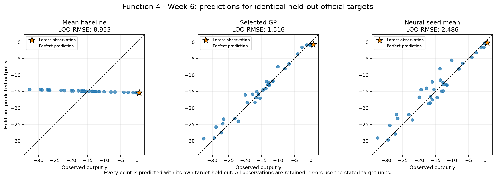
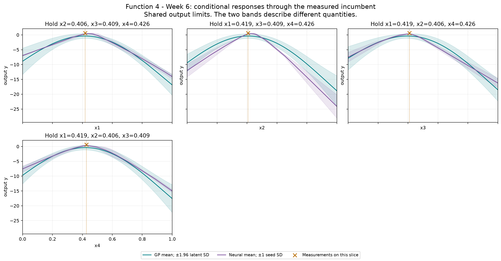
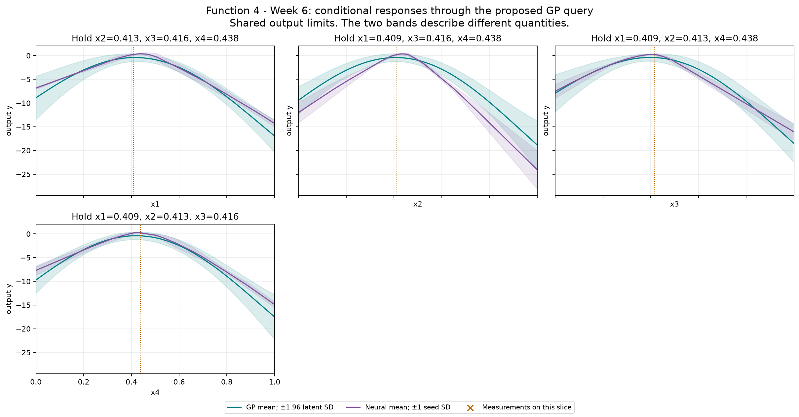

# Function 4 — Week 6 model review

**Submission confirmation, 31 October 2026:** the project owner confirmed submission of the [eight Week 6 inputs](../../../submissions/Week_06/README.md). Results are pending; seven future queries remain per function. The analysis below retains its pre-submission evidence and query budget.

Prepared on **30 October 2026**, using **35 official observations through round 5**.
The provisional query uses **Gaussian process**, fitted to **official**.
Its proposal is **`0.408963-0.412546-0.416464-0.438393`**. It has not been submitted by this workflow.

**Decision agreed:** keep **`0.408963-0.412546-0.416464-0.438393`** with
weight **1.96**, recording that the GP underpredicts the already measured
positive incumbent. The point is a small local test guided by candidate
ranking, not a demonstrated predicted improvement or calibrated local forecast.
The prepared fourth line already matches; nothing has been submitted.

[Executed prediction notebook](official/model_predictions.ipynb) · [Numerical review](official/model-review.json) ·
[Interactive GP/neural input explorer](official/figures/neural-network-explorer.html)

## Evidence and decision

The latest return, 0.6501304054949952, is the first positive official observation and the new measured incumbent. The candidate pool therefore centres its local component on this confirmed input. Retained peers are tested on the same official targets, while official progress remains based on confirmed owner evaluations. The course description does not specify noisy evaluations; no noise level is inferred from the existing regularisation setting.

The declared selection criterion is **LOO RMSE**, measured in **output y**. Each row below scores the same official held-out targets.
The selected GP's error is **0.169 times the mean baseline**, a **83.1% reduction**.
The neural ensemble is the mean of all three held-out seed predictions for its validation-selected architecture; no best seed is selected.

| Model | Error |
| --- | --- |
| Mean baseline (official only) | 8.95281 |
| Official-only GP: Gaussian process | 1.51557 |
| Neural seed ensemble (official only): relu-8-8 | 2.48624 |

Official-only GP has the smaller error when both model families train on official observations only. Any selected peer-assisted GP is shown separately because it has additional training evidence. Architecture and GP selection use these validation results, so selected errors are optimistic estimates of future performance. These are predictive checks on adaptively sampled points, not a test of complete optimisation policies or evidence of a global maximum. The GP query policy remains restricted to the declared GPs because neural seed spread is not a posterior uncertainty estimate.

## Provisional query

| Quantity | Value |
| --- | --- |
| Portal input | `0.408963-0.412546-0.416464-0.438393` |
| Predicted target mean | -0.408796 |
| Latent posterior SD | 0.421992 |
| UCB, mean + 1.96 × SD | 0.418308 |
| Mean minus best observed target | -1.05893 |
| Inside this fit's sampled full-input hull | True |
| Distance to nearest known input | 0.0185714 |
| Eligible candidates | 20,512 |
| Query opportunities including Week 6 | 8 |

All output quantities in this table use **output y**. Posterior SD is conditional on the GP kernel and regularisation. UCB is a selection score, not a returned value or a guarantee. The finite pool retains seeded full-space and incumbent-local candidates, corners, six-decimal bounds and known-input exclusions. The geometric comparator is a finite-pool farthest-point proxy, not a fresh continuous minimax search. The notebook shows exploration weights 0, 1, 1.96 and 3 on the same pool.

The neural mean-led alternative is **`0.451528-0.411139-0.399846-0.451750`**, with predicted target **0.395117** and seed SD **0.390893**. This is scored on the same eligible candidates. Its seed SD describes fitted-seed variation and must not be used as GP uncertainty.

## Discussion: refine the newly successful neighbourhood

The agreed query is **`0.408963-0.412546-0.416464-0.438393`**, with
weight **1.96**. This is a small local step from the new
official incumbent, rather than a renewed global exploration query.

The measured incumbent is **0.650130** at
`(0.419096, 0.406060, 0.408855, 0.426466)`. The recommended step changes the
coordinates by approximately `(-0.010133, +0.006486, +0.007609, +0.011927)`;
its full-input distance is **0.018571**. It stays inside the official sampled
hull. No new evaluation has been obtained for it.

The same tested candidate wins on the saved finite pool at weights **0, 1
and 1.96**. This supports a local-refinement interpretation without relying on
the precise uncertainty multiplier. It does not establish a continuous optimum
between candidate inputs or robustness to changed model assumptions.

| Candidate | Input | Selected official GP mean | GP latent SD | Neural seed mean |
| --- | --- | ---: | ---: | ---: |
| Recommended local step | `0.408963-0.412546-0.416464-0.438393` | -0.408796 | 0.421992 | 0.229631 |
| Wider local step; official weight 3 | `0.372732-0.416315-0.443160-0.432391` | -0.600865 | 0.517408 | -0.236996 |
| Neural mean proposal | `0.451528-0.411139-0.399846-0.451750` | -0.505819 | 0.396423 | 0.395117 |

The wider step is **0.058879** from the incumbent and is also the peer-assisted
GP's proposed point at weight 1.96. The neural step is **0.042404** away.
Both are plausible nearby alternatives, but neither has sufficient comparative
evidence to replace the smaller official-GP step this week. Official-only GP
held-out RMSE is **1.515566**, versus **1.562677** with peer training and
**2.486238** for the neural ensemble. Those global errors do not separately
validate decisions near the maximum. The neural proposal's three seed forecasts
are **-0.041287, +0.513513 and +0.713126**, so its positive mean masks substantial
fit variation; seed spread is not posterior uncertainty.

**The GP's absolute forecast near the peak deserves caution.** At the already
measured incumbent it predicts **-0.371831**, despite the actual **+0.650130**.
At the proposed point, even its UCB **0.418308** is below the measured best.
The model smooths the data under its declared diagonal regularisation, which
has not been established as a measured noise level. The comparison therefore
does not demonstrate a predicted improvement or calibrated local uncertainty.

The recommendation rests on investigating the newly successful neighbourhood,
using the better-validated model's finite-pool ranking to choose a small step.
It does not establish that the observed point is a maximum, that the next
return will be positive, or that its exact forecast is reliable. No additional
models were fitted for this discussion; the existing model exports and
observations were reused. The point and weight are agreed; submission remains on hold.

## Neural exploration

The bounded comparison retains **tanh-8**, **tanh-16** and **ReLU-8-8**, each with seeds **11, 42 and 73**. Maximum training iterations remain 400, with the existing L-BFGS settings and regularisation. Full input and target scalers are fitted only on each fold's training rows.

The offline explorer includes every architecture and seed. Change inputs or the conditional-curve axis, then compare neural means and seed variation with the selected GP's mean and latent SD. Buttons restore the measured incumbent or the provisional GP query. The validation-selected architecture is labelled separately from whichever architecture is displayed. It performs no training or course evaluations.

The selected neural models passed input-gradient checks at the measured incumbent.

## Provenance and limits

Official snapshot SHA-256: `c1371934c3ae51051bcc6a664a8c02c028fcfb7c3c270bfb596e83d6cda2e38d`. Earlier weekly notebooks, snapshots and submitted queries remain unchanged. The observation notebook preserves the historical Week 5 forecast comparison; this notebook's held-out review is retrospective.

There are **6 retained peer rows** in the optional training comparison. Their source repositories were not refreshed. The local audit retains the pinned source hashes and verifies that official rows are unchanged. Each official target is held out while peer rows are training evidence only. Peer reports do not establish an official incumbent or increase the owner's query budget. The numerical review records both scopes' candidates on the same pool where peer data are available.

The saved official and peer-fit comparisons record **147 fitting warnings** across all folds and full fits, with their exact messages retained in the numerical JSON. These include declared convergence or kernel-bound limits; the analysis did not extend the tuning budget in response. Neural results deserve the same scrutiny as the GP assumptions.

## Course lifecycle

1. **Define the goal and scope** — support the project owner's next one-query-per-function decision; compare predictive evidence and preserve a reviewable provisional input.
2. **Gather the data** — use the confirmed official Week 6 snapshot through round 5 and, for Functions 1–4, the unchanged audited 20 October peer snapshot.
3. **Explore the data** — carry forward the measured review; inspect fitted conditional responses, candidate scores and the interactive explorer.
4. **Clean and preprocess the data** — validate the fixed schema and round counts, bounds, hashes and complete observations. Neural input and target scaling are fitted inside each fold; Function 1 retains its fixed signed-log transform.
5. **Select and engineer features** — preserve ordered inputs and the declared Function 2 projection and Function 3 quadratic comparator; no information unavailable at query time is introduced.
6. **Define the machine-learning task** — numerical regression supports sequential continuous black-box maximisation.
7. **Partition the data** — use leave-one-out checks on identical official targets. No independent final test set is available; adaptive sampling and model selection limit interpretation.
8. **Select and train candidate methods** — refit the declared baseline, regression, GP and nine neural configurations. Compare retained peer training on the same official targets; neural architecture selection averages all seeds.
9. **Evaluate and interpret the results** — compare held-out errors, neural seed sensitivity, GP regularisation and exploration weights, conditional views, exact candidate inputs and extrapolation. Fitted predictions remain distinct from measured returns.
10. **Deploy and iterate** — not applicable to deployment: prepare a provisional next query for review. No portal submission or new course evaluation is performed; eight query opportunities remain including Week 6.

