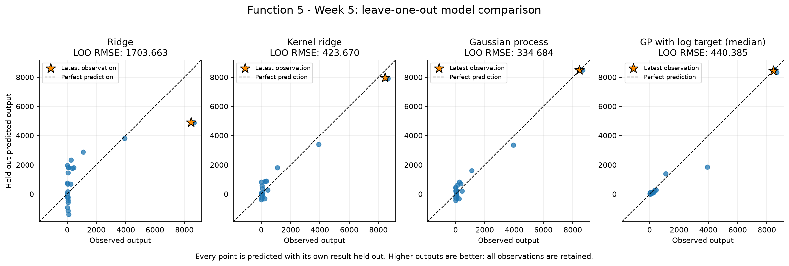
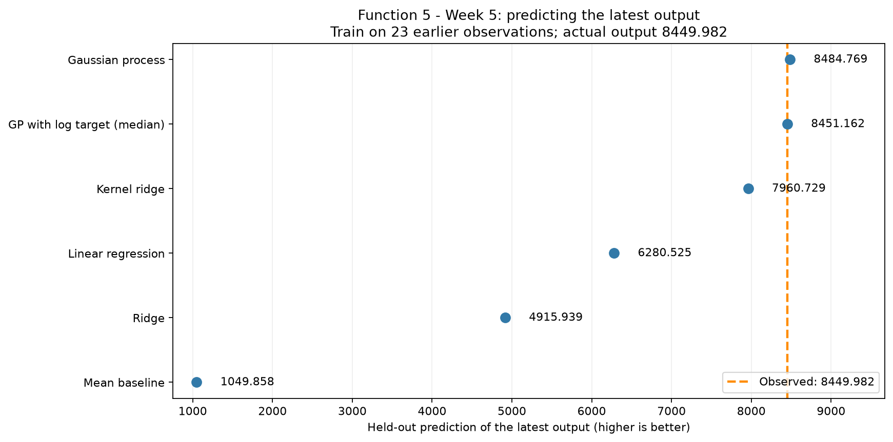
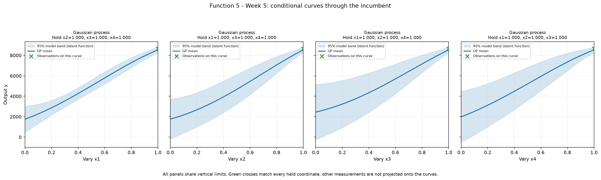

# Function 5 — Week 5 model review and selected query

**Submission confirmation, 29 October 2026:** the project owner confirmed
submission of the [eight selected Week 5 inputs](../../../submissions/Week_05/README.md).
Results are pending. Eight future weekly queries remain per function.
The analysis below retains its pre-submission evidence and query budget.

**Analysis date: 28 October 2026.** The independent official snapshot contains
**24 observations** through the round 4 return received
on 23 October. All 4 original input coordinates are retained.
The [observation review](observation_review.ipynb) records the measured results;
the [executed model notebook](model_predictions.ipynb) records the calculations.

## Selected input

**`0.999999-0.999999-0.999999-0.979636`** is included in the
[eight-function submission](../../../submissions/Week_05/README.md).
Submission was confirmed on 29 October 2026; results are pending.
Eight future query opportunities remain per function.

Retain raw-output GP selection, including the log-target comparator. Apply an explicit 0.02 minimum Euclidean input distance to avoid a near-repeat after two non-improving corner refinements; test x4 while retaining the other three upper-bound settings.

The official incumbent is **8662.405001**. At the exact
six-decimal input above, the raw-output GP predicts **8431.759823**
with posterior SD **169.622719**. Its UCB selection score is
**8764.220351**, using predicted mean plus 1.96 times SD.
The predicted mean is below the incumbent. The input is outside the sampled
full-dimensional hull, so the prediction involves extrapolation.

## Held-out model evidence

Each estimator, including kernel optimisation and target transformation where
used, is fitted separately inside every leave-one-out fold. Every observation
is scored once in the original output units; there is no independent final test
set in this small, adaptively sampled history. The declared comparison criterion
is RMSE, with MAE retained to show sensitivity to large errors.

| Model | LOO RMSE | LOO MAE |
| --- | --- | --- |
| Gaussian process | 334.683703 | 280.611217 |
| Kernel ridge | 423.669511 | 339.969505 |
| GP with log target (median) | 440.384778 | 155.753967 |
| Linear regression | 1655.140374 | 1420.533068 |
| Ridge | 1703.662708 | 1325.450254 |
| Mean baseline | 2951.314710 | 2098.999919 |

The GP has the lowest RMSE among the methods tested, **88.7%**
below the mean baseline. Its fitted kernel is `1.33**2 * RBF(length_scale=0.949)`.
This prediction check supports retaining the model, without establishing the
location of the global maximum or the calibration of its uncertainty.

The GP's latest-result held-out prediction is **8484.768502**;
its signed error is **34.786128**. This is a retrospective
leave-one-out calculation under the current settings. The separate observation
review checks the actual saved Week 4 forecast against the returned value.

## Candidate search and sensitivity

The search compares 16,384 seeded broad Sobol samples and all allowed extreme
corners, 4,096 local samples and corners within a clipped radius of 0.15 per
coordinate around the incumbent, and one independently optimised geometric
coverage point. Inputs are rounded to six decimals before prediction; duplicates
and already measured inputs at that precision are removed. Every coordinate
remains free. The seed, sample sizes, kernel bounds, three optimiser restarts
and GP diagonal regularisation are declared in the notebook's settings cell.

The unconstrained search chose a point only **0.000057** from the already
measured all-upper-bound input. That would make the next scarce query an almost
identical repeat after two nearby refinements failed to improve the incumbent.
The selection therefore adds a **0.02 minimum Euclidean distance** from every
measured input, on the original unit-scale coordinates. This is an explicit
budget safeguard, not an estimated correlation length or an optimised threshold.
The selected input is **0.020363** from its nearest measured neighbour and changes
x4 while leaving x1–x3 at the upper limit. This tests a direction that the earlier
four returned queries, all with x3 = x4 = 0.999999, did not vary.

The same frozen scores give the following spacing comparison; no model is
refitted to choose the threshold:

| Minimum distance | Selected input | UCB |
| --- | --- | --- |
| 0.0 | `0.999999-0.999999-0.999942-0.999999` | 8857.647679 |
| 0.01 | `0.999999-0.999999-0.999999-0.989835` | 8808.562362 |
| 0.02 | `0.999999-0.999999-0.999999-0.979636` | 8764.220351 |
| 0.05 | `0.999999-0.999999-0.999999-0.949598` | 8657.096067 |

The raw-output GP wins on RMSE (334.683703 versus 440.384778 for the log-target
GP), while the log-target GP wins on MAE (155.753967 versus 280.611217).
Back-transformed log predictions are medians in original units. Keeping the
raw-output query model follows the established RMSE criterion and retains its
original-scale uncertainty calculation. The metric disagreement remains a limit.

The final comparison retains **20,059 eligible inputs**;
the selected route is **near incumbent**. The maximum is
over this finite comparison, rather than a proven continuous optimum.
Weights **0, 1, 1.96 and 3** choose **one input**.
The four weights agree after applying the separate spacing rule.

The notebook also refits the same GP at diagonal fractions **0.03, 0.10 and 0.30**
and predicts this same chosen input. These conditional regularisation checks
do not estimate repeat-evaluation noise and do not reselect the query.

Each curve varies one coordinate while holding every other coordinate at the
incumbent. The shaded band is model uncertainty in that conditional section;
measurements at other held-coordinate settings are not projected onto the curve.

## Course lifecycle

| Step | Application in this review |
| --- | --- |
| 1. Define the goal and scope | Choose one next input for the learner's ongoing sequential maximisation task. |
| 2. Gather the data | Use the independent official snapshot through round 4; gather no new peer evidence. |
| 3. Explore the data | Carry forward the measured-output ranks, round progress and full-input profiles from the observation review. |
| 4. Clean and preprocess the data | Validate finite values, dimensions, round counts and bounds; fit model normalisation and any target transformation inside folds. |
| 5. Select and engineer features | Retain all original coordinates; introduce no additional features. |
| 6. Define the machine-learning task | Regress continuous outputs to support sequential maximisation. |
| 7. Partition the data | Hold out each observation once; an independent final test set is not available. |
| 8. Select and train candidate methods | Compare the established mean, linear, ridge, kernel-ridge and GP methods; Function 5 also compares a log-target GP. |
| 9. Evaluate and interpret the results | Review RMSE, MAE, conditional curves, candidate alternatives and sensitivity before selecting an input. |
| 10. Deploy and iterate | Deployment is not applicable to this notebook, which prepares an experiment. Portal submission is confirmed; evaluation and iteration await the next return. |

The [submission record](../../../submissions/Week_05/proposals.json)
preserves source hashes and validation evidence. Original observations and
earlier weekly analyses are unchanged. No hidden course function was evaluated.
