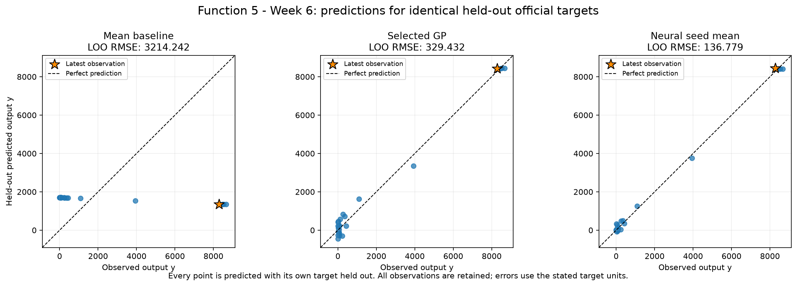
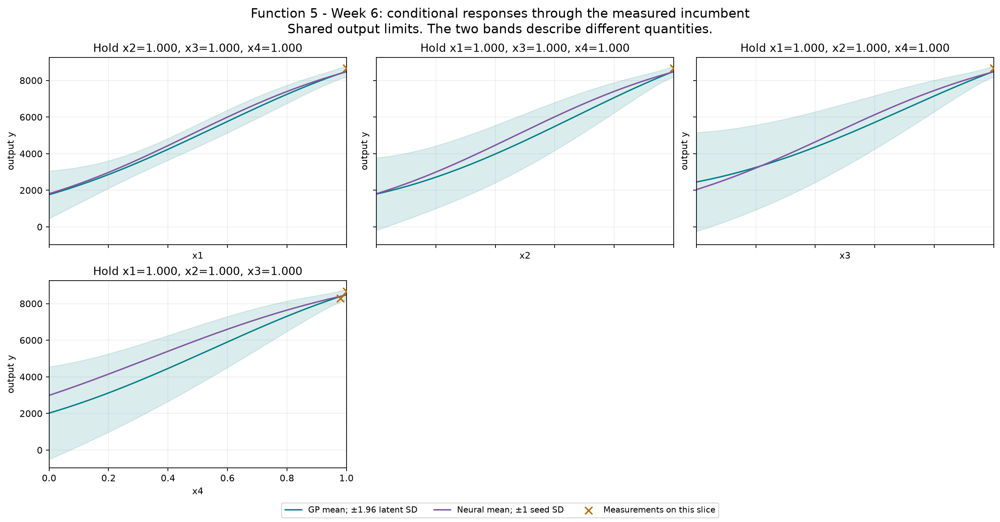
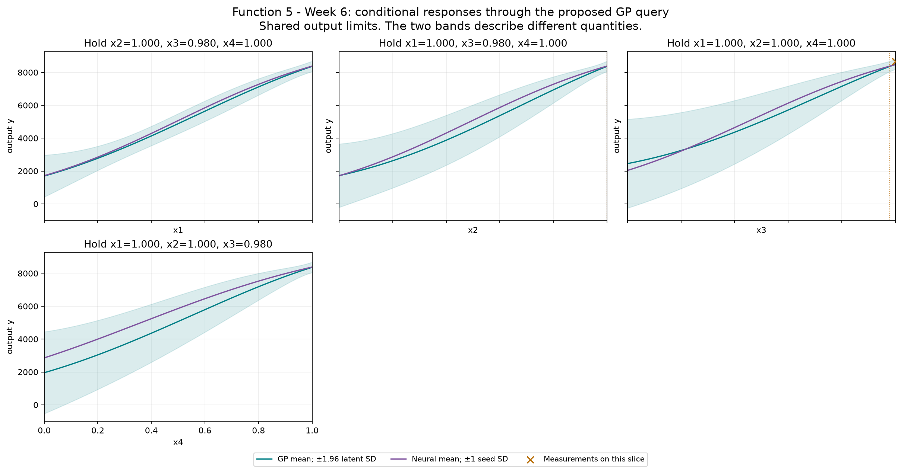

# Function 5 — Week 6 model review

**Submission confirmation, 31 October 2026:** the project owner confirmed submission of the [eight Week 6 inputs](../../../submissions/Week_06/README.md). Results are pending; seven future queries remain per function. The analysis below retains its pre-submission evidence and query budget.

Prepared on **30 October 2026**, using **25 official observations through round 5**.
The provisional query uses **Gaussian process**, fitted to **official**.
Its proposal is **`0.999999-0.999999-0.979593-0.999999`**. It has not been submitted by this workflow.

**Decision agreed:** the one-off exploration query is
**`0.000000-0.000000-0.999999-0.999999`**, for one information-seeking query,
with the low-return expectation, unfinished local x3 test and unproven optimum
recorded as caveats. The original model predictions below remain unchanged.
The prepared fifth line already matches; nothing has been submitted.
See the [prepared selection review](../../../submissions/Week_06/README.md).

[Executed prediction notebook](model_predictions.ipynb) · [Numerical review](model-review.json) ·
[Interactive GP/neural input explorer](figures/neural-network-explorer.html)

## Evidence and decision

The round 2 upper-corner incumbent remains 8662.405001248297 after three lower nearby returns. Retain the existing 0.02 minimum full-input distance and show its 0, 0.01, 0.02 and 0.05 sensitivity table. The log-target GP comparator returns back-transformed medians in raw output units; the raw-output GP retains the declared acquisition role. The neural ensemble has substantially lower held-out RMSE here and deserves further attention. That predictive gain alone does not supply a calibrated uncertainty model or prove a global boundary maximum.

The declared selection criterion is **LOO RMSE**, measured in **output y**. Each row below scores the same official held-out targets.
The selected GP's error is **0.102 times the mean baseline**, a **89.8% reduction**.
The neural ensemble is the mean of all three held-out seed predictions for its validation-selected architecture; no best seed is selected.

| Model | Error |
| --- | --- |
| Mean baseline (official only) | 3214.24 |
| Official-only GP: Gaussian process | 329.432 |
| Neural seed ensemble (official only): tanh-16 | 136.779 |

Neural seed ensemble has the smaller error when both model families train on official observations only. Any selected peer-assisted GP is shown separately because it has additional training evidence. Architecture and GP selection use these validation results, so selected errors are optimistic estimates of future performance. These are predictive checks on adaptively sampled points, not a test of complete optimisation policies or evidence of a global maximum. The GP query policy remains restricted to the declared GPs because neural seed spread is not a posterior uncertainty estimate.

## Provisional query

| Quantity | Value |
| --- | --- |
| Portal input | `0.999999-0.999999-0.979593-0.999999` |
| Predicted target mean | 8366.4 |
| Latent posterior SD | 161.44 |
| UCB, mean + 1.96 × SD | 8682.82 |
| Mean minus best observed target | -296.003 |
| Inside this fit's sampled full-input hull | False |
| Distance to nearest known input | 0.020406 |
| Eligible candidates | 20,010 |
| Query opportunities including Week 6 | 8 |

All output quantities in this table use **output y**. Posterior SD is conditional on the GP kernel and regularisation. UCB is a selection score, not a returned value or a guarantee. The finite pool retains seeded full-space and incumbent-local candidates, corners, six-decimal bounds and known-input exclusions. The geometric comparator is a finite-pool farthest-point proxy, not a fresh continuous minimax search. The notebook shows exploration weights 0, 1, 1.96 and 3 on the same pool.

The neural mean-led alternative is **`0.999999-0.999999-0.979593-0.999999`**, with predicted target **8381.79** and seed SD **0.168621**. This is scored on the same eligible candidates. Its seed SD describes fitted-seed variation and must not be used as GP uncertainty.

## Discussion: one exploration query, with refinement still available

The agreed decision is to pause local refinement for **one query** at
**`0.000000-0.000000-0.999999-0.999999`**. The confirmed best stays
**8662.405001**; three subsequent nearby returns were **8525.753289**,
**8449.982375** and **8283.828104**. That supports a pause without proving
even a non-improvable local maximum.

The strongest refinement alternative remains
**`0.999999-0.999999-0.979593-0.999999`**, selected by both the GP-UCB rule
and neural mean rule. Their predicted means, **8366.402** and **8381.790**,
are below the incumbent. The neural model has materially lower held-out RMSE
(**136.779**, versus **329.432**), but that improvement does not change this
candidate. Prediction errors are not calibrated uncertainty at a new point.

Importantly, **an isolated near-incumbent x3 reduction has not been tested**.
Rounds 3 and 4 changed x1 and x2 together; round 5 reduced x4 alone. The
original model proposal would test x3. This is a meaningful alternative if
the next query prioritises finishing local checks. The course's typical
unimodality description also does not support assuming another peak exists.

The exploration point keeps x3 and x4 high while moving x1 and x2 to an
under-sampled boundary face. It is **0.731397** from its nearest observation.
Maximum GP latent SD outside the incumbent's local box and the finite-pool
coverage rule choose the same point. The selection is stable across the
recorded Sobol seeds and pool sizes; this is model/search sensitivity, not
independent evidence of a hidden high-yield region.

Both models forecast a low result there: GP mean **-685.995**, with latent
SD **1583.200**, and neural mean **-13.515**. These are extrapolated model
predictions, not measured yields. This query prioritises uncertainty and
coverage directly; **the 1.96 UCB weight does not select it**. It could simply
confirm low yield and has not been shown to maximise downstream optimisation
benefit. The purpose is to check an inadequately sampled part of the current
response explanation while retaining the banked incumbent.

This agreement commits one exploration query; later decisions remain open.
No prepared input is changed by this discussion,
no new model is fitted, and nothing is submitted. The global-maximum and
local-x3 questions remain open.

## Neural exploration

The bounded comparison retains **tanh-8**, **tanh-16** and **ReLU-8-8**, each with seeds **11, 42 and 73**. Maximum training iterations remain 400, with the existing L-BFGS settings and regularisation. Full input and target scalers are fitted only on each fold's training rows.

The offline explorer includes every architecture and seed. Change inputs or the conditional-curve axis, then compare neural means and seed variation with the selected GP's mean and latent SD. Buttons restore the measured incumbent or the provisional GP query. The validation-selected architecture is labelled separately from whichever architecture is displayed. It performs no training or course evaluations.

The selected neural models passed input-gradient checks at the measured incumbent.

## Provenance and limits

Official snapshot SHA-256: `548341fae720aea8687a5ba6f3c271134b654b34f0854d8f682ed0ea6946565c`. Earlier weekly notebooks, snapshots and submitted queries remain unchanged. The observation notebook preserves the historical Week 5 forecast comparison; this notebook's held-out review is retrospective.

There are **0 retained peer rows** in the optional training comparison. Their source repositories were not refreshed. The local audit retains the pinned source hashes and verifies that official rows are unchanged. Each official target is held out while peer rows are training evidence only. Peer reports do not establish an official incumbent or increase the owner's query budget. The numerical review records both scopes' candidates on the same pool where peer data are available.

The saved official and peer-fit comparisons record **0 fitting warnings** across all folds and full fits, with their exact messages retained in the numerical JSON. These include declared convergence or kernel-bound limits; the analysis did not extend the tuning budget in response. Neural results deserve the same scrutiny as the GP assumptions.

## Course lifecycle

1. **Define the goal and scope** — support the project owner's next one-query-per-function decision; compare predictive evidence and preserve a reviewable provisional input.
2. **Gather the data** — use the confirmed official Week 6 snapshot through round 5 and, for Functions 1–4, the unchanged audited 20 October peer snapshot.
3. **Explore the data** — carry forward the measured review; inspect fitted conditional responses, candidate scores and the interactive explorer.
4. **Clean and preprocess the data** — validate the fixed schema and round counts, bounds, hashes and complete observations. Neural input and target scaling are fitted inside each fold; Function 1 retains its fixed signed-log transform.
5. **Select and engineer features** — preserve ordered inputs and the declared Function 2 projection and Function 3 quadratic comparator; no information unavailable at query time is introduced.
6. **Define the machine-learning task** — numerical regression supports sequential continuous black-box maximisation.
7. **Partition the data** — use leave-one-out checks on identical official targets. No independent final test set is available; adaptive sampling and model selection limit interpretation.
8. **Select and train candidate methods** — refit the declared baseline, regression, GP and nine neural configurations. Compare retained peer training on the same official targets; neural architecture selection averages all seeds.
9. **Evaluate and interpret the results** — compare held-out errors, neural seed sensitivity, GP regularisation and exploration weights, conditional views, exact candidate inputs and extrapolation. Fitted predictions remain distinct from measured returns.
10. **Deploy and iterate** — not applicable to deployment: prepare a provisional next query for review. No portal submission or new course evaluation is performed; eight query opportunities remain including Week 6.

