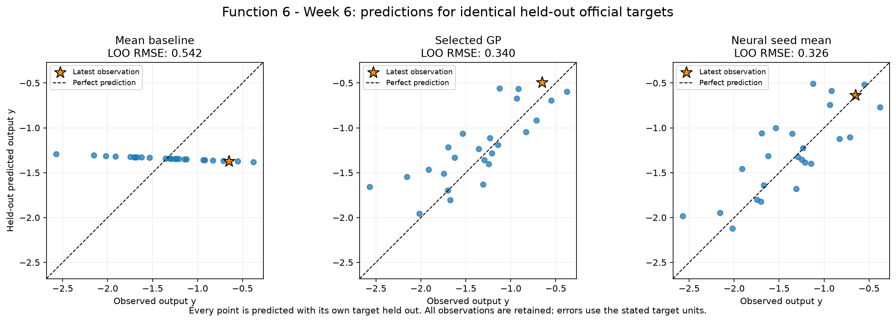
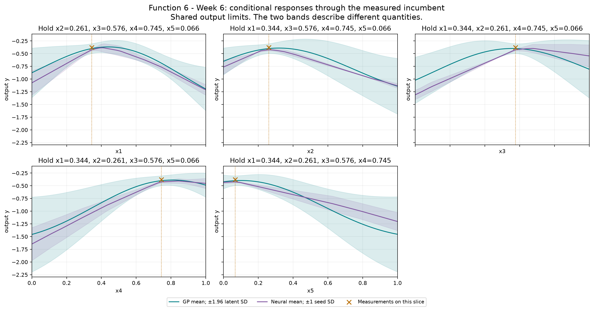
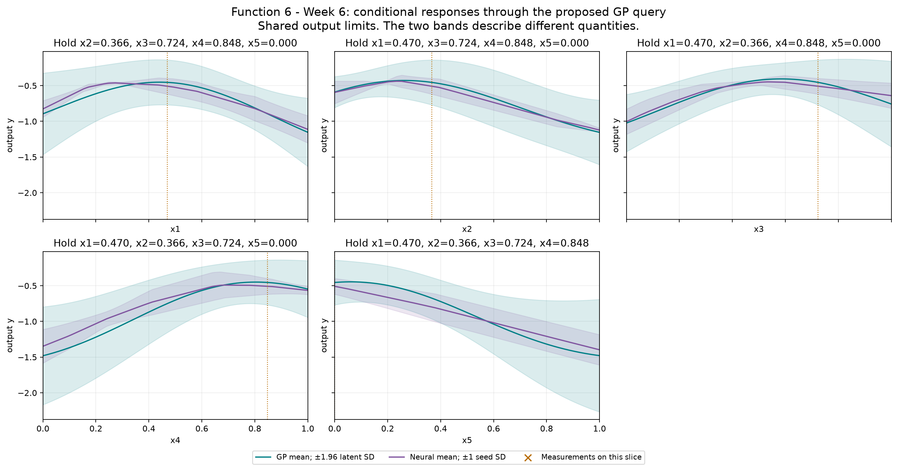

# Function 6 — Week 6 model review

**Submission confirmation, 31 October 2026:** the project owner confirmed submission of the [eight Week 6 inputs](../../../submissions/Week_06/README.md). Results are pending; seven future queries remain per function. The analysis below retains its pre-submission evidence and query budget.

Prepared on **30 October 2026**, using **25 official observations through round 5**.
The provisional query uses **Gaussian process**, fitted to **official**.
Its proposal is **`0.470286-0.366388-0.723696-0.848362-0.000000`**. It has not been submitted by this workflow.

**Decision agreed:** use the saved
neural ensemble candidate **`0.398303-0.269220-0.627336-0.768441-0.000000`**
for one focused neural-led test, retaining the caveats below. The prepared sixth line already
contains it. The original GP model evidence below remains unchanged. See the
[selection review](../../../submissions/Week_06/README.md). Nothing has been submitted.

[Executed prediction notebook](model_predictions.ipynb) · [Numerical review](model-review.json) ·
[Interactive GP/neural input explorer](figures/neural-network-explorer.html)

## Evidence and decision

The latest exploratory return remains below the round 1 incumbent. The neural ensemble's held-out RMSE is slightly lower than the GP's, so its prediction surfaces and mean-led alternative are useful evidence. The difference is small on 25 adaptive observations and is not an independent policy comparison. Retain the GP uncertainty-aware proposal as the declared review policy while keeping this neural comparison visible.

The declared selection criterion is **LOO RMSE**, measured in **output y**. Each row below scores the same official held-out targets.
The selected GP's error is **0.627 times the mean baseline**, a **37.3% reduction**.
The neural ensemble is the mean of all three held-out seed predictions for its validation-selected architecture; no best seed is selected.

| Model | Error |
| --- | --- |
| Mean baseline (official only) | 0.541677 |
| Official-only GP: Gaussian process | 0.339648 |
| Neural seed ensemble (official only): relu-8-8 | 0.326054 |

Neural seed ensemble has the smaller error when both model families train on official observations only. Any selected peer-assisted GP is shown separately because it has additional training evidence. Architecture and GP selection use these validation results, so selected errors are optimistic estimates of future performance. These are predictive checks on adaptively sampled points, not a test of complete optimisation policies or evidence of a global maximum. The GP query policy remains restricted to the declared GPs because neural seed spread is not a posterior uncertainty estimate.

## Provisional query

| Quantity | Value |
| --- | --- |
| Portal input | `0.470286-0.366388-0.723696-0.848362-0.000000` |
| Predicted target mean | -0.454159 |
| Latent posterior SD | 0.160542 |
| UCB, mean + 1.96 × SD | -0.139496 |
| Mean minus best observed target | -0.0754677 |
| Inside this fit's sampled full-input hull | False |
| Distance to nearest known input | 0.252766 |
| Eligible candidates | 20,543 |
| Query opportunities including Week 6 | 8 |

All output quantities in this table use **output y**. Posterior SD is conditional on the GP kernel and regularisation. UCB is a selection score, not a returned value or a guarantee. The finite pool retains seeded full-space and incumbent-local candidates, corners, six-decimal bounds and known-input exclusions. The geometric comparator is a finite-pool farthest-point proxy, not a fresh continuous minimax search. The notebook shows exploration weights 0, 1, 1.96 and 3 on the same pool.

The neural mean-led alternative is **`0.398303-0.269220-0.627336-0.768441-0.000000`**, with predicted target **-0.363497** and seed SD **0.0752542**. This is scored on the same eligible candidates. Its seed SD describes fitted-seed variation and must not be used as GP uncertainty.

## Discussion: one focused neural candidate, with a GP cross-check

The agreed query is **`0.398303-0.269220-0.627336-0.768441-0.000000`**,
the mean-led candidate of the selected ReLU-8-8 ensemble using all three
declared seeds. It is **0.102747** from the incumbent input. Four subsequent
returns have failed to improve that incumbent's **-0.378691** score, so a
focused near-incumbent test is worth considering alongside further exploration.

The principal alternatives use the same saved eligible pool. The table scores
each input with both fitted model families; all values are predictions in
output units, not new measurements.

| Candidate | Input | GP mean | Neural seed mean | GP latent SD |
| --- | --- | ---: | ---: | ---: |
| Agreed neural point | `0.398303-0.269220-0.627336-0.768441-0.000000` | -0.394068 | -0.363497 | 0.081577 |
| GP mean-only point | `0.440478-0.300403-0.565546-0.790678-0.101469` | -0.347673 | -0.449379 | 0.065261 |
| Original GP-UCB point; weight 1.96 | `0.470286-0.366388-0.723696-0.848362-0.000000` | -0.454159 | -0.507858 | 0.160542 |

Both model families prefer the recommended point's mean to the original
GP-UCB point's mean, and all three neural seeds rank it above both GP
alternatives. The GP itself still prefers its separate mean-only point;
there is no unique cross-model optimum. The GP mean-only point stays inside
the sampled hull, making it a credible local-refinement alternative.

The neural ensemble's held-out RMSE **0.326054** is approximately **4%** lower
than the GP's **0.339648**; MAE is **0.261343** versus **0.266970**. This is
modest evidence on 25 adaptive observations. Two individual neural seeds have
higher RMSE than the GP, and the ensemble has worse RMSE on the five weekly
targets (**0.359079**, versus **0.327887**). These reuse the same retrospective
LOO predictions; they are not independent forward tests of the query policies.

The neural forecast improves on the incumbent by only **0.015194**, much
smaller than held-out error. Its three seed forecasts are **-0.448362,
-0.304887 and -0.337243**: only two exceed the incumbent. At that input the GP
mean **-0.394068** remains below the incumbent. Neither the tiny proposed gain
nor the seed SD **0.075254** supplies confidence in an improvement.

The point sets x5 to zero and lies outside the full-input sampled hull. It
also changes the other four coordinates; its result cannot isolate x5's effect.
It accepts less GP uncertainty/coverage gain than the original UCB candidate
to test a plausible mean-led direction. **The 1.96 UCB multiplier does not
select the neural point**; it remains a comparison setting for the original GP
policy. Neural seed variation is not posterior uncertainty.

This is agreed as one candidate-level trial, without treating the neural
model as a general replacement for Bayesian optimisation. No new fits or
course evaluations were needed for the discussion. The prepared sixth input
is unchanged and submission remains on hold.

## Neural exploration

The bounded comparison retains **tanh-8**, **tanh-16** and **ReLU-8-8**, each with seeds **11, 42 and 73**. Maximum training iterations remain 400, with the existing L-BFGS settings and regularisation. Full input and target scalers are fitted only on each fold's training rows.

The offline explorer includes every architecture and seed. Change inputs or the conditional-curve axis, then compare neural means and seed variation with the selected GP's mean and latent SD. Buttons restore the measured incumbent or the provisional GP query. The validation-selected architecture is labelled separately from whichever architecture is displayed. It performs no training or course evaluations.

1 selected neural seed fit(s) put a ReLU activation near zero at the incumbent. Their anchor gradient checks are flagged; backpropagation is instead verified at a fixed nearby smooth probe. No validated derivative is claimed at the kink.

## Provenance and limits

Official snapshot SHA-256: `a8993a0d51afc688212122ef893e336610068f8443449334e955601fc144c091`. Earlier weekly notebooks, snapshots and submitted queries remain unchanged. The observation notebook preserves the historical Week 5 forecast comparison; this notebook's held-out review is retrospective.

There are **0 retained peer rows** in the optional training comparison. Their source repositories were not refreshed. The local audit retains the pinned source hashes and verifies that official rows are unchanged. Each official target is held out while peer rows are training evidence only. Peer reports do not establish an official incumbent or increase the owner's query budget. The numerical review records both scopes' candidates on the same pool where peer data are available.

The saved official and peer-fit comparisons record **92 fitting warnings** across all folds and full fits, with their exact messages retained in the numerical JSON. These include declared convergence or kernel-bound limits; the analysis did not extend the tuning budget in response. Neural results deserve the same scrutiny as the GP assumptions.

## Course lifecycle

1. **Define the goal and scope** — support the project owner's next one-query-per-function decision; compare predictive evidence and preserve a reviewable provisional input.
2. **Gather the data** — use the confirmed official Week 6 snapshot through round 5 and, for Functions 1–4, the unchanged audited 20 October peer snapshot.
3. **Explore the data** — carry forward the measured review; inspect fitted conditional responses, candidate scores and the interactive explorer.
4. **Clean and preprocess the data** — validate the fixed schema and round counts, bounds, hashes and complete observations. Neural input and target scaling are fitted inside each fold; Function 1 retains its fixed signed-log transform.
5. **Select and engineer features** — preserve ordered inputs and the declared Function 2 projection and Function 3 quadratic comparator; no information unavailable at query time is introduced.
6. **Define the machine-learning task** — numerical regression supports sequential continuous black-box maximisation.
7. **Partition the data** — use leave-one-out checks on identical official targets. No independent final test set is available; adaptive sampling and model selection limit interpretation.
8. **Select and train candidate methods** — refit the declared baseline, regression, GP and nine neural configurations. Compare retained peer training on the same official targets; neural architecture selection averages all seeds.
9. **Evaluate and interpret the results** — compare held-out errors, neural seed sensitivity, GP regularisation and exploration weights, conditional views, exact candidate inputs and extrapolation. Fitted predictions remain distinct from measured returns.
10. **Deploy and iterate** — not applicable to deployment: prepare a provisional next query for review. No portal submission or new course evaluation is performed; eight query opportunities remain including Week 6.

