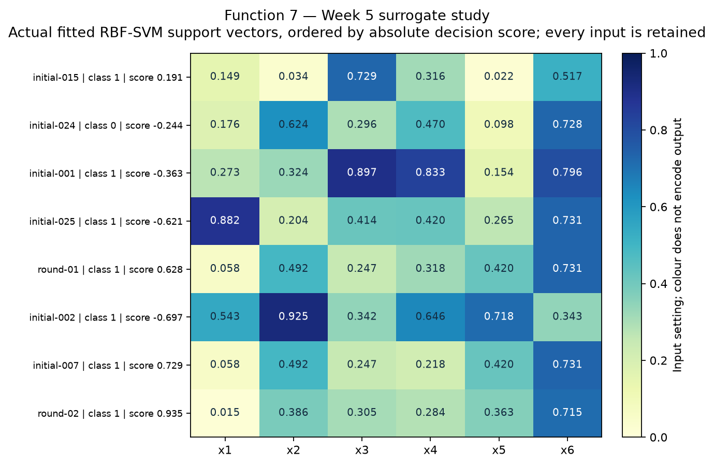
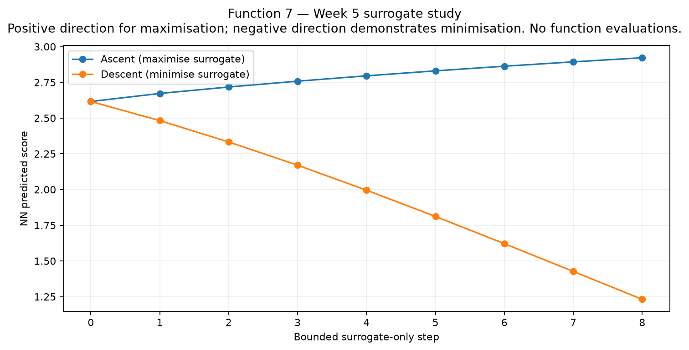
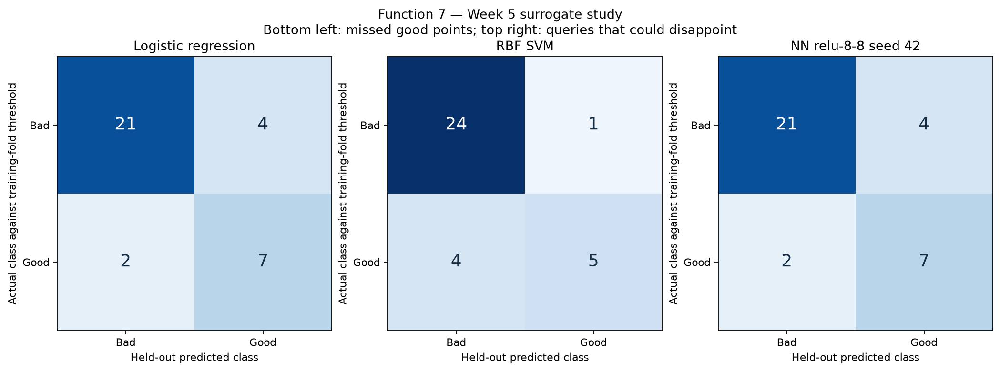
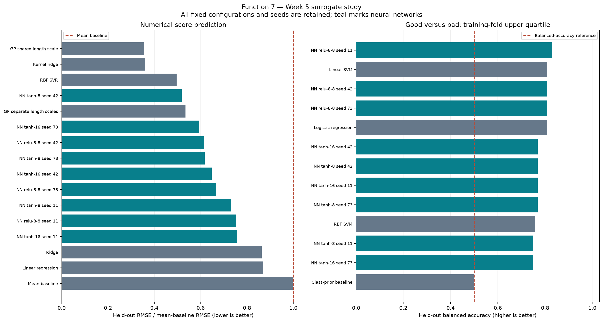
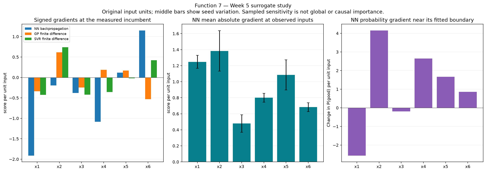
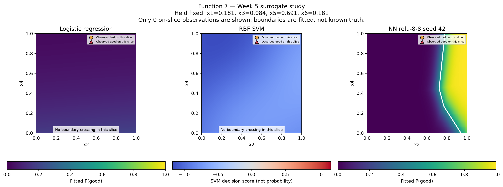
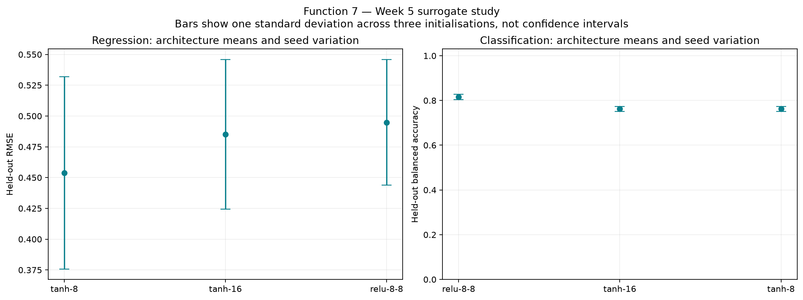

# Function 7 — Week 5 neural-network and surrogate study

**Study date: 2026-10-29.** This is a retrospective discussion
experiment using 34 official observations through round 4.
The fifth query is already submitted and its result is pending. This experiment
does not explain or replace the earlier submission decision. Sources and settings
are recorded in [results.json](results.json); the executed notebook is
[surrogate_comparison.ipynb](../surrogate_comparison.ipynb).

Three architectures (tanh-8, tanh-16 and ReLU-8-8) each use seeds 11, 42 and 73
for regression and classification. Input scaling and regression target scaling
are fitted inside every leave-one-out fold. Function 1 uses its existing fixed,
order-preserving signed-log transform; all other functions use original score
units. Neural training uses L-BFGS, backpropagated gradients, L2 alpha 0.1,
400 iterations at most and no early-stopping holdout. Neither depth nor higher
input dimension is assumed to make a network preferable.

SVM probability calibration is not fitted to these tiny class samples. Its
decision scores support labels, ROC AUC and boundary plots; its Brier score and
log loss are unavailable. Probability near 0.5 may reflect noisy ambiguity as
well as lack of information, so it is not by itself a rule for spending a query.

The common candidate comparison and gradient paths evaluate fitted models only.
Variation across neural initialisations measures optimisation sensitivity, not
calibrated posterior uncertainty. Support-vector examples identify observations
by ID; no additional source arrays are exported to the result record.

## Evidence for the seven reflection points

### 1. Inputs acting as support vectors

The full-fit RBF SVM identifies **22 of 34**
observations as actual support vectors. Examples nearest its decision boundary
in absolute decision score are initial-015 (class 1, decision score 0.191), initial-024 (class 0, decision score -0.244), initial-001 (class 1, decision score -0.363). The linear SVM uses
**18** support vectors. Their full input profiles
are retained in the notebook table and figure. Kernel decision scores are not
Euclidean distances from the boundary. These points support the fitted classifier,
not a known true boundary of the hidden function. A large support-vector fraction
alone neither validates nor invalidates the boundary. Nearby uncertain classifications can motivate exploration only where held-out predictive evidence supports using the classifier.

### 2. Surrogate gradients and directions

The study trains neural regressors and backpropagates their output derivatives
to the original input coordinates, including both fitted scalers. Independent
finite-difference checks pass for the representative regressor and classifier.
The bounded ascent demonstration accepts **8 steps**, changing the
NN prediction from **2.61607 to 2.92219**;
descent accepts **8 steps**, changing it from
**2.61607 to 1.23171**. Zero accepted
steps mean no improving step was found under the declared step limits.
The project maximises its signed score, so ascent is the relevant query direction;
descent is included to address the assignment's minimisation wording. All these
predictions use **score**, and no new course evaluations occur.

### 3. Classification framing and exploration trade-offs

"Good" means a result at least as high as the training history's 75th percentile.
Every validation fold estimates its threshold from training outcomes only.
The final full-data threshold is **0.551179** in
score, giving **9 good** and
**25 bad** labels. Fold thresholds
vary; held-out metrics evaluate this training-relative rule rather than one fixed
oracle boundary. The representative NN misses **2** good
held-out results and falsely labels **4** bad results as
good. False negatives risk excluding promising regions; false positives spend
scarce queries. Labels discard output magnitude, so this is supporting evidence
alongside numerical maximisation, not a replacement objective.

### 4. Choice of model and interpretability

The representative NN's LOO RMSE is **0.377854**, compared with
**0.634093** for linear regression and **0.257475** for
the reference GP (**GP shared length scale**). Averaging all three seeds of
the selected NN architecture gives RMSE **0.453814** with seed SD
**0.0779982**. The architecture is selected by this mean, and seed 42
is the fixed representative rather than the luckiest seed. The average network
does not improve on the reference GP on these
observed validation targets. Linear coefficients are easier to explain; neural
curves and input gradients provide local interpretation. GP posterior uncertainty
and variation across neural initialisations answer different questions.

### 5. Input influence and priorities for exploration

The largest NN mean absolute gradients across the observed input locations are
**x2 (1.383), x1 (1.247), x5 (1.085)**, in score per unit input. These sampled
sensitivities average the selected architecture's three fitted seeds; they are
neither causal effects nor global importance. The separate signed gradients at
the incumbent and probability gradients near a fitted classification boundary
retain all inputs and can suggest different priorities. Every coordinate shares
the original 0–1 range. Larger, seed-stable gradients can motivate controlled
local perturbations, while small or unstable gradients still warrant coverage
checks rather than permanent exclusion of an input.

### 6. Neural decision boundary and backpropagation

The representative neural classifier has held-out balanced accuracy
**0.809**, good-result recall **0.778**
and Brier score **0.169**. Its full-fit training balanced
accuracy is **1.000**, so the training versus
held-out gap remains visible. Logistic regression scores
**0.809** and the RBF SVM
**0.758** on the same folds.
Backpropagation supplies weight gradients to the L-BFGS training optimiser;
the later input backpropagation differentiates the fixed trained model's
P(good). The latter is checked against finite differences and used to select
two informative plotting axes. Other coordinates remain fixed in higher-dimensional
slices, and observations away from that slice are omitted. These plots visualise
an estimated boundary, not measured truth throughout the domain. Softmax or
sigmoid confidence is not automatically calibrated uncertainty about unsampled regions.

### 7. Added neural flexibility versus simpler models

For regression, the selected architecture's mean RMSE is **0.453814**,
with individual seeds spanning **0.377854–0.533702**. The
representative fit has training RMSE **0.040645**, compared
with held-out RMSE **0.377854**. For classification, its selected
architecture averages balanced accuracy **0.816** with seed SD
**0.012**, which exceeds
the logistic baseline's **0.809**. Regression and
classification can therefore give different answers about the value of flexibility.
The bounded study retains **303 fitting warnings**, including iteration
limits where present, rather than increasing the budget until a network wins.
There are only 34 observations for 6
inputs. All configuration selection reuses these small validation samples, so
the comparison is exploratory and supplies no independent final-test guarantee.
The submitted Week 5 inputs remain unchanged; useful future decisions require
new returned evidence rather than lower training error alone.

## Course lifecycle

| Step | Application |
| --- | --- |
| 1. Define the goal and scope | Gather comparative evidence for the seven reflection criteria, using existing observations. |
| 2. Gather the data | Read the independent official Week 5 snapshot through round 4; add no peer or portal returns. |
| 3. Explore the data | Inspect input dimensions, output range, class balance and the existing incumbent. |
| 4. Clean and preprocess the data | Validate the snapshot; fit scaling inside folds and preserve Function 1's fixed signed-log ordering. |
| 5. Select and engineer features | Retain all original inputs; keep the existing Function 2 x1-only GP as an explicit comparison. |
| 6. Define the machine-learning task | Compare score regression with a separate good/bad classification framing. |
| 7. Partition the data | Use the same leave-one-out rows for all methods; fit each classification threshold on training outcomes only. |
| 8. Select and train candidate methods | Run the declared linear, kernel, GP and small neural models with fixed seeds and budgets. |
| 9. Evaluate and interpret the results | Compare held-out errors, seed stability, support vectors, checked input gradients and conditional boundaries. |
| 10. Deploy and iterate | Deployment is not applicable to this retrospective study. The submitted inputs remain fixed; revisit after new feedback. |
