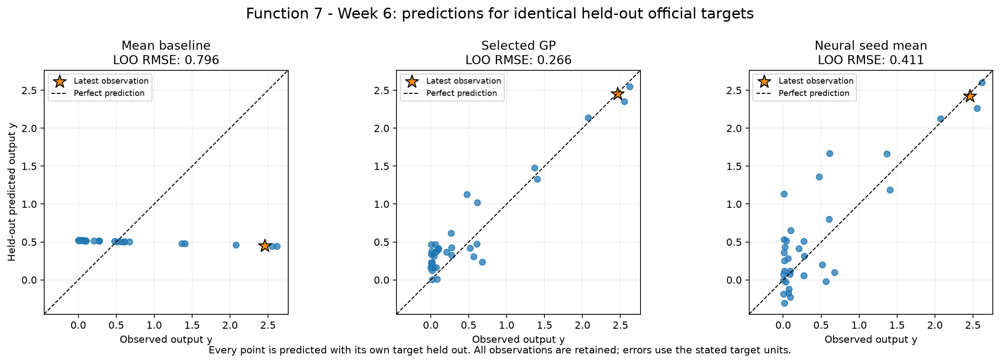
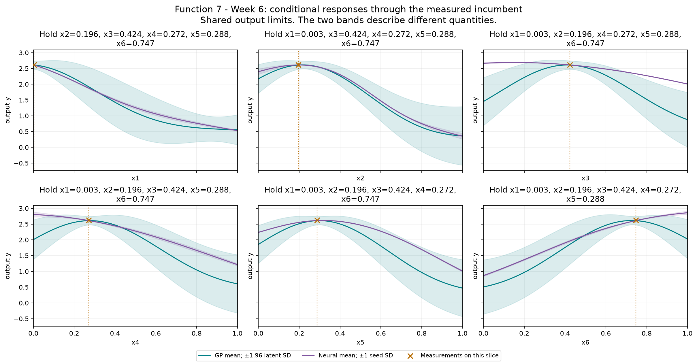
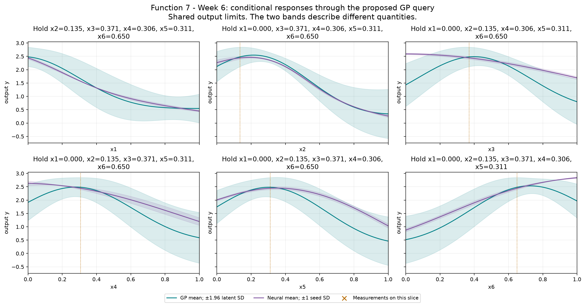

# Function 7 — Week 6 model review

**Submission confirmation, 31 October 2026:** the project owner confirmed submission of the [eight Week 6 inputs](../../../submissions/Week_06/README.md). Results are pending; seven future queries remain per function. The analysis below retains its pre-submission evidence and query budget.

Prepared on **30 October 2026**, using **35 official observations through round 5**.
The provisional query uses **Gaussian process**, fitted to **official**.
Its proposal is **`0.000000-0.135108-0.370684-0.306265-0.311144-0.649736`**. It has not been submitted by this workflow.

**Decision agreed:** keep **`0.000000-0.135108-0.370684-0.306265-0.311144-0.649736`**
with weight **1.96**. Retain the below-incumbent GP mean, extrapolation on x1=0,
conditional model uncertainty and weight-sensitive point as caveats. The
prepared seventh line already matches; nothing has been submitted.

[Executed prediction notebook](model_predictions.ipynb) · [Numerical review](model-review.json) ·
[Interactive GP/neural input explorer](figures/neural-network-explorer.html)

## Evidence and decision

The fifth return fell below the round 4 incumbent, ending four successive improving owner queries. The local component remains anchored on that round 4 measured best. The GP and neural curves display all six inputs as conditional slices, rather than projecting observations from incompatible settings onto a fitted line.

The declared selection criterion is **LOO RMSE**, measured in **output y**. Each row below scores the same official held-out targets.
The selected GP's error is **0.335 times the mean baseline**, a **66.5% reduction**.
The neural ensemble is the mean of all three held-out seed predictions for its validation-selected architecture; no best seed is selected.

| Model | Error |
| --- | --- |
| Mean baseline (official only) | 0.796164 |
| Official-only GP: Gaussian process | 0.266487 |
| Neural seed ensemble (official only): tanh-8 | 0.410558 |

Official-only GP has the smaller error when both model families train on official observations only. Any selected peer-assisted GP is shown separately because it has additional training evidence. Architecture and GP selection use these validation results, so selected errors are optimistic estimates of future performance. These are predictive checks on adaptively sampled points, not a test of complete optimisation policies or evidence of a global maximum. The GP query policy remains restricted to the declared GPs because neural seed spread is not a posterior uncertainty estimate.

## Provisional query

| Quantity | Value |
| --- | --- |
| Portal input | `0.000000-0.135108-0.370684-0.306265-0.311144-0.649736` |
| Predicted target mean | 2.48135 |
| Latent posterior SD | 0.186111 |
| UCB, mean + 1.96 × SD | 2.84613 |
| Mean minus best observed target | -0.137615 |
| Inside this fit's sampled full-input hull | False |
| Distance to nearest known input | 0.133443 |
| Eligible candidates | 20,607 |
| Query opportunities including Week 6 | 8 |

All output quantities in this table use **output y**. Posterior SD is conditional on the GP kernel and regularisation. UCB is a selection score, not a returned value or a guarantee. The finite pool retains seeded full-space and incumbent-local candidates, corners, six-decimal bounds and known-input exclusions. The geometric comparator is a finite-pool farthest-point proxy, not a fresh continuous minimax search. The notebook shows exploration weights 0, 1, 1.96 and 3 on the same pool.

The neural mean-led alternative is **`0.000000-0.192810-0.357833-0.124255-0.219568-0.896821`**, with predicted target **2.92749** and seed SD **0.0359757**. This is scored on the same eligible candidates. Its seed SD describes fitted-seed variation and must not be used as GP uncertainty.

## Discussion: continue the promising local search

The agreed query is **`0.000000-0.135108-0.370684-0.306265-0.311144-0.649736`**,
with weight **1.96**. The prepared seventh line already
matches. Four improving weekly queries followed by one lower result support
continuing to investigate the incumbent's neighbourhood; they do not establish
a plateau or a maximum.

The incumbent is **2.618968** at
`(0.002902, 0.196293, 0.424115, 0.271557, 0.287658, 0.746916)`.
The latest return was **2.458557**. The proposed query is **0.133443** from
the incumbent, which is also its nearest measured input. It retains a local
focus while moving far enough to test a different combination.

The principal candidates below are scored by the same saved models. These are
fitted predictions, not measured results.

| Candidate | GP mean | GP latent SD | Neural seed mean |
| --- | ---: | ---: | ---: |
| GP mean-only point | 2.608844 | 0.078802 | 2.593394 |
| Recommended GP-UCB point | 2.481353 | 0.186111 | 2.443915 |
| Neural mean proposal | 2.115110 | 0.276351 | 2.927486 |

The mean-only point is
**`0.000000-0.203559-0.387219-0.271260-0.273578-0.718375`**, just
**0.049350** from the incumbent. It is a credible smaller-step alternative,
but its predicted mean remains below the measured best. The current UCB point
accepts a **0.127491** lower mean to investigate greater conditional model
uncertainty. Its UCB is **2.846131**, not a forecast that the score will reach
that value. The GP predicts **2.608798** at the measured incumbent itself,
close to its actual result; this in-sample agreement is not an independent
validation of the proposed query.

Weight 1 offers an intermediate point,
**`0.000000-0.204921-0.380637-0.285976-0.324343-0.666259`**, with GP mean
**2.574541**, SD **0.121134** and distance **0.100162** from the incumbent.
Weights 0, 1, 1.96 and 3 all put x1 at zero, but alter the other coordinates.
The exact proposed point is weight-sensitive, and no optimal multiplier has
been established. The common x1 boundary does not prove a causal input effect.

The neural proposal's forecast **2.927486** is above the incumbent, with all
three selected seeds optimistic (**2.969026, 2.906987 and 2.906444**). At that
same input the GP instead predicts **2.115110**. The neural point is also
farther from measured inputs (**0.230694**). Its small seed SD **0.035976**
does not establish calibrated uncertainty or independently validate the
optimistic forecast.

GP held-out RMSE is **0.266487**, versus neural **0.410558**. On the five
weekly targets, the corresponding RMSEs are **0.104896** and **0.164456**.
Those subset scores reuse the retrospective LOO fits; they are not a forward
test of optimisation policies. Both checks favour retaining the GP explanation
here, unlike the modest neural advantage discussed for Function 6.

The recommendation therefore keeps the declared GP-UCB balance for one local
query. Its mean is below the incumbent, so there is no claim that its predicted
mean exceeds the best measured score. The full six-input point lies outside the sampled hull on x1=0,
and posterior SD remains conditional on the chosen kernel and regularisation.
No new fits or course evaluations were needed for this discussion. Function 7
is agreed with these caveats retained; nothing is submitted.

## Neural exploration

The bounded comparison retains **tanh-8**, **tanh-16** and **ReLU-8-8**, each with seeds **11, 42 and 73**. Maximum training iterations remain 400, with the existing L-BFGS settings and regularisation. Full input and target scalers are fitted only on each fold's training rows.

The offline explorer includes every architecture and seed. Change inputs or the conditional-curve axis, then compare neural means and seed variation with the selected GP's mean and latent SD. Buttons restore the measured incumbent or the provisional GP query. The validation-selected architecture is labelled separately from whichever architecture is displayed. It performs no training or course evaluations.

The selected neural models passed input-gradient checks at the measured incumbent.

## Provenance and limits

Official snapshot SHA-256: `05447e3f71720ea2db202303f185f735a4ad0f953298fa1b302ccd8c346a879d`. Earlier weekly notebooks, snapshots and submitted queries remain unchanged. The observation notebook preserves the historical Week 5 forecast comparison; this notebook's held-out review is retrospective.

There are **0 retained peer rows** in the optional training comparison. Their source repositories were not refreshed. The local audit retains the pinned source hashes and verifies that official rows are unchanged. Each official target is held out while peer rows are training evidence only. Peer reports do not establish an official incumbent or increase the owner's query budget. The numerical review records both scopes' candidates on the same pool where peer data are available.

The saved official and peer-fit comparisons record **215 fitting warnings** across all folds and full fits, with their exact messages retained in the numerical JSON. These include declared convergence or kernel-bound limits; the analysis did not extend the tuning budget in response. Neural results deserve the same scrutiny as the GP assumptions.

## Course lifecycle

1. **Define the goal and scope** — support the project owner's next one-query-per-function decision; compare predictive evidence and preserve a reviewable provisional input.
2. **Gather the data** — use the confirmed official Week 6 snapshot through round 5 and, for Functions 1–4, the unchanged audited 20 October peer snapshot.
3. **Explore the data** — carry forward the measured review; inspect fitted conditional responses, candidate scores and the interactive explorer.
4. **Clean and preprocess the data** — validate the fixed schema and round counts, bounds, hashes and complete observations. Neural input and target scaling are fitted inside each fold; Function 1 retains its fixed signed-log transform.
5. **Select and engineer features** — preserve ordered inputs and the declared Function 2 projection and Function 3 quadratic comparator; no information unavailable at query time is introduced.
6. **Define the machine-learning task** — numerical regression supports sequential continuous black-box maximisation.
7. **Partition the data** — use leave-one-out checks on identical official targets. No independent final test set is available; adaptive sampling and model selection limit interpretation.
8. **Select and train candidate methods** — refit the declared baseline, regression, GP and nine neural configurations. Compare retained peer training on the same official targets; neural architecture selection averages all seeds.
9. **Evaluate and interpret the results** — compare held-out errors, neural seed sensitivity, GP regularisation and exploration weights, conditional views, exact candidate inputs and extrapolation. Fitted predictions remain distinct from measured returns.
10. **Deploy and iterate** — not applicable to deployment: prepare a provisional next query for review. No portal submission or new course evaluation is performed; eight query opportunities remain including Week 6.

