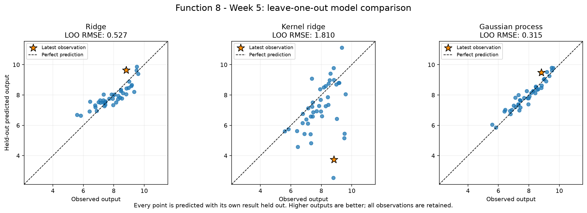
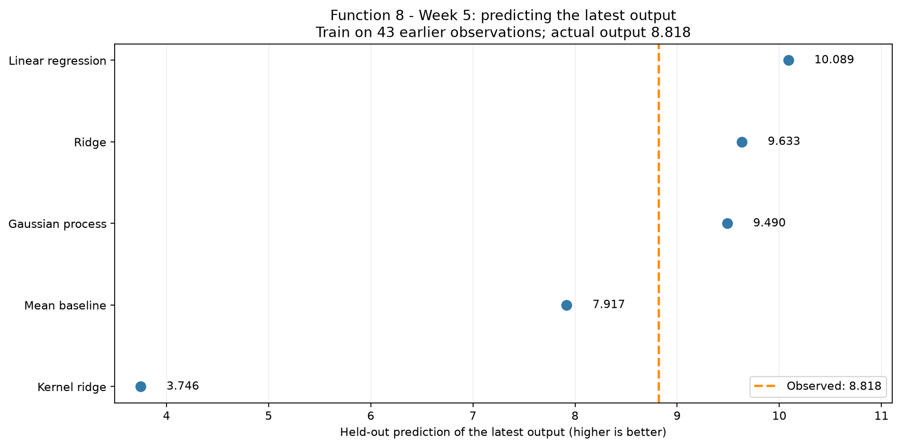
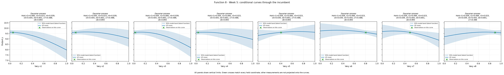

# Function 8 — Week 5 model review and selected query

**Submission confirmation, 29 October 2026:** the project owner confirmed
submission of the [eight selected Week 5 inputs](../../../submissions/Week_05/README.md).
Results are pending. Eight future weekly queries remain per function.
The analysis below retains its pre-submission evidence and query budget.

**Analysis date: 28 October 2026.** The independent official snapshot contains
**44 observations** through the round 4 return received
on 23 October. All 8 original input coordinates are retained.
The [observation review](observation_review.ipynb) records the measured results;
the [executed model notebook](model_predictions.ipynb) records the calculations.

## Selected input

**`0.000000-0.000000-0.000000-0.000000-0.000000-0.000000-0.000000-0.999999`** is included in the
[eight-function submission](../../../submissions/Week_05/README.md).
Submission was confirmed on 29 October 2026; results are pending.
Eight future query opportunities remain per function.

Select an unmeasured corner by GP/UCB after comparing full-space, incumbent-local, latest-return-local and geometric coverage alternatives. The point is extrapolative and weight-sensitive.

The official incumbent is **9.598482**. At the exact
six-decimal input above, the raw-output GP predicts **9.432307**
with posterior SD **0.588048**. Its UCB selection score is
**10.584882**, using predicted mean plus 1.96 times SD.
The predicted mean is below the incumbent. The input is outside the sampled
full-dimensional hull, so the prediction involves extrapolation.

## Held-out model evidence

Each estimator, including kernel optimisation and target transformation where
used, is fitted separately inside every leave-one-out fold. Every observation
is scored once in the original output units; there is no independent final test
set in this small, adaptively sampled history. The declared comparison criterion
is RMSE, with MAE retained to show sensitivity to large errors.

| Model | LOO RMSE | LOO MAE |
| --- | --- | --- |
| Gaussian process | 0.315459 | 0.244826 |
| Ridge | 0.527168 | 0.428428 |
| Linear regression | 0.550326 | 0.437936 |
| Mean baseline | 1.010554 | 0.845625 |
| Kernel ridge | 1.810039 | 1.184564 |

The GP has the lowest RMSE among the methods tested, **68.8%**
below the mean baseline. Its fitted kernel is `1.58**2 * RBF(length_scale=1.28)`.
This prediction check supports retaining the model, without establishing the
location of the global maximum or the calibration of its uncertainty.

The GP's latest-result held-out prediction is **9.489841**;
its signed error is **0.671538**. This is a retrospective
leave-one-out calculation under the current settings. The separate observation
review checks the actual saved Week 4 forecast against the returned value.

## Candidate search and sensitivity

The search compares 16,384 seeded broad Sobol samples and all allowed extreme
corners, 4,096 local samples and corners within a clipped radius of 0.15 per
coordinate around the incumbent, and one independently optimised geometric
coverage point. Inputs are rounded to six decimals before prediction; duplicates
and already measured inputs at that precision are removed. Every coordinate
remains free. The seed, sample sizes, kernel bounds, three optimiser restarts
and GP diagonal regularisation are declared in the notebook's settings cell.

As in Week 4, an additional 4,096-sample local pool plus corners searches
around the latest returned corner, which differs from the incumbent's region.
It is compared with the broad search and incumbent-local alternatives under the
same GP and acquisition rule. The selected corner is different from every
earlier measured or submitted input. The previous corner return was below its
forecast; the present uncertainty estimate remains conditional rather than
empirically calibrated by that single result.

The final comparison retains **25,324 eligible inputs**;
the selected route is **full input space**. The maximum is
over this finite comparison, rather than a proven continuous optimum.
Weights **0, 1, 1.96 and 3** choose **4 distinct inputs**.
The exact choice therefore depends on the declared exploration balance.

The notebook also refits the same GP at diagonal fractions **0.03, 0.10 and 0.30**
and predicts this same chosen input. These conditional regularisation checks
do not estimate repeat-evaluation noise and do not reselect the query.

Each curve varies one coordinate while holding every other coordinate at the
incumbent. The shaded band is model uncertainty in that conditional section;
measurements at other held-coordinate settings are not projected onto the curve.

## Course lifecycle

| Step | Application in this review |
| --- | --- |
| 1. Define the goal and scope | Choose one next input for the learner's ongoing sequential maximisation task. |
| 2. Gather the data | Use the independent official snapshot through round 4; gather no new peer evidence. |
| 3. Explore the data | Carry forward the measured-output ranks, round progress and full-input profiles from the observation review. |
| 4. Clean and preprocess the data | Validate finite values, dimensions, round counts and bounds; fit model normalisation and any target transformation inside folds. |
| 5. Select and engineer features | Retain all original coordinates; introduce no additional features. |
| 6. Define the machine-learning task | Regress continuous outputs to support sequential maximisation. |
| 7. Partition the data | Hold out each observation once; an independent final test set is not available. |
| 8. Select and train candidate methods | Compare the established mean, linear, ridge, kernel-ridge and GP methods; Function 5 also compares a log-target GP. |
| 9. Evaluate and interpret the results | Review RMSE, MAE, conditional curves, candidate alternatives and sensitivity before selecting an input. |
| 10. Deploy and iterate | Deployment is not applicable to this notebook, which prepares an experiment. Portal submission is confirmed; evaluation and iteration await the next return. |

The [submission record](../../../submissions/Week_05/proposals.json)
preserves source hashes and validation evidence. Original observations and
earlier weekly analyses are unchanged. No hidden course function was evaluated.
