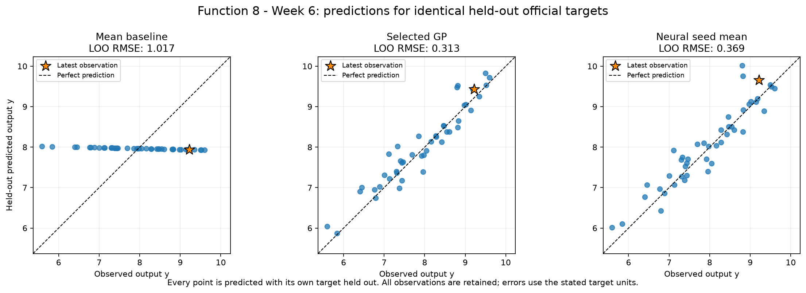
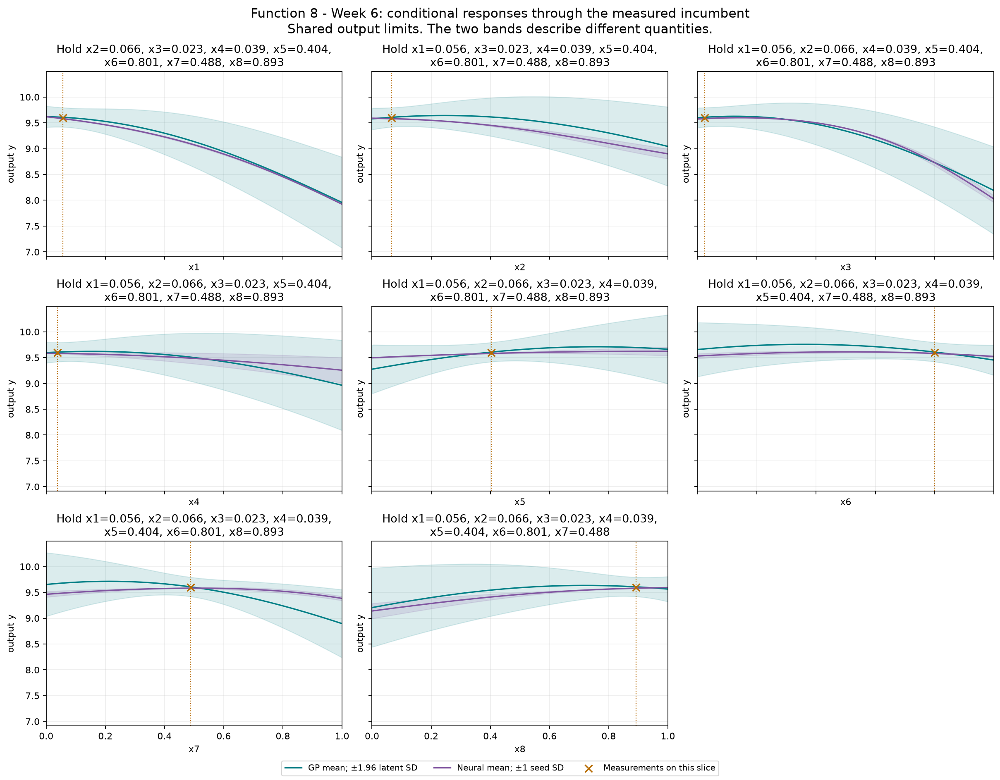
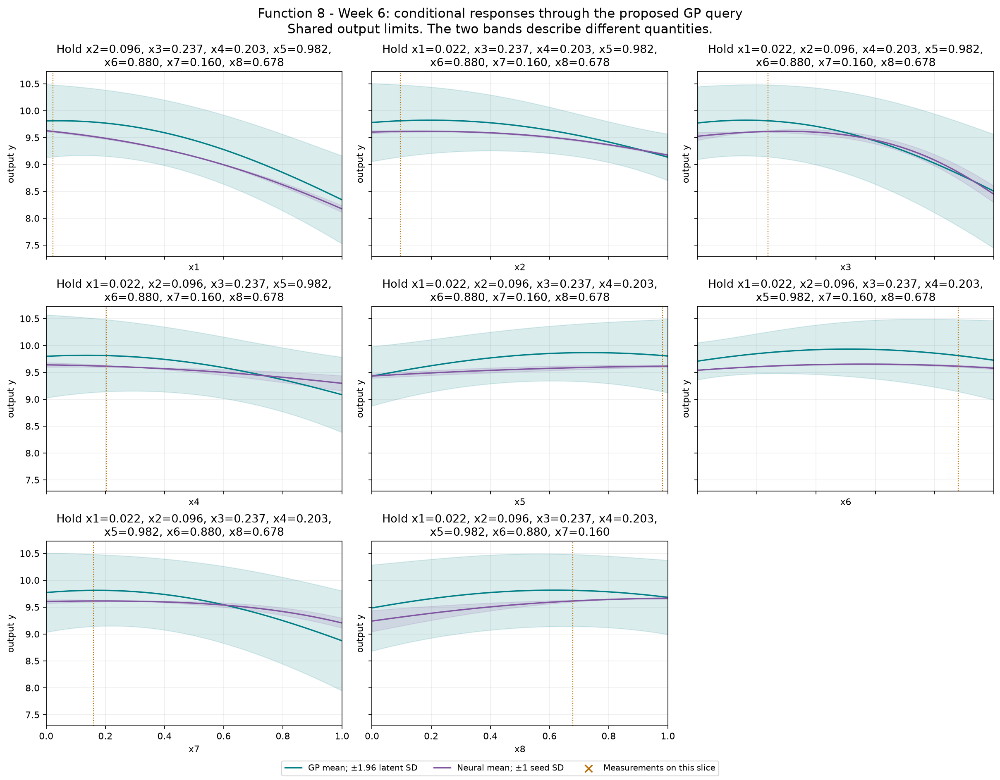

# Function 8 — Week 6 model review

**Submission confirmation, 31 October 2026:** the project owner confirmed submission of the [eight Week 6 inputs](../../../submissions/Week_06/README.md). Results are pending; seven future queries remain per function. The analysis below retains its pre-submission evidence and query budget.

Prepared on **30 October 2026**, using **45 official observations through round 5**.
The provisional query uses **Gaussian process**, fitted to **official**.
Its proposal is **`0.022327-0.096114-0.237034-0.202848-0.982361-0.880106-0.159960-0.678158`**. It has not been submitted by this workflow.

**Decision agreed on 31 October 2026:** keep the above point with weight
**1.96**. Retain sparse eight-dimensional coverage, extrapolation, modest mean
gains, weight sensitivity, near-tied candidate scores and conditional model
uncertainty as caveats. The prepared eighth line already matches; nothing has
been submitted. The original fitted-model evidence below remains unchanged.

[Executed prediction notebook](model_predictions.ipynb) · [Numerical review](model-review.json) ·
[Interactive GP/neural input explorer](figures/neural-network-explorer.html)

## Evidence and decision

The fifth corner query remains below the initial incumbent. All eight input coordinates stay in the search, validation, explorer controls and proposal record. The finite candidate pool includes the permitted corners and an incumbent-local component. Held-out performance and a high UCB do not establish reliability in this sparsely sampled eight-dimensional space.

The declared selection criterion is **LOO RMSE**, measured in **output y**. Each row below scores the same official held-out targets.
The selected GP's error is **0.308 times the mean baseline**, a **69.2% reduction**.
The neural ensemble is the mean of all three held-out seed predictions for its validation-selected architecture; no best seed is selected.

| Model | Error |
| --- | --- |
| Mean baseline (official only) | 1.01724 |
| Official-only GP: Gaussian process | 0.313369 |
| Neural seed ensemble (official only): tanh-16 | 0.368572 |

Official-only GP has the smaller error when both model families train on official observations only. Any selected peer-assisted GP is shown separately because it has additional training evidence. Architecture and GP selection use these validation results, so selected errors are optimistic estimates of future performance. These are predictive checks on adaptively sampled points, not a test of complete optimisation policies or evidence of a global maximum. The GP query policy remains restricted to the declared GPs because neural seed spread is not a posterior uncertainty estimate.

## Provisional query

| Quantity | Value |
| --- | --- |
| Portal input | `0.022327-0.096114-0.237034-0.202848-0.982361-0.880106-0.159960-0.678158` |
| Predicted target mean | 9.81224 |
| Latent posterior SD | 0.341687 |
| UCB, mean + 1.96 × SD | 10.4819 |
| Mean minus best observed target | 0.21376 |
| Inside this fit's sampled full-input hull | False |
| Distance to nearest known input | 0.754759 |
| Eligible candidates | 20,987 |
| Query opportunities including Week 6 | 8 |

All output quantities in this table use **output y**. Posterior SD is conditional on the GP kernel and regularisation. UCB is a selection score, not a returned value or a guarantee. The finite pool retains seeded full-space and incumbent-local candidates, corners, six-decimal bounds and known-input exclusions. The geometric comparator is a finite-pool farthest-point proxy, not a fresh continuous minimax search. The notebook shows exploration weights 0, 1, 1.96 and 3 on the same pool.

The neural mean-led alternative is **`0.000000-0.000000-0.172928-0.000000-0.553935-0.651055-0.338307-0.999999`**, with predicted target **9.69569** and seed SD **0.013867**. This is scored on the same eligible candidates. Its seed SD describes fitted-seed variation and must not be used as GP uncertainty.

## Discussion: retain the GP-UCB query, with modest confidence

The agreed query is
**`0.022327-0.096114-0.237034-0.202848-0.982361-0.880106-0.159960-0.678158`**,
with weight **1.96**. The prepared eighth line already
matches. Five subsequent corner queries have not improved the initial
incumbent **9.598482**. This proposal tests a different combination across
all eight coordinates, away from the exact corner configurations.

The same saved GP and neural models give the following cross-checks. Means
and SDs are model predictions, not measured results.

| Candidate | GP mean | GP latent SD | Neural seed mean |
| --- | ---: | ---: | ---: |
| Recommended GP-UCB point | 9.812242 | 0.341687 | 9.614409 |
| GP mean-only point | 10.010860 | 0.164776 | 9.506271 |
| Neural mean-led point | 9.780370 | 0.201474 | 9.695693 |

At the recommended point, both models' means exceed the measured incumbent,
although the neural margin is only **0.015927**. The GP's predicted mean gain
is **0.213760**, smaller than held-out RMSE **0.313369**. Its UCB **10.481948**
is an optimistic ranking score, not a returned-value forecast or a confidence
guarantee about improvement.

The GP mean-only alternative is
**`0.122040-0.163925-0.152653-0.132862-0.773160-0.205219-0.116891-0.341348`**.
It stays inside the sampled hull and has lower GP SD, but the models disagree
on whether its mean exceeds the best measured score: GP **10.010860**, neural
**9.506271**. Its nearest measured input is **0.553600** away. Hull membership
does not itself establish local prediction accuracy.

The neural point is
**`0.000000-0.000000-0.172928-0.000000-0.553935-0.651055-0.338307-0.999999`**.
It is a credible, more locally focused alternative, **0.332372** from the
incumbent and nearest observation, compared with **0.754759** for the current
GP-UCB point. Both models' means exceed the incumbent there as well. Retaining
GP-UCB favours a higher GP mean and greater conditional uncertainty, rather
than establishing that the neural input is inferior in the true function.

The GP has lower overall held-out RMSE (**0.313369**, versus **0.368572**)
and lower error on the five weekly targets (**0.472085**, versus **0.714391**).
The latter are retrospective subset checks using the same LOO fits, not a
new forward policy test. They support keeping the GP explanation, with no
calibrated uncertainty implied by the neural seed SD.

**The exact candidate is sensitive to the policy and finite search.** Weight 1
chooses
`0.253360-0.262644-0.070249-0.077138-0.511387-0.389897-0.039989-0.503902`.
When that point is rescored at weight 1.96, its UCB is **10.480676**, only
**0.001271** below the selected point. The neural mean there is **9.270792**,
so that cross-check favours the current point over this near-tied alternative.
The tiny UCB gap does not establish a uniquely best input or justify treating
six-decimal coordinates as scientific precision.

The current point lies outside the full eight-input sampled hull. With only
45 measured inputs, extrapolation and kernel assumptions remain material
limitations, and weights 0, 1, 1.96 and 3 select different points. The
recommendation retains the declared GP-UCB balance for this query, without
claiming that 1.96 is optimal. No new models or course evaluations were needed
for this discussion. Function 8 is agreed with these caveats retained; nothing is submitted.

## Neural exploration

The bounded comparison retains **tanh-8**, **tanh-16** and **ReLU-8-8**, each with seeds **11, 42 and 73**. Maximum training iterations remain 400, with the existing L-BFGS settings and regularisation. Full input and target scalers are fitted only on each fold's training rows.

The offline explorer includes every architecture and seed. Change inputs or the conditional-curve axis, then compare neural means and seed variation with the selected GP's mean and latent SD. Buttons restore the measured incumbent or the provisional GP query. The validation-selected architecture is labelled separately from whichever architecture is displayed. It performs no training or course evaluations.

The selected neural models passed input-gradient checks at the measured incumbent.

## Provenance and limits

Official snapshot SHA-256: `4e9c47ebf4398e7e574c4fb253f097b016b5c846611a894c7be929b417524f2c`. Earlier weekly notebooks, snapshots and submitted queries remain unchanged. The observation notebook preserves the historical Week 5 forecast comparison; this notebook's held-out review is retrospective.

There are **0 retained peer rows** in the optional training comparison. Their source repositories were not refreshed. The local audit retains the pinned source hashes and verifies that official rows are unchanged. Each official target is held out while peer rows are training evidence only. Peer reports do not establish an official incumbent or increase the owner's query budget. The numerical review records both scopes' candidates on the same pool where peer data are available.

The saved official and peer-fit comparisons record **329 fitting warnings** across all folds and full fits, with their exact messages retained in the numerical JSON. These include declared convergence or kernel-bound limits; the analysis did not extend the tuning budget in response. Neural results deserve the same scrutiny as the GP assumptions.

## Course lifecycle

1. **Define the goal and scope** — support the project owner's next one-query-per-function decision; compare predictive evidence and preserve a reviewable provisional input.
2. **Gather the data** — use the confirmed official Week 6 snapshot through round 5 and, for Functions 1–4, the unchanged audited 20 October peer snapshot.
3. **Explore the data** — carry forward the measured review; inspect fitted conditional responses, candidate scores and the interactive explorer.
4. **Clean and preprocess the data** — validate the fixed schema and round counts, bounds, hashes and complete observations. Neural input and target scaling are fitted inside each fold; Function 1 retains its fixed signed-log transform.
5. **Select and engineer features** — preserve ordered inputs and the declared Function 2 projection and Function 3 quadratic comparator; no information unavailable at query time is introduced.
6. **Define the machine-learning task** — numerical regression supports sequential continuous black-box maximisation.
7. **Partition the data** — use leave-one-out checks on identical official targets. No independent final test set is available; adaptive sampling and model selection limit interpretation.
8. **Select and train candidate methods** — refit the declared baseline, regression, GP and nine neural configurations. Compare retained peer training on the same official targets; neural architecture selection averages all seeds.
9. **Evaluate and interpret the results** — compare held-out errors, neural seed sensitivity, GP regularisation and exploration weights, conditional views, exact candidate inputs and extrapolation. Fitted predictions remain distinct from measured returns.
10. **Deploy and iterate** — not applicable to deployment: prepare a provisional next query for review. No portal submission or new course evaluation is performed; eight query opportunities remain including Week 6.

