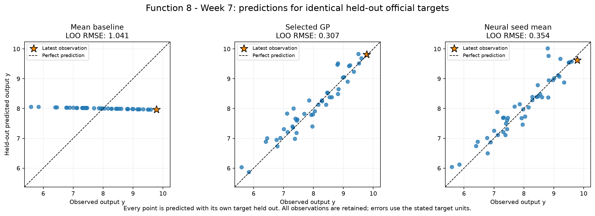
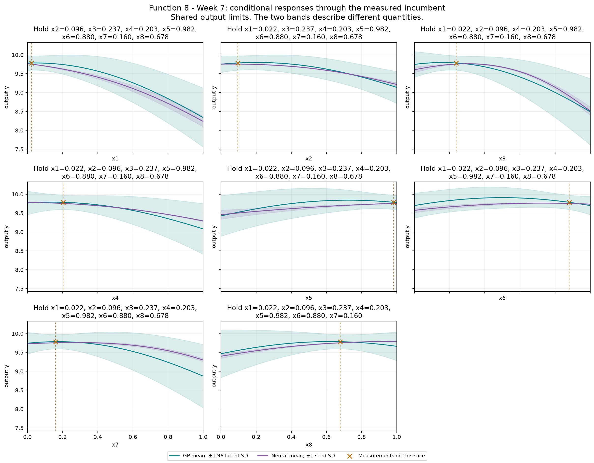

# Function 8 — Week 7 review

Prepared on **5 November 2026**, using **46 official observations through round 6**. The latest result arrived on 2 November at 07:28 GMT. Seven queries remain, including Week 7. The model candidate is **provisional and unsubmitted**.

[Executed observation review](observation_review.ipynb) · [Executed models](model_predictions.ipynb) · [Numerical review](model-review.json) · [Offline GP/neural explorer](figures/neural-network-explorer.html)

## What the return adds

The full eight-input query achieves 9.7829427576811 and finally exceeds the initial incumbent of 9.598482002566342. The saved GP mean of 9.812241549906545 is close to the measured return. All eight coordinates changed from the previous query, so this result does not isolate input effects. Sparse coverage and extrapolation remain limitations.

The signed return is **9.78294276**, rank **1/46** (1 = highest). The best observed output is **9.78294276**.

## Forecasts recorded before the return

The final Week 6 selection record supplies these forecasts at the actually submitted coordinates. The observation notebook checks the saved record hash and exact input match; it does not refit the historical models. Units below are **output y**. Predictions and the actual return use the original signed output units.

| Quantity | Value |
| --- | ---: |
| Actual in prediction units | 9.78294276 |
| Saved GP mean | 9.81224155 |
| Saved GP latent SD | 0.341686769 |
| Actual minus saved GP mean | -0.0292987922 |
| Saved neural seed mean | 9.61440882 |
| Actual minus saved neural mean | 0.168533937 |

GP latent SD and neural seed variation measure different things. A single forecast error does not establish calibration.

## Refreshed model evidence

The declared criterion is **LOO RMSE** in **output y**. Each error uses the same official held-out targets, with complete fitting pipelines inside each fold. Neural architecture selection averages seed errors for seeds 11, 42 and 73; ensemble error scores their mean predictions.

| Fit | Held-out error |
| --- | ---: |
| Mean baseline, official only | 1.04147279 |
| Best declared official-only GP: Gaussian process | 0.307339018 |
| Selected GP: Gaussian process, official | 0.307339018 |
| Neural seed mean: tanh-16, official only | 0.35355053 |

The GP remains stronger than the neural ensemble on held-out RMSE. Its provisional candidate has a mean above the new measured best but lies outside the full eight-input training hull, with substantial distance to known inputs. Weight changes move the selected point considerably. The close Week 6 forecast is useful individual forward evidence and does not establish general calibration.

Selection reuses these validation errors, so they are optimistic estimates of future performance. Retained-peer GPs have additional training rows and are labelled separately. These checks do not compare complete optimisation policies or establish a global maximum. The declared GP acquisition policy is retained; lower neural prediction error does not automatically replace it.

## Provisional candidate

| Quantity | Value |
| --- | --- |
| GP-UCB input | `0.050308-0.523110-0.059738-0.199458-0.627842-0.214082-0.028552-0.500147` |
| Target mean | 9.92239858 |
| Latent posterior SD | 0.266485337 |
| UCB, mean + 1.96 × SD | 10.4447098 |
| Mean minus measured best in target units | 0.139455825 |
| Inside selected GP training hull | False |
| Nearest known input distance | 0.754717266 |

The neural mean-led alternative is `0.000000-0.000000-0.300942-0.086133-0.999999-0.760552-0.150301-0.809022`, with target mean **9.83723394** and seed SD **0.014251288**. Both candidates use the same eligible finite pool. No final Week 7 selection or submission is recorded.

The notebook checks weights 0, 1, 1.96 and 3 on a common seeded broad/local pool. Six-decimal bounds, duplicate exclusions and the existing spacing settings are retained. The coverage comparator is a finite-pool farthest-point proxy. UCB is a selection score, not a forecast or guarantee of improvement.

## Reproducibility and limits

Both notebooks have saved executions from the Capstone-local Python interpreter. The new independent CSV exactly matches the round 6 accumulated data at float64 precision. Earlier snapshots and submitted inputs are preserved. Functions 1–4 reuse unchanged retained peers with a new audit; official progress excludes them. Fitting warnings remain in the numerical review. The offline explorer exports the new fitted GP and all declared neural architectures and seeds. It performs no training, course evaluations or submissions.

## Course lifecycle

1. **Define the goal and scope** — review round 6 and prepare evidence for the next weekly input; success means reconciled observations and reviewable candidate evidence.
2. **Gather the data** — use the retained 2 November email and original cumulative attachments; reuse audited peer rows only where already present.
3. **Explore the data** — inspect signed ranks, incumbent progress, full input profiles and coverage.
4. **Clean and preprocess the data** — validate finite values, dimensions, bounds and exact round counts; retain full precision and fit scalers inside held-out folds.
5. **Select and engineer features** — retain the ordered input coordinates and established feature-set comparisons; no speculative feature expansion.
6. **Define the machine-learning task** — continuous-output regression supports black-box maximisation.
7. **Partition the data** — use leave-one-out comparisons on the small adaptive dataset; no independent final test set is available.
8. **Select and train candidate methods** — retain established baseline/regression/GP families and three neural architectures with three fixed seeds.
9. **Evaluate and interpret the results** — keep historical forward forecasts separate from new retrospective errors; compare identical official targets and candidate/weight sensitivity.
10. **Deploy and iterate** — deployment is not applicable; save local models, explorers and provisional next-query evidence. Seven queries remain including Week 7, and no query is submitted.
