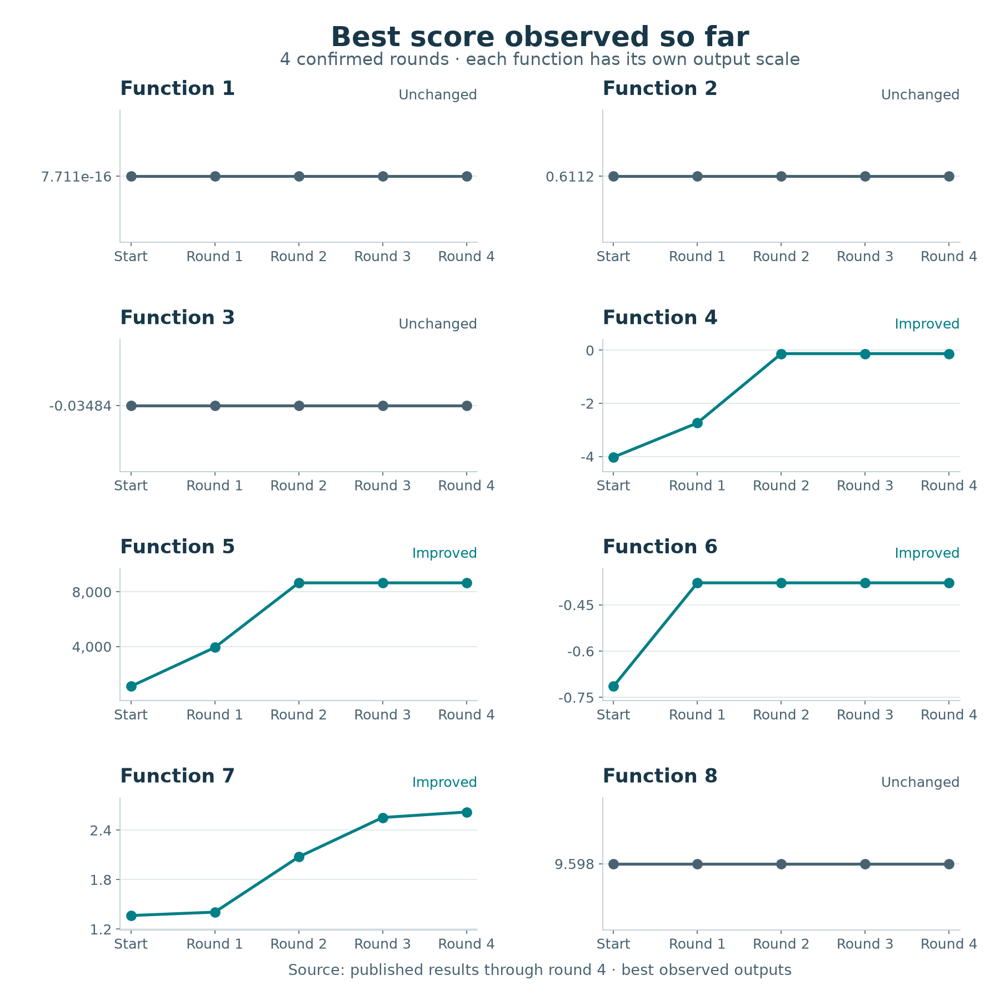

# Results and progress

[The introduction](../README.md) explains the experiment in plain language.
This page records measured outcomes through round 4, as of 23 October 2026.
All eight Week 4 inputs have been evaluated. Week 5 observation notebooks have
saved runs using independent snapshots of the 207 confirmed observations.
All eight functions now have saved Week 5 model comparisons. The
[submission and selection review](../submissions/Week_05/README.md)
contains all eight chosen inputs, prepared on 28 October. Submission was confirmed
by the project owner on 29 October 2026; results are pending. These inputs do not
change the measured progress below.

## How to read progress

The aim is to raise the **best observed output** for each function. A returned
score can be lower than that best; the best-so-far line then stays flat. A flat
line does not mean nothing was learned, but it does mean no higher output has
been observed. The true global maxima are unknown.

*Every panel has its own output scale. Read changes within a panel; heights and
slopes cannot be compared across functions. The chart uses the full-precision
values in the round result records; dots mark the recorded bests and lines
join the checkpoints. Round 4 raises Function 7's best; the other seven
incumbents remain unchanged.*

Values are rounded for readability; the structured records retain full precision.

| Function | Starting best | Best after round 1 | Best after round 2 | Best after round 3 | Best after round 4 |
| --- | ---: | ---: | ---: | ---: | ---: |
| 1 | 7.710875e-16 | 7.710875e-16 | 7.710875e-16 | 7.710875e-16 | 7.710875e-16 |
| 2 | 0.611205 | 0.611205 | 0.611205 | 0.611205 | 0.611205 |
| 3 | -0.034835 | -0.034835 | -0.034835 | -0.034835 | -0.034835 |
| 4 | -4.025542 | -2.738157 | -0.129918 | -0.129918 | -0.129918 |
| 5 | 1088.859618 | 3933.145724 | 8662.405001 | 8662.405001 | 8662.405001 |
| 6 | -0.714265 | -0.378691 | -0.378691 | -0.378691 | -0.378691 |
| 7 | 1.364968 | 1.405759 | 2.075222 | 2.552418 | 2.618968 |
| 8 | 9.598482 | 9.598482 | 9.598482 | 9.598482 | 9.598482 |

## Latest results: round 4

The Week 4 results email arrived on **23 October 2026 at 03:53 BST**. All eight
inputs match `Week_04/submissions.txt`. The cumulative attachments contain four
rounds and agree exactly with the retained history. Adding only the eight new
returns gives **207 observations**; earlier snapshots remain unchanged.

Function 7 improves from `2.55241765269229` to `2.6189682154023832`, a gain of
`0.06655056271009308`. No other incumbent changes. See the
[round 4 result record](../submissions/round-04-results.json) and
[Week 5 data notes](../data/README.md#week-5-notebook-snapshots).

| Function | Returned output | Best observed after round 4 | Improved incumbent? |
| --- | ---: | ---: | --- |
| 1 | -9.545890e-172 | 7.710875e-16 | No |
| 2 | 0.131194 | 0.611205 | No |
| 3 | -0.056642 | -0.034835 | No |
| 4 | -1.259160 | -0.129918 | No |
| 5 | 8449.982375 | 8662.405001 | No |
| 6 | -0.917070 | -0.378691 | No |
| 7 | 2.618968 | 2.618968 | Yes |
| 8 | 8.818303 | 9.598482 | No |

All eight Week 5 observation notebooks follow the latest Week 4 pattern, with
executions and figures saved. Function 1's final fixed exploration point has
been submitted; Functions 2 and 3 have completed their shortlists. All eight model studies
and the [Week 5 selection review](../submissions/Week_05/README.md) are complete;
the eight-line input file preserves the submitted inputs. The review selects
pooled candidates for Functions 2 and 3, the official GP's saved common-pool
candidate for Function 4 and new official-data candidates for Functions 5–8.
Eight future weekly queries remain per function after the fifth submission.

## Previous results: round 3

The Week 3 results email arrived on **14 October 2026 at 10:16 BST**. All eight
returned inputs match the saved Week 3 submissions. The three-round cumulative
attachments agree exactly with both earlier returns. Adding only the eight new
observations gives **199 confirmed observations**; the initial data and earlier
weekly snapshots remain unchanged.

Function 7 improved from `2.075221839308756` to `2.55241765269229`, a gain of
`0.477195813383534`. No other incumbent improved. See the
[round 3 results record](../submissions/round-03-results.json) and
[Week 4 data notes](../data/README.md#week-4-notebook-snapshots).

| Function | Returned output | Best observed after round 3 | Improved incumbent? |
| --- | ---: | ---: | --- |
| 1 | 1.972812e-200 | 7.710875e-16 | No |
| 2 | 0.156096 | 0.611205 | No |
| 3 | -0.054209 | -0.034835 | No |
| 4 | -0.347965 | -0.129918 | No |
| 5 | 8525.753289 | 8662.405001 | No |
| 6 | -0.551379 | -0.378691 | No |
| 7 | 2.552418 | 2.552418 | Yes |
| 8 | 8.798303 | 9.598482 | No |

Function 1's small positive return remains below its incumbent; scientific
notation preserves the distinction from zero. Week 4 has thirteen notebooks
using independent CSV snapshots, with initial runs saved pending review.
The existing Week 4 strategies were retained and all eight inputs were submitted,
confirmed on 20 October 2026.

## Previous results: round 2

The Week 2 results email arrived on **8 October 2026 at 18:42 BST**. All eight
returned inputs match the saved Week 2 submissions. The results record covers
**191 observations**. The Week 3 notebooks use a consolidated CSV snapshot of
that round beside each notebook. These local files are Git-ignored and must be
restored or rebuilt on a fresh checkout; see the [data notes](../data/README.md).
Initial observations and earlier analyses are preserved.

Functions 4, 5 and 7 improved their incumbents. Function 5 returned
`8662.405001248297`, up from its previous best of `3933.145723875986`.
The cumulative attachments were reconciled with Week 1 before adding the eight
new observations. See the [round 2 results record](../submissions/round-02-results.json)
and [Week 3 data notes](../data/README.md#week-3-notebook-snapshots).

| Function | Returned output | Best observed after round 2 | Improved incumbent? |
| --- | ---: | ---: | --- |
| 1 | -4.057745e-109 | 7.710875e-16 | No |
| 2 | 0.031095 | 0.611205 | No |
| 3 | -0.051282 | -0.034835 | No |
| 4 | -0.129918 | -0.129918 | Yes |
| 5 | 8662.405001 | 8662.405001 | Yes |
| 6 | -1.124281 | -0.378691 | No |
| 7 | 2.075222 | 2.075222 | Yes |
| 8 | 9.518300 | 9.598482 | No |

Function 1's round 2 output is extremely close to zero, but remains below its
small positive incumbent. The scientific notation preserves that distinction.

## Best inputs from the returned queries

Functions 4–7 have beaten their starting bests. Their current best inputs are
listed below, exactly as evaluated by the portal. Functions 1, 2, 3 and 8 still
have incumbents from the starting data; their locations remain in the authorised
local datasets and analysis notebooks, rather than being copied here.

| Function | Current best evaluated input | Output | Found in |
| --- | --- | ---: | --- |
| 4 | `0.445520-0.390792-0.374106-0.377372` | -0.129918 | Round 2 |
| 5 | `0.999999-0.999999-0.999999-0.999999` | 8662.405001 | Round 2 |
| 6 | `0.344331-0.260596-0.575965-0.745346-0.066311` | -0.378691 | Round 1 |
| 7 | `0.002902-0.196293-0.424115-0.271557-0.287658-0.746916` | 2.618968 | Round 4 |

## Previous results: round 1

The first results email arrived on **5 October 2026 at 00:38 BST**. All eight
returned inputs match the saved proposals. The recorded dataset then contained
**183 observations**. Those historical snapshots are recoverable from Git;
see [recovering earlier snapshots](../data/README.md#recovering-earlier-snapshots).
The round 1 import record documents preservation of the original 175 observations.

Functions **4, 5, 6 and 7** improved their best observed values. The other four
incumbents are unchanged. Values below are rounded for readability; the
[results record](../submissions/round-01-results.json) retains full precision.

| Function | Returned output | Best observed after round 1 | Improved incumbent? |
| --- | ---: | ---: | --- |
| 1 | -0.00550935 | 7.710875e-16 | No |
| 2 | 0.283444 | 0.611205 | No |
| 3 | -0.0564312 | -0.0348353 | No |
| 4 | -2.738157 | -2.738157 | Yes |
| 5 | 3933.145724 | 3933.145724 | Yes |
| 6 | -0.378691 | -0.378691 | Yes |
| 7 | 1.405759 | 1.405759 | Yes |
| 8 | 9.498300 | 9.598482 | No |

Start with the [Function 1 result analysis](../results/function-1-round-01-analysis.md).
Its returned output, `-0.00550934555381189`, is a new minimum; the best observed
value is unchanged. Average sampling distance fell by 7.53776%, while the three
existing GP families still failed to beat the mean baseline on held-out RMSE.
The [Function 2 result analysis](../results/function-2-round-01-analysis.md) records
its fifth-ranked return, unchanged incumbent and stronger held-out support for
the x1-only and flexible models. Its next-query choices remain sensitive to
model and noise assumptions. All eight functions now have Week 2 exploration
notebooks reviewing the returned observation, output scale and sampling gaps.
Functions 4–8 also have Week 2 model-comparison and query-selection notebooks.

See the [round results record](../submissions/round-01-results.json) and
[accumulated data layout](../data/README.md#accumulated-observations-round-3).
The [first-query proposals](first-query-proposals.md) describe historical
pre-evaluation work; their proposal JSON and source arrays remain unchanged.

## Week 4: evaluated

The [saved Week 3 inputs](../submissions/Week_03/submissions.txt) have now been
evaluated. Their submission confirmation was recorded on 12 October 2026; the
return arrived on 14 October. The exact portal submission timestamp was not supplied.

Week 4 copies preserve the existing methods. Functions 1–3 advance to the next
unevaluated points in their saved shortlists; Functions 4–8 retain their model
and acquisition settings for a fresh comparison. Initial runs are saved for
Functions 1–4 exploration and Function 4 model predictions, pending review.
All Week 4 runs have now been reviewed and the existing strategies retained.
Submission was confirmed on 20 October 2026; see the [selected inputs](../submissions/Week_04/submissions.txt).
The return arrived on 23 October and is reviewed in the Week 5 observation notebooks.
See the
[notebook guide](../notebooks/README.md) for the working sequence.

## Inspecting an individual result

The current observation reviews are in each function's `Week_05/` folder.
Function 1 uses `exploration.ipynb`; Functions 2 and 3 use `exploration-review.ipynb`
and continue in `model_predictions.ipynb`; Functions 4–8 use `observation_review.ipynb`.
Their fixed snapshots include all four returned rounds. Earlier `Week_03/` and
`Week_04/` notebooks preserve the evidence used for those weeks' decisions. See
the [notebook guide](../notebooks/README.md).
Standalone round 1 reports for [Function 1](function-1-round-01-analysis.md) and
[Function 2](function-2-round-01-analysis.md) explain how a lower returned score
affected coverage, modelling and the next decision.

Prediction error and acquisition scores are discussed in
[methodology](../docs/methodology.md#week-2-approach-and-submitted-inputs). They
are model diagnostics, separate from the measured optimisation progress here.
