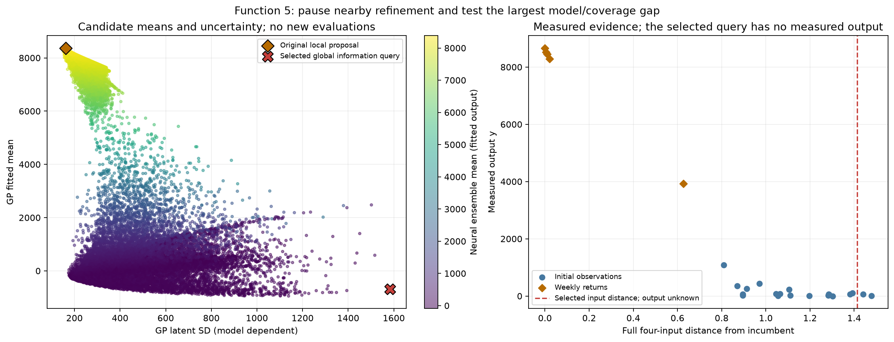
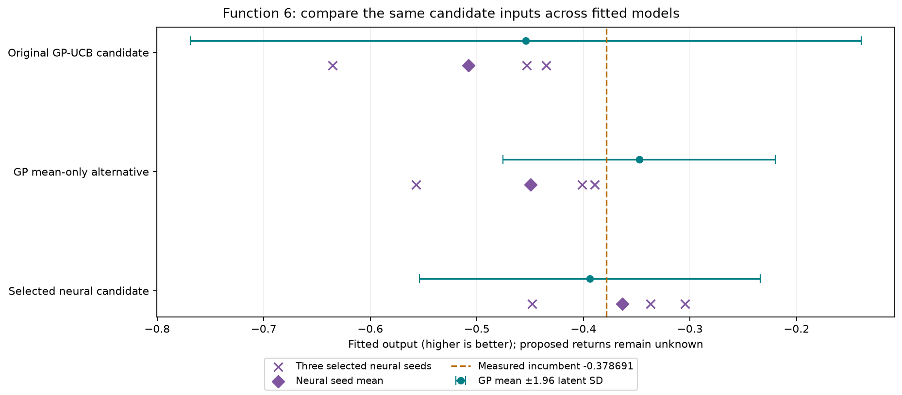

# Week 6 submitted inputs

**Prepared on 30 October 2026. Submission confirmed by the project owner on
31 October 2026. Status: submitted; awaiting results.** The exact portal
submission timestamp was not supplied.

All eight choices were finalised on 31 October 2026. The
[submission confirmation](submission-confirmation.json) records the owner's
confirmation against the exact input-file hash. This workflow did not perform
the portal submission.

[`submissions.txt`](submissions.txt) contains exactly eight lines, in Function
1–8 order, with six-decimal coordinates and no labels or spaces. The submitted
bytes are unchanged. **Seven future query opportunities remain per function.**
Results are pending, so the measured record remains **215 observations through
round 5**, with all incumbents unchanged.

The decision notes below retain the pre-submission evidence, predictions,
budgets and caveats. The confirmation above records the later submission.

The review retains the saved GP proposals for **Functions 2–4, 7 and 8**,
uses **Function 1's agreed central signed-mean candidate to pursue a hunch**,
changes **Function 5 to a global information query**, and chooses **Function 6's
saved neural seed-mean candidate for one focused test**. Earlier model notebooks
and their provisional proposal outputs remain unchanged.

[Executed selection review](selection_review.ipynb) ·
[Structured decisions, predictions and source hashes](proposals.json) ·
[Original Week 6 model comparison](../../results/week-06-model-review.md)

## Eight submitted inputs

| Function | Portal input | Selection policy |
| --- | --- | --- |
| 1 | `0.537942-0.522217` | hunch-led central signed mean |
| 2 | `0.700520-0.000114` | agreed GP-UCB; weight 1.96 |
| 3 | `0.721213-0.830963-0.001845` | agreed GP-UCB; weight 1.96; peer-dependent |
| 4 | `0.408963-0.412546-0.416464-0.438393` | agreed GP-UCB; weight 1.96; forecast caveat |
| 5 | `0.000000-0.000000-0.999999-0.999999` | agreed one-off global information query |
| 6 | `0.398303-0.269220-0.627336-0.768441-0.000000` | agreed one focused neural-led test |
| 7 | `0.000000-0.135108-0.370684-0.306265-0.311144-0.649736` | agreed GP-UCB; weight 1.96; extrapolation caveat |
| 8 | `0.022327-0.096114-0.237034-0.202848-0.982361-0.880106-0.159960-0.678158` | agreed GP-UCB; weight 1.96; sparse-data caveat |

## Function 1: follow through on the central-region hunch

Use **`0.537942-0.522217`**, the saved signed-log GP mean maximum, with an
effective uncertainty weight of **zero** for this decision. This replaces the
original `0.608515-0.846200` UCB proposal. The
[activity study](../../notebooks/Function_1/Week_06/activity-hypothesis.md)
supports investigating the central region. A nearby positive peer report
provides a reason to query that neighbourhood ourselves. The choice follows
through on a hunch; it does not establish a source or a nearby positive peak.

**None of the outputs so far is regarded as clearly non-zero in practical or
source-detection terms.** The stored outputs are numerically non-zero and remain
unchanged. No background, detection or significance threshold has been
established; the magnitude comparison does not supply one.

The signed-log GP mean at the agreed point is **184.024**, with conditional
latent SD **18.521**. Those values are transformed predictions, not an expected
raw score. The candidate is **0.003364** from the positive self-reported peer
input and **0.111186** from the nearest official input. Its case depends heavily
on that peer report, and the official-only neural fit disagrees on sign.
Preparation and agreement do not imply a positive return or submission.

## Function 2: agreed GP-UCB input with weight 1.96

Keep **`0.700520-0.000114`**, with uncertainty weight **1.96**. Both the
point and the weight are agreed; this does not authorise portal submission.
The review retains the selected peer-assisted GP and accepts a lower predicted
mean in exchange for investigating the less sampled low-x2 region near the
promising x1 neighbourhood. The official-only GP proposes a similar region.
Weights 1, 1.96 and 3 favour that broad region, while weight zero chooses an
interior x2 location. The neural comparison does not justify replacing this
choice. See the [options and weight explanation](../../notebooks/Function_2/Week_06/report.md).

The weight is a deliberate policy setting, not a calibrated confidence level
or a guarantee of improvement. No numerical input changes are needed because
the prepared second line already contains the agreed point.

## Function 3: agreed GP-UCB input, with the peer-data caveat

Keep **`0.721213-0.830963-0.001845`**, with uncertainty weight **1.96**.
The prepared third line already matches. This is an exploratory test of the
low-x3/high-x2 region, not a claim of a likely positive return or a known optimum.

**The choice relies on retained self-reported peer data.** The peer-assisted GP
has lower declared official-target RMSE, but the official-only GP proposes a
completely different region. There is no cross-scope agreement on the proposed
region. Last week's low-x3 failure and the current query's extrapolation remain
material caveats. The retained peer evidence does not establish an official
incumbent. See the [Function 3 comparison](../../notebooks/Function_3/Week_06/report.md).

The input and weight are agreed; portal submission remains unauthorised.

## Function 4: agreed local step, with the GP forecast caveat

Keep **`0.408963-0.412546-0.416464-0.438393`**, with uncertainty weight
**1.96**, as a small local step around the new official incumbent. The prepared
fourth line already matches. Official-only GP validation is better than the
neural comparator, and peer training does not improve the declared error.

**The GP underpredicts the known positive incumbent:** its mean there is
**-0.371831**, despite the measured **+0.650130**. At the agreed point its mean
is **-0.408796** and its UCB **+0.418308**, both below the measured best. This
is a local investigation guided by the finite-pool ranking, without evidence
of calibrated local forecasts or a predicted improvement. Weights 0, 1 and
1.96 select the same tested candidate. See the [Function 4 comparison](../../notebooks/Function_4/Week_06/report.md).

The point and weight are agreed; nothing has been submitted.

## Function 5: switch from local refinement to global information

**Agreed:** use **`0.000000-0.000000-0.999999-0.999999`** for one exploration
query. The prepared fifth line already matches. This commits one query to
the information objective; the following choice remains open pending feedback.
Nothing has been submitted.

The confirmed upper-corner incumbent remains **8662.405001248297**. Rounds
3, 4 and 5 were lower nearby measurements. This supports pausing refinement
there; it does not establish a global maximum or rule out a better local basin.

The exploration recommendation is for **one query**. An isolated reduction of
x3 near the incumbent has not yet been measured; the original GP/neural
candidate below would test it. Refinement is being paused, not declared
exhausted. The course's typical-unimodality description also gives no reason
to assume a second peak exists.

The neural ensemble is materially better at prediction on the same 25 official
targets: RMSE **136.779**, versus the GP's **329.432** (58.5% lower). Both the
original GP-UCB policy and neural mean policy nevertheless choose exactly
`0.999999-0.999999-0.979593-0.999999`. All three selected neural seeds forecast
a lower output than the incumbent there. Choosing the neural model alone
would therefore not change that nearby refinement query.

This week's deliberate information objective selects
**`0.000000-0.000000-0.999999-0.999999`**. It maximises fitted GP latent SD
outside the incumbent's existing ±0.15-per-coordinate local-search box, retaining
the earlier 0.02 minimum known-input distance. The finite-pool farthest-point
coverage rule independently selects the same location. Its nearest known input
is **0.731397** away, and its distance from the incumbent is **1.414212**.
Changing the broad Sobol seed or pool size (2^12, 2^14 and 2^15) preserves this
choice. These are finite-pool checks, not proof of continuous global optimality.

**A low score is expected.** The GP mean is **-685.995** with latent SD
**1583.200**; the selected neural ensemble mean is **-13.515**. Those extrapolated
values are fitted predictions, not measurements; negative predictions are not
clipped. The purpose is to test a large unobserved region and the assumed
response shape. The query does not follow the highest predicted output or UCB,
and a worse return will leave the incumbent intact. GP SD remains conditional
on the fitted kernel; tiny neural seed spread does not establish certainty.

This selection directly prioritises uncertainty and coverage; **the 1.96 UCB
weight does not select the exploration point**. It may simply confirm a low
return and has not been shown to maximise downstream optimisation benefit.
The next returned value would inform the following choice; it does not commit
the remaining queries to exploration. The point and one-off purpose are agreed,
with the low-return expectation, unfinished x3 check and unproven optimum retained
as explicit caveats.



## Function 6: one focused neural candidate with a GP cross-check

**Agreed:** use **`0.398303-0.269220-0.627336-0.768441-0.000000`** for one
focused neural-led test, with the caveats below retained. The prepared sixth
line already matches; nothing has been submitted. The point follows the
neural ensemble mean, so the 1.96 UCB multiplier does not select it.

Adopt **`0.398303-0.269220-0.627336-0.768441-0.000000`**, the already saved
ReLU-8-8 ensemble-mean candidate from seeds **11, 42 and 73**. No best seed or
new architecture is selected. There have been four non-improving returns since
the round 1 incumbent, so this is a focused near-incumbent test.

The overall neural RMSE is **0.326054** versus **0.339648** for the GP (4.0%
lower), with MAE **0.261343** versus **0.266970**. The difference alone is small.
At the neural candidate, however, the neural mean is **-0.363497** and the GP
mean is **-0.394068**. Both are higher than their means at the original GP-UCB
candidate (**-0.507858** and **-0.454159**, respectively). All three selected
neural seeds prefer the neural candidate's mean over that original UCB point.
The GP's own mean-only optimum is a separate alternative in the review table;
the two models do not agree on a unique maximising location.

The new query is **0.102747** from its nearest known input. Its GP latent SD
is **0.081577**, compared with **0.160542** at the original UCB query. This
choice accepts less GP uncertainty reduction to prioritise a plausible local
improvement. It remains outside the full-input sampled hull on the x5=0 face.

The limitations are material: the predicted neural gain over the incumbent is
only **0.015194**, much smaller than the held-out error. Two individual neural
seeds have higher overall RMSE than the GP. On the five weekly-return targets
as a group, the ensemble RMSE is **0.359079**, worse than the GP's **0.327887**.
Its latest held-out error is much smaller, but one result does not establish
superiority. These subset scores reuse retrospective LOO fits; they are not new
temporal validation. Neural seed SD (**0.075254**) is fitted-seed variation,
not posterior uncertainty. This is one candidate-level policy trial, not a
general replacement of GP acquisition or a guaranteed improvement.

At the agreed point the GP mean also remains below the measured incumbent,
and the GP prefers its separate mean-only candidate. The recommendation does
not represent cross-model agreement on an improvement or a unique optimum.



## Function 7: agreed GP-UCB point, with extrapolation and weight sensitivity

Keep **`0.000000-0.135108-0.370684-0.306265-0.311144-0.649736`**, with
weight **1.96**. The prepared seventh line already matches. This continues
investigating the round 4 incumbent's neighbourhood after four improving
weekly queries and one setback. GP validation is stronger than the neural
comparator overall and on the five retrospective weekly-target checks.

The GP mean **2.481353** is below the measured incumbent **2.618968**. Its
latent SD is **0.186111** and UCB **2.846131**; UCB is an optimistic ranking
score, not a future-return forecast. The full six-input point extrapolates
outside the sampled hull on **x1=0**, and the exact choice changes with the
uncertainty weight. SD is conditional on the fitted model; neither an optimal
multiplier nor an improvement is established. See the [Function 7 comparison](../../notebooks/Function_7/Week_06/report.md).

The point, weight and caveats are agreed; nothing has been submitted.

## Function 8: agreed GP-UCB point, with sparse-data and sensitivity caveats

Keep **`0.022327-0.096114-0.237034-0.202848-0.982361-0.880106-0.159960-0.678158`**,
with weight **1.96**, agreed on **31 October 2026**. The prepared eighth line
already matches. Both GP and neural means exceed the measured incumbent at
this point, and GP validation is stronger overall and on the retrospective
weekly-target checks. See the [Function 8 comparison](../../notebooks/Function_8/Week_06/report.md).

Only **45 observations** support the eight-dimensional fit. The full-input
point lies outside the sampled hull and is **0.754759** from its nearest
observation. The GP's mean gain **0.213760** is smaller than held-out error,
and the neural mean margin is tiny. The exact point changes with the weight,
with another candidate having a near-identical UCB. Posterior SD is conditional
on the fitted model, and UCB **10.481948** is a selection score, not a forecast
or guarantee. Neither a uniquely best input nor an optimal weight is established.

All eight input choices and their caveats are agreed. Nothing has been submitted.

## Retained choices

- **Function 2:** retain the pooled separate-length-scale GP. Paired official-target
  RMSE falls from 0.123352 to 0.111379; the neural comparator is weaker. Weight
  and regularisation sensitivity remain explicit.
- **Function 3:** retain the pooled shared-length-scale GP under the declared
  RMSE rule: 0.048697 versus 0.073900 for the official selected GP. The latest
  low-x3 failure and continued extrapolation are risks; one changed full input
  does not identify an x3 effect or invalidate the whole training scope.
- **Function 4:** retain the official GP near the new positive incumbent. It
  has much lower error than the neural fit, and peer training does not improve
  the criterion. Its smoothed mean remains below the measured best.
- **Function 7:** retain the GP-UCB local candidate. GP RMSE 0.266487 is lower
  than the neural ensemble's 0.410558; the neural alternative's higher predicted
  score is not sufficient evidence to replace it.
- **Function 8:** retain the full-input GP-UCB candidate. Its GP mean exceeds
  the incumbent, and GP RMSE 0.313369 is below the neural 0.368572. The input
  is still an eight-dimensional extrapolation and weight-sensitive.

## Verification and provenance

The selection script reuses saved Week 6 GP/MLP exports and held-out predictions;
no model is retrained, peer source refreshed or new course output obtained.
Each selected input was checked against official observations, the retained
peer snapshots where available, and all five earlier weekly submission files.
Dimensions, finiteness, [0, 1) bounds, six-decimal precision, eight-line order,
spaces and duplicate exclusions passed. The file was read back after writing.

Pre-submission verification passed **26 focused tests**. The submission-status
update passed **29 focused tests** and re-executed the selection notebook with
the owner-confirmed status. The [verification record](verification.json)
retains the checks and hashes. The two existing figures, earlier model outputs,
source snapshots and earlier submission files are preserved.

`proposals.json` preserves the final decisions separately from the original
notebook proposals, with source-file hashes, full-precision predictions,
candidate alternatives and Function 5 pool sensitivity. The review script can
be rerun from the capstone root:

```powershell
.\run-python.ps1 stage-2-bbo/scripts/review_week_06_queries.py
.\run-python.ps1 -m unittest discover -s stage-2-bbo/tests -p test_week_06_submission_review.py
```

The script refuses to replace a differing existing submission file. It never
submits inputs. These prepared inputs have no measured results yet.

## Course lifecycle

1. **Define the goal and scope** — choose one next input per function, including the agreed Function 1 hunch and an explicit Function 5 information objective.
2. **Gather the data** — use the saved 215 official observations through round 5 and retained peer-training snapshots.
3. **Explore the data** — review progress, incumbent neighbourhoods, model errors, candidate means, uncertainty and coverage.
4. **Clean and preprocess the data** — verify source hashes, exact inputs, bounds, precision and duplicates; preserve the original observations.
5. **Select and engineer features** — retain the declared input order and existing model preprocessing; no new features are introduced.
6. **Define the machine-learning task** — continuous black-box maximisation remains the overall task; Function 5's next query prioritises information.
7. **Partition the data** — not applicable to a new split; reuse existing identical-target LOO checks and label retrospective subset scoring explicitly.
8. **Select and train candidate methods** — no new training applies; review the saved GP and neural fits with their original budgets.
9. **Evaluate and interpret the results** — compare predictive errors, full-input geometry, model agreement and explicit policy trade-offs.
10. **Deploy and iterate** — the owner has confirmed submission of the eight-line file; retain it unchanged and await round 6 evaluations before the next iteration.
